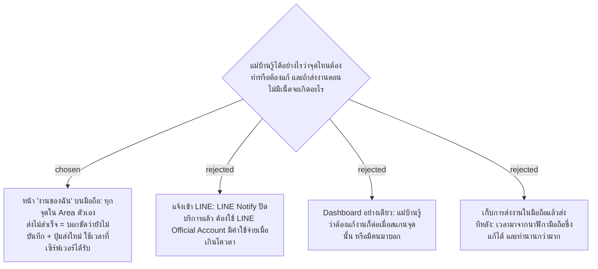

# Cleaner "My Work" Page Instead of Push Notifications; Failed Sends Are Resent by Hand

- วันที่: 2026-10-07
- ที่มา: คำตอบของหัวหน้า ผ่านเจ้าของโปรเจกต์ 2026-10-07
- เกี่ยวข้อง: facility-0007 (flow สแกน), facility-0029 (การตรวจงาน), facility-0047 (รอบเป็นช่วงเวลา), facility-0049 (แม่บ้านใช้เน็ตมือถือ)

## Context & Decision

1. **หน้า "งานของฉัน"** แม่บ้านเปิดหน้าเว็บเมื่อไรก็เห็นทุกจุดใน Area ของตัวเอง (และ Area ที่ได้รับมอบหมายทำแทนในกะนี้):
   - รอบปัจจุบันและรอบถัดไป
   - จุดที่เลยรอบ
   - จุดที่หัวหน้าให้แก้ พร้อมข้อบกพร่อง
2. **ไม่มีการแจ้งเตือนเด้งขึ้น** ไม่ส่งเข้า LINE และไม่ใช้ push notification ในช่วงทดลอง
3. **ส่งไม่สำเร็จเพราะไม่มีเน็ต** หน้าจอบอกชัดว่า "ยังไม่ได้บันทึก" พร้อมปุ่มส่งใหม่ แม่บ้านเดินไปตรงที่มีสัญญาณแล้วกดส่ง เวลาที่บันทึกคือเวลาที่เซิร์ฟเวอร์ได้รับ ไม่มีการเก็บไว้ในมือถือแล้วส่งทีหลัง

## Consequences

- เพิ่มหน้า "งานของฉัน" ใน Wireframe และ endpoint ที่คืนสถานะทุกจุดของ Area ตัวเอง (ตามสิทธิ์ใน facility-0041 ไม่คืนจุดของ Area อื่น)
- ส่งงานใหม่หลังเดินออกมา GPS อาจอยู่ไกลจากป้ายจนติดธง (facility-0035) และอาจพ้นช่วงรอบจนนับเป็นส่งช้า (facility-0047) ยอมรับได้ Admin เห็นเหตุผลจากธง
- ตอนเก็บพิกัดป้ายที่หน้างาน (facility-0045) ให้เช็กด้วยว่า Area ทดลองมีจุดที่ไม่มีสัญญาณไหม ถ้ามีเยอะค่อยทบทวนข้อ 3

> **แก้ไข 2026-10-15 (แผน 8):** หน้างานของฉันถามเซิร์ฟเวอร์ใหม่ทุกครั้งที่เปิดหน้าและเมื่อกด "อัปเดต" ไม่มี hub สำหรับแม่บ้าน การ์ดไม่มีลิงก์ไปหน้าสแกน (facility-0059) แม้ wireframe M9 จะมี การส่งที่ไม่ถึงเซิร์ฟเวอร์ (ไม่มีสัญญาณ, ไม่ตอบใน 20 วินาที, คำตอบอ่านไม่ได้ หรือเซิร์ฟเวอร์ขัดข้อง 5xx) ขึ้น "ยังไม่ได้บันทึก" (M12) พร้อมสิ่งที่เลือกไว้และปุ่ม "ส่งใหม่" ที่อ่าน GPS ใหม่ทุกครั้ง ยอมรับความเสี่ยงว่าถ้าคำขอถึงเซิร์ฟเวอร์แล้วแต่คำตอบหาย การส่งใหม่จะได้ Scan Record ที่สอง ซึ่งระบบจัดรอบตามกติกาปกติ (มักเป็นงานนอกรอบ)

> **แก้ไข 2026-10-26 (เจ้าของสั่ง):** ข้อ 2 และประโยค "ไม่มี hub สำหรับแม่บ้าน" ของแก้ไข 2026-10-15 ถูกแทนที่ หน้างานของฉันอัปเดตเอง: เมื่อหัวหน้าบันทึกผลตรวจ (หรือมีการส่งงานในพื้นที่) เซิร์ฟเวอร์ส่ง `ScanRecorded` / `InspectionRecorded` ไปหาแม่บ้านทุกกะของพื้นที่นั้น และแม่บ้านที่ทำแทนพื้นที่นั้นในกะปัจจุบัน (ตัวเดียวกับที่หัวหน้าตึกได้รับ ไม่มี `qrToken` ตาม facility-0060) หน้าจอไม่เอาการ์ดที่ส่งมาไปแปะ แต่ถามเซิร์ฟเวอร์ใหม่ เพราะการ์ดจาก hub เป็นของกะที่นาฬิกาอยู่ ส่วนแม่บ้านชั่วโมงก่อนหรือหลังกะของตัวเองเห็นอีกกะหนึ่ง ปุ่ม "อัปเดต" ยังอยู่ไว้ใช้ตอนสัญญาณหลุด และหน้าบอกสถานะการเชื่อมต่อแบบเดียวกับหน้าตึกของหัวหน้า (facility-0064) ยังไม่มีแจ้งเตือนเด้งนอกแอป ไม่ใช้ LINE และไม่ใช้ push notification ของระบบ ข้อ 2 ใช้กับสองอย่างนั้นอยู่
