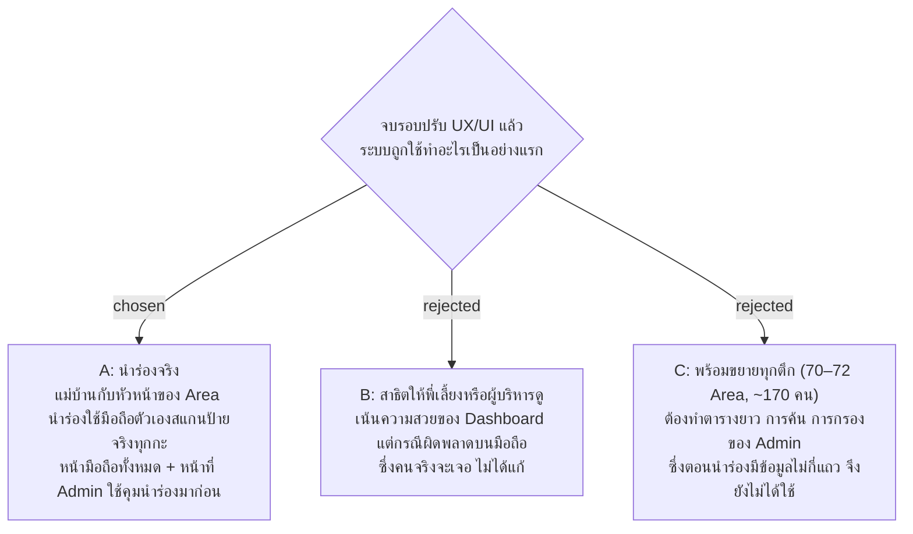

# รอบปรับ UX/UI ทำเพื่อให้พร้อมนำร่องจริงใน Area นำร่อง

- วันที่: 2026-10-21
- ที่มา: เจ้าของโปรเจกต์ตัดสิน 2026-10-21 ตอนเก็บ requirement ของรอบปรับ UX/UI (ตอบ "A")
- เกี่ยวข้อง: facility-0043 (ขอบเขตนำร่อง 1 Area), `docs/handoff.md` หัวข้อ "Next: the UX/UI pass"

## Context & Decision

หลังแผน 12 ทุกหน้าใน wireframe มีครบแล้ว เจ้าของโปรเจกต์จึงให้ปรับ UX/UI ครั้งเดียวทั้งระบบ ก่อนเขียนแผนต้องรู้ว่ารอบนี้จบแล้วระบบจะถูกใช้ทำอะไร เพราะคำตอบนี้กำหนดว่าหน้าไหนต้องดีก่อน

ตัดสินว่ารอบนี้ทำเพื่อ**การนำร่องจริง** (facility-0043): แม่บ้านและหัวหน้าของ Area นำร่องใช้มือถือของตัวเองสแกนป้ายจริงทุกกะ และ Admin คุมการนำร่องจากหน้า Admin

ลำดับความสำคัญของหน้า:

1. หน้ามือถือของแม่บ้านและหัวหน้า (M0–M16) ผู้ใช้ยืนอยู่คนเดียวหน้าป้าย ไม่มีใครช่วย ถ้าหน้าจอทำให้งง งานของรอบนั้นหายไป
2. หน้าที่ Admin ใช้คุมการนำร่อง: Dashboard (D1), การลงเวลา (D2), รายการเตือน (D3), Area และพิมพ์ป้าย (D4, D5, D10, M17), บัญชี (D6)
3. หน้ารายงาน: สรุปการตรวจ (D7), Excel (D8), ประวัติ (D9) ทำเมื่อข้อ 1–2 เสร็จ หรือแก้เฉพาะสิ่งที่ขวางการใช้งาน

## Consequences

- งานที่จำเป็นเฉพาะตอนข้อมูลเยอะ เช่น ตาราง 170 แถว การค้นหาฝั่งเซิร์ฟเวอร์ของ D9 ไม่อยู่ในรอบนี้ เว้นแต่เจ้าของโปรเจกต์สั่งเพิ่ม
- รายการปัญหาของรอบนี้เรียงตามผลกระทบต่อคนทำงาน: แม่บ้านที่ป้าย หัวหน้าที่เดินตรวจ แล้วจึง Admin ที่โต๊ะ

> **แก้ไข 2026-10-21:** ไม่ทำรอบปรับทั้งระบบแล้ว แก้เฉพาะรายการใน facility-0074 ลำดับความสำคัญของหน้าในข้อนี้ยังใช้เรียงงานในรายการนั้น
