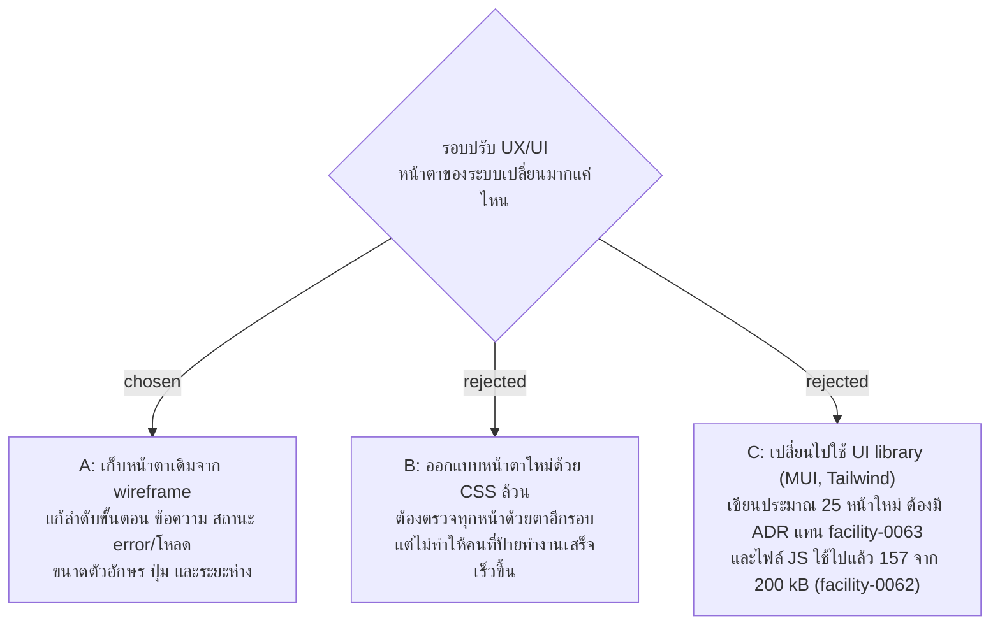

# รอบปรับ UX/UI เก็บหน้าตาเดิม แก้เฉพาะการใช้งาน

- วันที่: 2026-10-21
- ที่มา: เจ้าของโปรเจกต์ตัดสิน 2026-10-21 ตอนเก็บ requirement ของรอบปรับ UX/UI (ตอบ "A")
- เกี่ยวข้อง: facility-0070 (รอบนี้ทำเพื่อการนำร่อง), facility-0063 (CSS ล้วน, token ใน `index.css`), facility-0062 (งบไฟล์ JS 200 kB)

## Context & Decision

ตอนนี้ทุกหน้าใช้หน้าตาเดียวกันจาก wireframe คือพื้นสว่าง สีหลัก `#0E6B66` ฟอนต์ IBM Plex Sans Thai และการ์ดขอบมน ในการนำร่อง (facility-0070) ผู้ใช้ตัดสินระบบจากคำถามเดียวว่าทำงานที่ป้ายเสร็จไหม จึงตัดสินว่ารอบนี้**เก็บหน้าตาเดิม** และแก้เฉพาะการใช้งาน ได้แก่ ลำดับขั้นตอน ข้อความ สถานะ error และสถานะโหลด ขนาดตัวอักษร ขนาดปุ่ม และระยะห่าง

ปรับค่าใน token ของ `index.css` ได้ (เช่น ขนาดตัวอักษร) ถ้าการแก้การใช้งานต้องใช้ แต่ไม่เปลี่ยนสีหลัก หรือรูปทรงของการ์ดและปุ่มทั้งระบบ ฟอนต์เป็นข้อยกเว้นข้อเดียว: เปลี่ยนเป็นฟอนต์ของเครื่องตาม facility-0072

## Consequences

- ถ้าอยากได้หน้าตาใหม่ ทำเป็นรอบแยกหลังการนำร่อง ตอนนั้นจะมีคำติชมจากคนใช้จริงมาช่วยตัดสิน
- test หาองค์ประกอบด้วย role, label และข้อความ จึงต้องแก้ test เฉพาะข้อความที่เปลี่ยน

> **แก้ไข 2026-10-21:** ไม่ทำรอบปรับทั้งระบบแล้ว แก้เฉพาะรายการใน facility-0074 ข้อนี้ยังใช้กับรายการนั้น: ไม่เปลี่ยนหน้าตา ยกเว้นฟอนต์ (facility-0072)

> **ถูกแทนที่ 2026-10-22:** เจ้าของโปรเจกต์ให้เปลี่ยนหน้าตาตอนย้ายไป Tailwind ก่อนนำร่อง (facility-0087) ข้อยกเว้นเรื่องฟอนต์ (facility-0072) ยังใช้ต่อ
