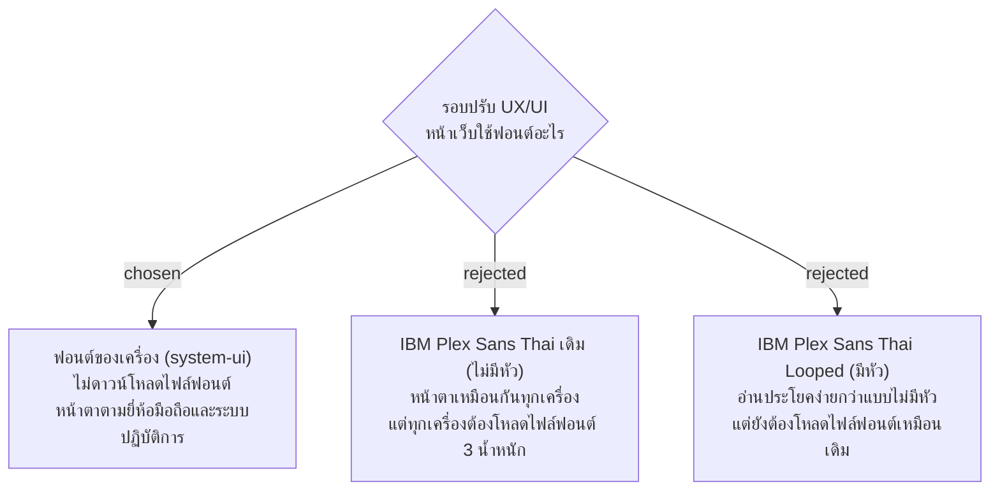

# ใช้ฟอนต์ของเครื่องแทน IBM Plex Sans Thai

- วันที่: 2026-10-21
- ที่มา: เจ้าของโปรเจกต์ตัดสิน 2026-10-21 ตอนเก็บ requirement ของรอบปรับ UX/UI (ตอบ "ฟอนต์เครื่อง") ผู้พัฒนาแนะนำให้ใช้ฟอนต์เดิมไปก่อน แล้วถามแม่บ้านตอนนำร่อง เจ้าของโปรเจกต์เลือกทางนี้แทน
- เกี่ยวข้อง: facility-0071 (เก็บหน้าตาเดิม ข้อนี้เป็นข้อยกเว้นเรื่องฟอนต์), facility-0063 (แก้ไข 2026-10-15 ระบุฟอนต์จาก `@fontsource`), facility-0055 (แม่บ้านใช้เน็ตมือถือของตัวเอง)

## Context & Decision

ตอนนี้ `frontend/src/main.tsx` โหลด IBM Plex Sans Thai จาก `@fontsource` 3 น้ำหนัก (400, 600, 700) ส่วนตัวอักษรไทยประมาณ 12 kB ต่อน้ำหนัก และ `index.css` ตั้ง `font-family: 'IBM Plex Sans Thai', system-ui, sans-serif`

ตัดสินว่าเลิกโหลดฟอนต์ และใช้ฟอนต์ของเครื่อง (`system-ui` แล้วตามด้วย `sans-serif`) ทุกหน้า ทั้งมือถือและหน้า Admin

## Consequences

- เอา import ของ `@fontsource/ibm-plex-sans-thai` ออกจาก `main.tsx` และเอาแพ็กเกจออกจาก `package.json`
- หน้าตัวอักษรต่างกันไปตามเครื่อง (iPhone, Android แต่ละยี่ห้อ, Windows, Mac) ฟอนต์บางเครื่องเป็นแบบมีหัว บางเครื่องไม่มีหัว ความกว้างของตัวอักษรก็ต่างกัน ข้อความจึงอาจตัดบรรทัดไม่เหมือนกัน ตอนตรวจหน้าต้องดูบนมือถือจริงอย่างน้อย iPhone 1 เครื่องและ Android 1 เครื่อง
- ป้ายที่พิมพ์จากหน้าพิมพ์ป้าย (D5) ใช้ฟอนต์ของเครื่องที่ Admin ใช้พิมพ์
- test ไม่ได้ตรวจฟอนต์ จึงไม่ต้องแก้ test
