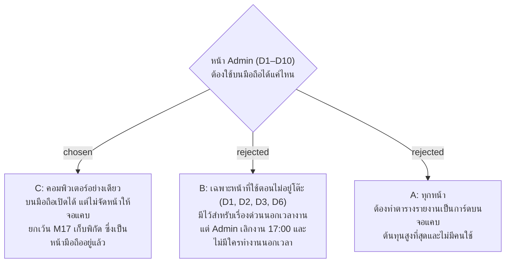

# หน้า Admin ออกแบบสำหรับคอมพิวเตอร์อย่างเดียว

- วันที่: 2026-10-21
- ที่มา: เจ้าของโปรเจกต์ตัดสิน 2026-10-21 ตอนเก็บ requirement ของรอบปรับ UX/UI: Admin เลิกงาน 17:00 และไม่มีใครทำงาน Admin นอกเวลา
- เกี่ยวข้อง: facility-0070 (รอบนี้ทำเพื่อการนำร่อง), facility-0041 (มอบหมายทำแทนเฉพาะกะ), facility-0051 (Admin แก้เวลาลงงาน), facility-0045 (M17 เก็บพิกัดที่ป้าย)

## Context & Decision

เหตุผลเดียวที่จะทำหน้า Admin ให้ใช้บนมือถือได้ คือ Admin ต้องทำเรื่องด่วนตอนไม่อยู่หน้าคอม เช่น มอบหมายคนทำแทน (D3) เพิ่มเวลาเข้างานให้แม่บ้านที่แบตหมด (D2) หรือแก้เบอร์โทร (D6) แต่ Admin เลิกงาน 17:00 และไม่มีใครทำงานนอกเวลา เรื่องที่เกิดหลัง 17:00 จึงรอวันทำงานถัดไปอยู่แล้ว

ตัดสินว่าหน้า Admin D1–D10 ออกแบบสำหรับคอมพิวเตอร์อย่างเดียว บนมือถือยังเปิดได้ แค่ต้องซูมหรือเลื่อนตารางไปด้านข้าง หน้าเดียวที่ยังเป็นหน้ามือถือคือ M17 เก็บพิกัด เพราะ Admin ต้องยืนที่ป้าย

## Consequences

- รอบปรับ UX/UI ตรวจหน้า Admin ที่ 1280 px อย่างเดียว ไม่ต้องตรวจที่ 390 px (แก้จากที่ `docs/handoff.md` เคยเขียนไว้)
- CSS สำหรับจอแคบที่มีอยู่แล้ว (Area, บัญชี, Excel, พิมพ์ป้าย) เก็บไว้ ไม่ลบ แต่ไม่ทำเพิ่ม
- เรื่องของกะดึก (19:00–07:00) เกิดตอนไม่มี Admin เสมอ เวลาลงงานที่ขาดของกะดึก Admin เพิ่มย้อนหลังได้ในวันถัดไป (facility-0051) ส่วนการมอบหมายคนทำแทนกะดึกต้องทำก่อน 17:00 ซึ่งตอนตัดสินข้อนี้หน้ารายการเตือน (D3) ยังทำไม่ได้ เพราะมอบหมายได้เฉพาะกะปัจจุบัน (API รับกะที่ยังไม่เริ่มได้อยู่แล้ว) เจ้าของโปรเจกต์ให้แก้ใน facility-0074 ข้อ 1
