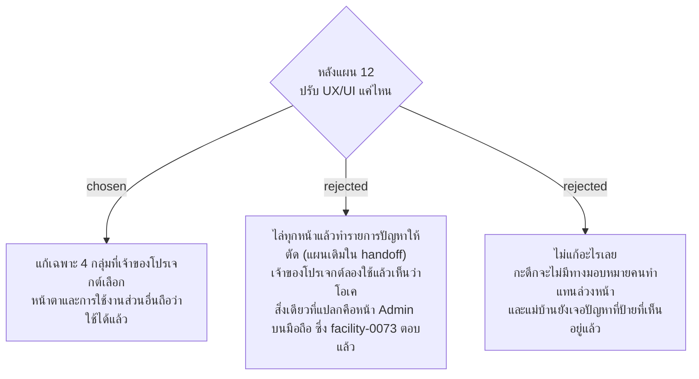

# ไม่ทำรอบปรับ UX/UI ทั้งระบบ แก้เฉพาะรายการที่เจ้าของโปรเจกต์เลือก

- วันที่: 2026-10-21
- ที่มา: เจ้าของโปรเจกต์ 2026-10-21: "เรื่อง UXUI ช่างมันก็ได้ครับ ผมว่าโอเคแล้ว แค่ตอนนั้นใช้หน้า admin ในมือถือแล้วมันแปลกๆ แต่จริงๆหน้า admin มันควรอยู่แค่บนคอม" แล้วเลือกเก็บไว้ 4 กลุ่มด้านล่าง
- เกี่ยวข้อง: facility-0070, 0071 (ตั้งไว้สำหรับรอบปรับทั้งระบบ ข้อนี้ทำให้ขอบเขตเล็กลง), facility-0072 (ฟอนต์ของเครื่อง), facility-0073 (หน้า Admin สำหรับคอมพิวเตอร์), facility-0041 (มอบหมายทำแทน)

## Context & Decision

`docs/handoff.md` วางแผนไว้ว่าจะไล่ทุกหน้าที่ 390 px และ 1280 px แล้วทำรายการปัญหาให้เจ้าของโปรเจกต์ตัด แต่ระหว่างเก็บ requirement เจ้าของโปรเจกต์บอกว่าหน้าตาและการใช้งานโอเคแล้ว สิ่งที่แปลกมีแค่หน้า Admin บนมือถือ ซึ่งตัดสินแล้วว่าหน้า Admin ใช้บนคอมพิวเตอร์อย่างเดียว (facility-0073)

จึงไม่ไล่หน้าเพิ่ม และแก้เฉพาะ 4 กลุ่มนี้:

1. **มอบหมายคนทำแทนล่วงหน้า (D3):** หน้ารายการเตือนเลือกวันและกะได้ ล่วงหน้าสูงสุด 7 วัน ไม่ใช่เฉพาะกะปัจจุบัน Admin จึงมอบหมายกะดึกได้ก่อนเลิกงาน 17:00 และมอบหมายเสาร์–อาทิตย์ได้ตั้งแต่วันศุกร์ (facility-0073, 0075) เซิร์ฟเวอร์รับกะที่ยังไม่เริ่มอยู่แล้ว แก้ที่หน้าจออย่างเดียว
2. **สองข้อจากการลองใช้จริงของเจ้าของโปรเจกต์:** หน้าบัญชี (D6) "แก้เบอร์โทร" แสดงเบอร์เดิมก่อน แล้วจึงมีช่องเบอร์ใหม่ และหน้า Area (D4) เลือกเวลารอบจากรายการแทนการพิมพ์ "HH:mm" โดยรอบที่เพิ่มไว้ในจุดแล้วเลือกซ้ำไม่ได้
3. **ฟอนต์ของเครื่อง** ตาม facility-0072
4. **ปัญหาหน้ามือถือของแม่บ้าน 5 ข้อ** ที่ผู้พัฒนาเจอตอนไล่หน้า 2026-10-21:
   1. สแกนป้ายลงเวลาที่ใช้ไม่ได้ (QR เก่าหรือ QR ที่ไม่มีในระบบ) หรือป้ายลงเวลาของ Area อื่น ต้องบอกตั้งแต่เปิดหน้า ไม่ใช่หลังกด "เข้างาน"
   2. สแกนจุดของ Area อื่น ต้องบอกตั้งแต่เปิดหน้า ไม่ใช่ให้กรอกฟอร์มจนเสร็จแล้วถูกบล็อกตอนส่ง ส่วน Admin ยังต้องเห็น Blocked Scan เหมือนเดิม (facility-0041) วิธีบันทึกให้ตัดสินตอนเขียนแผน
   3. ข้อความเตือน "เลือกปัญหาที่พบอย่างน้อย 1 อย่าง หรือเขียนหมายเหตุ" ต้องหายไปเมื่อเลือกปัญหาหรือเขียนหมายเหตุแล้ว
   4. นอกกะของตัวเอง หน้างานของฉันและหน้าลงเวลาต้องบอกว่ากะของตัวเองคือกี่โมง และหน้างานของฉันต้องไม่นับงานของอีกกะเป็น "ส่งแล้ว"
   5. หน้าลงเวลาไม่มีปุ่มสองปุ่มที่เขียนว่า "ถัดไป" เหมือนกัน และหน้าส่งงานเสร็จไม่มีการ์ดที่มีแค่ป้ายเดียว

## Consequences

- ไม่อยู่ในรายการ จึงไม่ทำ: ปุ่ม "แสดง" ของ D7/D9 ที่ไม่บอกว่าดึงข้อมูลแล้ว, ข้อเล็กที่เลื่อนมาจากแผน 12 (`BuildingSelect` เมื่อโหลดตึกไม่ได้, `?actor=` ที่ไม่อยู่ในรายชื่อ, hook ร่วมของ D7–D9), การจัดหน้า Admin สำหรับมือถือ (facility-0073)
- แผนเขียนจากรายการนี้กับ ADR ที่เกี่ยวข้อง ด้วย `sp-writing-plans` ตามขั้นที่ 2 ใน `docs/handoff.md`
- test หาองค์ประกอบด้วย role, label และข้อความ ข้อความที่เปลี่ยนต้องแก้ test ไปพร้อมกัน

> **แก้ไข 2026-10-22 (เจ้าของโปรเจกต์):** ไม่ทำรอบปรับ UX/UI ทั้งระบบเพิ่ม แต่ทั้ง 4 กลุ่มข้างบนยังทำครบ ข้อ 3 ฟอนต์ของเครื่องทำแล้ว 2026-10-22 ที่เหลือคือข้อ 1, 2 และ 4

> **แก้ไข 2026-10-22 (ถามเจ้าของโปรเจกต์ทีละข้อพร้อม mockup):** วิธีแก้ของแต่ละข้ออยู่ใน ADR เหล่านี้ ข้อไหนขัดกับข้างบน ให้ยึด ADR ที่ใหม่กว่า
> - ข้อ 1 D3 มอบหมายล่วงหน้า: facility-0075 และ facility-0084 (รายการ Area เดิม เพิ่มตัวเลือกวันกับกะ และช่องค้นหา)
> - ข้อ 2 D6: facility-0081 (ไม่แสดงเบอร์เดิม เพราะระบบเก็บเป็น hash ฟอร์มเขียนว่าไม่ต้องรู้เบอร์เดิม) · D4: facility-0083 (พิมพ์เอง แยกช่องชั่วโมงกับนาที ไม่ใช่เลือกจากรายการ)
> - ข้อ 4.1 ป้ายลงเวลาที่ใช้ไม่ได้บอกตั้งแต่เปิดหน้า: facility-0082 · ป้ายลงเวลาของ Area อื่น: ไม่แก้ (facility-0080)
> - ข้อ 4.2 ป้ายจุดของ Area อื่น: ไม่แก้ บอกและบันทึก Blocked Scan ตอนกดเหมือนเดิม (facility-0080)
> - ข้อ 4.3 ข้อความเตือนหายเองเมื่อเลือกครบ: facility-0076
> - ข้อ 4.4 นอกกะบอกเวลากะของตัวเอง และไม่แสดงงานของอีกกะ: facility-0077
> - ข้อ 4.5 แถว "วันนี้" ไม่มี "ถัดไป": facility-0078 · สถานะในหน้าส่งงานเสร็จเป็นบรรทัดเดียว: facility-0079
> - กลุ่มที่ 5 (เพิ่ม 2026-10-22) คำบนหน้าเว็บใช้คำของคนหน้างาน: facility-0085 (รายการคำที่อนุมัติอยู่ในนั้น)

> **แก้ไข 2026-10-22 (แผน 13):** ทำครบทุกกลุ่มในแผน `docs/superpowers/plans/2026-10-22-ux-fix-list.md` บน branch `feat/ux-fix-list`: กลุ่ม 1 (D3 ล่วงหน้า), กลุ่ม 2 (D6, D4), กลุ่ม 4 (หน้ามือถือแม่บ้าน) และกลุ่ม 5 (คำบนหน้าเว็บ) ข้อ 4.2 และส่วนป้ายของพื้นที่อื่นในข้อ 4.1 ไม่แก้ตาม facility-0080
