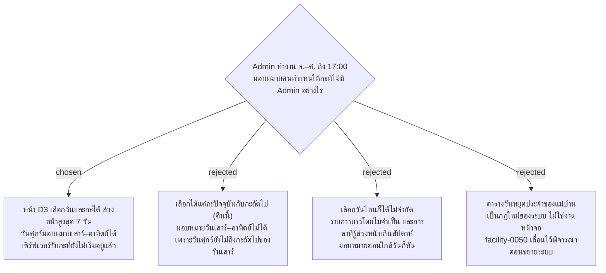

# มอบหมายคนทำแทนล่วงหน้าได้ 7 วัน เพราะไม่มี Admin ตอนกะดึกและวันเสาร์–อาทิตย์

- วันที่: 2026-10-21
- ที่มา: เจ้าของโปรเจกต์ 2026-10-21: Admin ไม่ทำงานวันเสาร์–อาทิตย์ (และเลิกงาน 17:00 ตาม facility-0073) ตัวเลข 7 วันเป็นค่าที่ผู้พัฒนาแนะนำ เจ้าของโปรเจกต์เปลี่ยนได้
- เกี่ยวข้อง: facility-0074 ข้อ 1 (ข้อนี้ขยายข้อนั้น), facility-0041 (มอบหมายทำแทนเฉพาะกะ), facility-0050 (ไม่เก็บตารางวันหยุด), facility-0073 (ไม่มี Admin นอกเวลา)

## Context & Decision

ทุก Area ทำทุกวัน และระบบไม่เก็บตารางวันหยุด วันที่แม่บ้านประจำไม่มา Admin ต้องมอบหมายคนทำแทนทุกครั้ง (facility-0050) แต่ Admin ทำงานวันจันทร์–ศุกร์ถึง 17:00 กะดึกทุกคืนและวันเสาร์–อาทิตย์ทั้งวันจึงไม่มี Admin ส่วนหน้า D3 ตอนนี้มอบหมายได้เฉพาะกะปัจจุบัน ถ้าแม่บ้าน A หยุดวันเสาร์ จะไม่มีใครมอบหมาย B ได้เลย B สแกนจุดของ A จะถูกบล็อกทั้งวัน

ตัดสินว่าหน้า D3 เลือก**วันและกะ**ได้ ตั้งแต่กะปัจจุบันไปจนถึง 7 วันข้างหน้า Admin มอบหมายกะดึกของคืนนี้ได้ก่อน 17:00 และมอบหมายวันเสาร์–อาทิตย์ได้ตั้งแต่วันศุกร์

## Consequences

- เซิร์ฟเวอร์รับการมอบหมายและให้รายชื่อคนทำแทนของกะที่ยังไม่เริ่มได้อยู่แล้ว (`POST /api/admin/cover-assignments`, `GET .../candidates`) ไม่มีการจำกัด 7 วันที่เซิร์ฟเวอร์ ข้อจำกัดนี้อยู่ที่หน้าจอ
- ตอนนี้ D3 แสดงเฉพาะ Area ที่ยังไม่มีคนลงเวลาในกะปัจจุบัน แต่กะที่ยังไม่เริ่มจะยังไม่มีใครลงเวลา ทุก Area จึงจะขึ้นว่าว่าง วิธีให้ Admin เลือก Area ของกะล่วงหน้าต้องตัดสินตอนเขียนแผน
- การมอบหมายล่วงหน้ายกเลิกได้เหมือนเดิม ถ้าแม่บ้านประจำมาทำงานตามปกติ
- เรื่องอื่นที่เกิดตอนไม่มี Admin รอวันทำงานถัดไป: เวลาลงงานที่ขาด Admin เพิ่มย้อนหลังได้ (facility-0051) และรายการเตือนของเสาร์–อาทิตย์ Admin เห็นวันจันทร์
- ถ้าแม่บ้านมีวันหยุดประจำ Admin ต้องมอบหมายซ้ำทุกสัปดาห์ ถ้าตอนขยายระบบภาระนี้มากไป ค่อยพิจารณาตารางวันหยุดประจำ (facility-0050)
