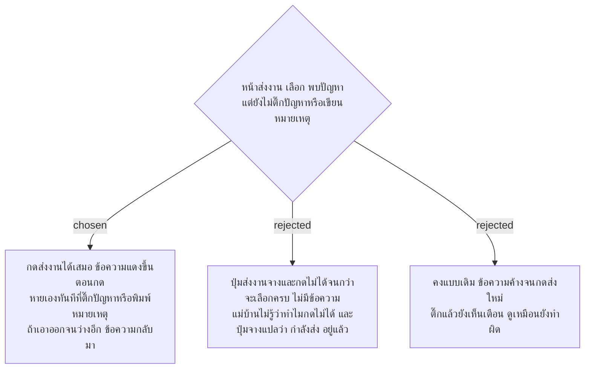

# ข้อความเตือน "เลือกปัญหาที่พบ" หายเองเมื่อเลือกครบ

- วันที่: 2026-10-22
- ที่มา: เจ้าของโปรเจกต์ 2026-10-22 ดู mockup แล้วเลือก A ("A ก็ได้") หลังถามเหตุผล
- เกี่ยวข้อง: facility-0074 ข้อ 4.3 (ข้อนี้ระบุวิธีแก้), facility-0046 (พบปัญหาต้องมีแท็กหรือหมายเหตุ)

## Context & Decision

หน้าส่งงาน (M4, `SubmitForm`) ขึ้นข้อความ "เลือกปัญหาที่พบอย่างน้อย 1 อย่าง หรือเขียนหมายเหตุ" เมื่อกดส่งงานโดยเลือก "พบปัญหา" แต่ยังไม่ติ๊กปัญหาหรือเขียนหมายเหตุ ข้อความนี้ค้างอยู่แม้ติ๊กแล้ว จนกว่าจะกดส่งอีกครั้ง

ตัดสินว่าข้อความแสดงเมื่อ "เคยกดส่งแล้ว และตอนนี้ยังเลือกไม่ครบ" จึงหายทันทีที่เลือกครบ และกลับมาถ้าเอาออกจนว่างอีก ปุ่มส่งงานกดได้เสมอเหมือนเดิม

เหตุผลที่ไม่เลือกปุ่มกดไม่ได้: แม่บ้านที่ยืนหน้าจุดจะเห็นปุ่มจางโดยไม่รู้สาเหตุ อาจคิดว่าเน็ตหรือแอปค้าง และปุ่มส่งงานที่จางใช้บอกว่า "กำลังส่ง..." อยู่แล้ว ความหมายจะชนกัน

## Consequences

- แก้ที่หน้าจออย่างเดียว ข้อความเดิมไม่เปลี่ยน test ที่หาข้อความนี้ยังใช้ได้ เพิ่ม test ว่าข้อความหายเมื่อติ๊กปัญหาและเมื่อพิมพ์หมายเหตุ
