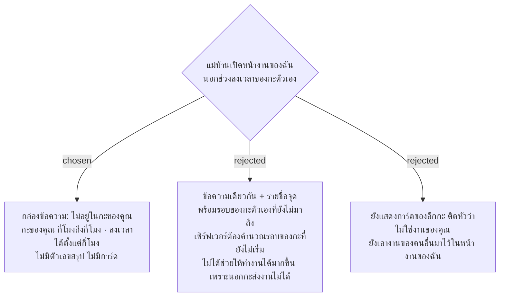

# นอกกะของตัวเอง หน้างานของฉันบอกเวลากะ และไม่แสดงงานของอีกกะ

- วันที่: 2026-10-22
- ที่มา: เจ้าของโปรเจกต์ 2026-10-22 ดู mockup แล้วเลือก A
- เกี่ยวข้อง: facility-0074 ข้อ 4.4 (ข้อนี้ระบุวิธีแก้), facility-0052 (หน้างานของฉัน), facility-0036 (ช่วงลงเวลา 60 นาทีก่อนกะเริ่มถึง 60 นาทีหลังกะจบ)

## Context & Decision

ตอนนี้เมื่อแม่บ้านเปิดหน้างานของฉันนอกช่วงลงเวลาของกะตัวเอง เซิร์ฟเวอร์ใช้กะตามนาฬิกาแทน (`MyWorkEndpoints`: `SlotFor(...) ?? ShiftCalendar.SlotAt(now)`) แม่บ้านกะดึกที่เปิดตอน 14:00 จึงเห็นงานที่แม่บ้านกะเช้าส่งเป็น "ส่งแล้ว" ของตัวเอง และทั้งหน้างานของฉันและหน้าลงเวลาบอกแค่ว่า "ไม่อยู่ในช่วงลงเวลา" โดยไม่บอกว่ากะของตัวเองคือกี่โมง

ตัดสินว่านอกช่วงลงเวลาของกะตัวเอง หน้างานของฉันแสดงกล่องข้อความ "ตอนนี้ไม่อยู่ในกะของคุณ" พร้อมกะของตัวเอง (เช่น "กะดึก 19:00–07:00") และเวลาที่เริ่มลงเวลาได้ (เช่น "ลงเวลาเข้างานได้ตั้งแต่ 18:00") โดยไม่มีตัวเลขสรุปและการ์ด หน้าลงเวลาบอกกะของตัวเองและช่วงที่ลงเวลาได้ (เช่น "ลงเวลาได้ตั้งแต่ 18:00 ถึง 08:00") แทนข้อความ "60 นาทีก่อนกะเริ่ม..."

## Consequences

- ตอนนี้หน้าจอไม่รู้กะของแม่บ้านเมื่ออยู่นอกช่วงลงเวลา (`AttendanceState.shift` เป็น null) เซิร์ฟเวอร์จึงต้องส่งกะของบัญชีมาด้วย แผนเป็นคนเลือกว่าเซิร์ฟเวอร์จะหยุดส่งจุดนอกช่วงลงเวลา หรือหน้าจอซ่อนเอง
- ภายในช่วงลงเวลา (เช่น 18:00–19:00 ก่อนกะดึกเริ่ม) ทำงานเหมือนเดิม

> **แก้ไข 2026-10-22 (แผน 13):** เซิร์ฟเวอร์ส่ง `ownShift { shift, opensAt, closesAt }` มากับ `GET /api/my-work` (เวลาตามนาฬิกาไทย คำนวณจากค่า 60 นาทีใน config) ส่วนจุดนอกช่วงลงเวลาเซิร์ฟเวอร์ยังส่งเหมือนเดิม หน้างานของฉันเป็นคนซ่อนตัวเลขสรุปและการ์ดเอง หน้าป้ายลงเวลาและหน้าป้ายจุดจึงยังใช้ชื่อพื้นที่ของตัวเองได้
