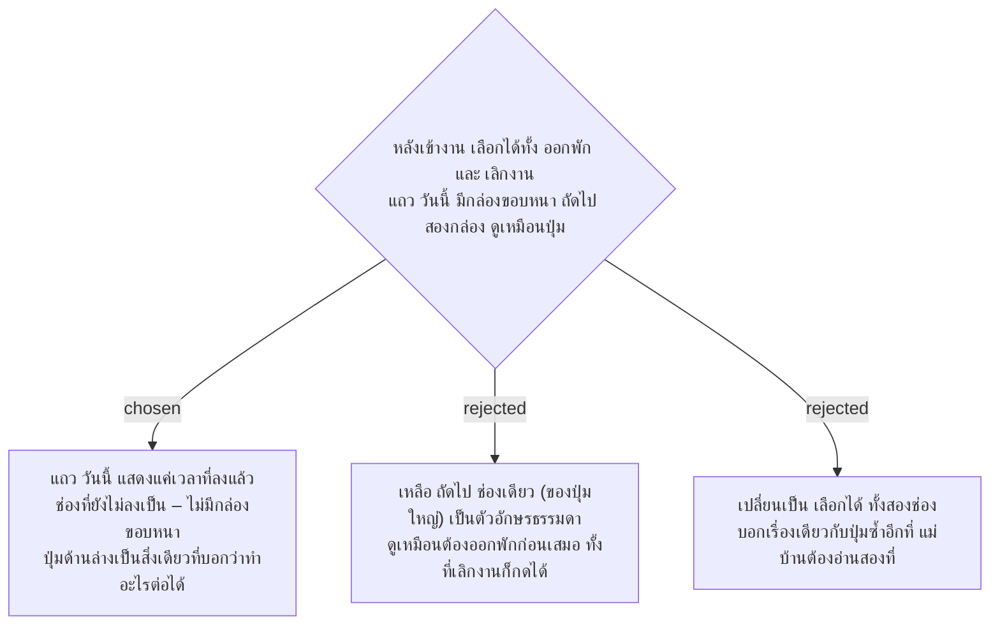

# แถว "วันนี้" ของหน้าลงเวลาแสดงแค่เวลาที่ลงแล้ว ไม่มี "ถัดไป"

- วันที่: 2026-10-22
- ที่มา: เจ้าของโปรเจกต์ 2026-10-22 ดู mockup แล้วเลือก A
- เกี่ยวข้อง: facility-0074 ข้อ 4.5 ส่วนแรก (ข้อนี้ระบุวิธีแก้), facility-0031 (ลำดับการลงเวลา หลังเข้างานเลือกออกพักหรือเลิกงานได้)

## Context & Decision

`AttendanceTimeline` (M1, M10) แสดง "ถัดไป" ในกล่องขอบเขียวหนาทุกช่องที่อยู่ใน `nextEvents` หลังเข้างานและหลังออกพัก `nextEvents` มีสองค่า (facility-0031) จึงมีกล่อง "ถัดไป" สองกล่องที่ดูเหมือนปุ่มแต่กดไม่ได้ ส่วนปุ่มจริงอยู่ด้านล่าง

ตัดสินว่าแถว "วันนี้" มีหน้าที่บอกแค่ว่าลงอะไรไปแล้ว: ช่องที่ลงแล้วแสดงเวลา (และ "ติดธง" ถ้ามี) ช่องที่ยังไม่ลงแสดง "–" แบบเดียวกันหมด ปุ่มด้านล่างเป็นสิ่งเดียวที่บอกว่าทำอะไรต่อได้

## Consequences

- ต่างจาก wireframe `CheckinNext` ที่เขียนช่องถัดไปว่า "ตอนนี้" ADR นี้ชนะ (wireframe วาดเฉพาะกรณีที่มีทางเลือกเดียว)
- test ที่หา "ถัดไป" ในแถววันนี้ต้องแก้ไปพร้อมกัน
