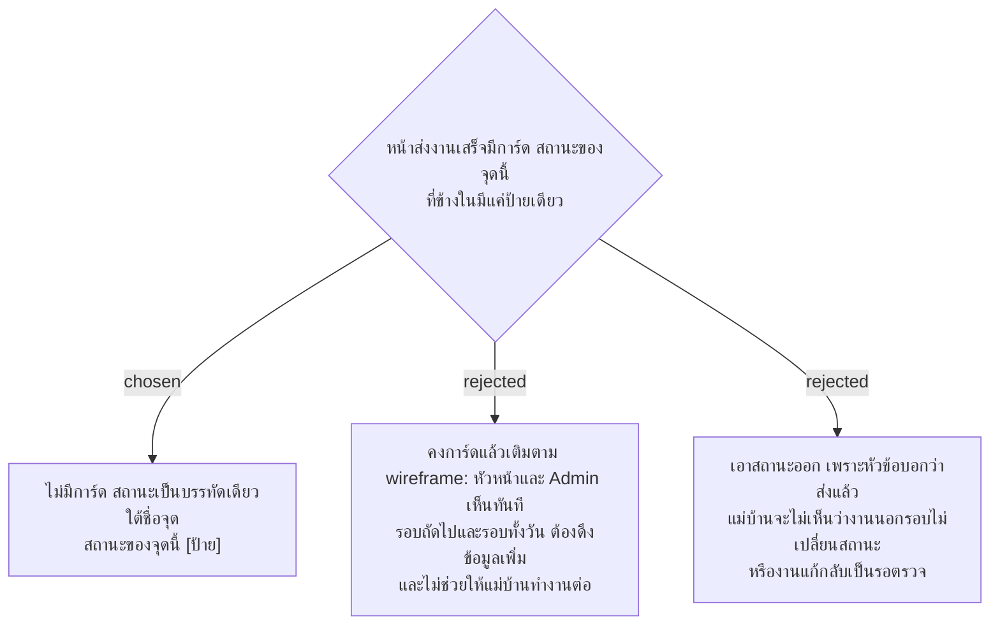

# หน้าส่งงานเสร็จแสดงสถานะของจุดเป็นบรรทัดเดียว ไม่มีการ์ด

- วันที่: 2026-10-22
- ที่มา: เจ้าของโปรเจกต์ 2026-10-22 ดู mockup แล้วเลือก A
- เกี่ยวข้อง: facility-0074 ข้อ 4.5 ส่วนหลัง (ข้อนี้ระบุวิธีแก้), facility-0071 (เก็บหน้าตาเดิม), facility-0047 (การวางงานที่ส่งลงรอบ)

## Context & Decision

`SubmitResult` (M5, M13) มี `app-panel` หัวข้อ "สถานะของจุดนี้" ที่ข้างในมีแค่ `StatusChip` ข้อความอื่นในการ์ดของ wireframe `CleanerDone` ไม่ได้ถูกสร้าง

ตัดสินว่าเอาการ์ดออก และแสดงสถานะเป็นบรรทัดเดียวในส่วนหัวใต้ชื่อจุด: "สถานะของจุดนี้" ตามด้วยป้ายสถานะ ข้อความอื่นในหน้าคงเดิม

## Consequences

- ต่างจาก wireframe `CleanerDone` และ `CleanerLate` ที่มีการ์ดพร้อมข้อความเพิ่ม ADR นี้ชนะ
