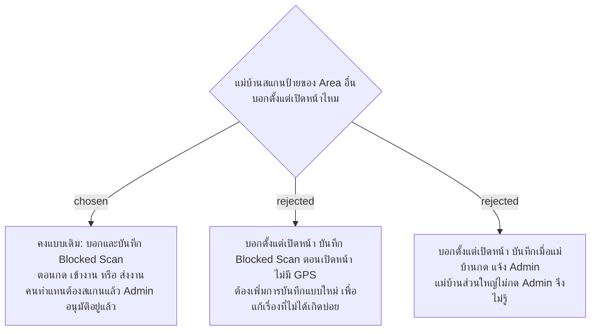

# สแกนป้ายของ Area อื่น ยังบอกและบันทึก Blocked Scan ตอนกดปุ่มเหมือนเดิม

- วันที่: 2026-10-22
- ที่มา: เจ้าของโปรเจกต์ 2026-10-22: "ไม่ต้องแก้อันนี้ก็ได้ เพราะถ้ามีคนลาหรือมาทำแทน เค้าต้องสแกน แล้วแอดมินต้องอนุมัติอยู่แล้ว"
- เกี่ยวข้อง: facility-0074 ข้อ 4.1 (ส่วนป้ายลงเวลาของ Area อื่น) และ 4.2 (ข้อนี้ยกเลิกสองส่วนนั้น), facility-0041 (Blocked Scan และมอบหมายทำแทน)

## Context & Decision

facility-0074 ข้อ 4.1 และ 4.2 ให้หน้าป้ายลงเวลาและหน้าป้ายจุดบอกตั้งแต่เปิดหน้าว่าเป็นป้ายของ Area อื่น แทนที่จะรู้หลังกด "เข้างาน" หรือหลังกรอกฟอร์มแล้วกด "ส่งงาน" แต่ Blocked Scan ถูกบันทึกตอนกดปุ่ม และ Admin ใช้รายการนี้ในหน้า D3 มอบหมายคนทำแทน ("ให้ทำแทน … กะนี้")

เจ้าของโปรเจกต์ตัดสินว่าไม่แก้: ขั้นตอนของคนมาทำแทนคือสแกน ถูกบล็อก แล้ว Admin อนุมัติอยู่แล้ว แบบเดิมจึงใช้ได้ หน้าป้ายทั้งสองแบบยังบอกและบันทึก Blocked Scan ตอนกดปุ่มเหมือนเดิม

## Consequences

- ส่วนที่เหลือของ facility-0074 ข้อ 4.1 คือป้ายลงเวลาที่ใช้ไม่ได้ (QR เก่าหรือไม่มีในระบบ) ซึ่งไม่เกี่ยวกับ Blocked Scan ตัดสินแยกใน facility-0082 (บอกตั้งแต่เปิดหน้า)
