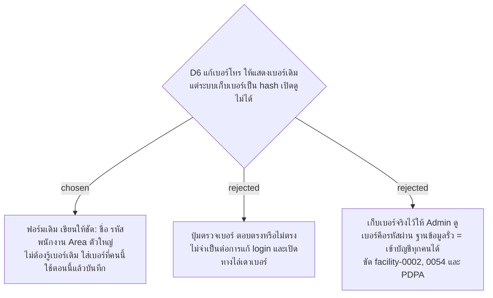

# ฟอร์มแก้เบอร์โทรไม่แสดงเบอร์เดิม แต่บอกให้ชัดว่าไม่ต้องรู้เบอร์เดิม

- วันที่: 2026-10-22
- ที่มา: เจ้าของโปรเจกต์ 2026-10-22 ดู mockup แล้วเลือก A ก่อนหน้านั้นเจ้าของโปรเจกต์อธิบายขั้นตอนจริงว่า แม่บ้าน login ไม่ได้ Admin ค้นรหัสพนักงาน แล้วแก้เป็นเบอร์ใหม่ที่แม่บ้านแจ้ง
- เกี่ยวข้อง: facility-0074 ข้อ 2 ส่วน D6 (ข้อนี้แทน "แสดงเบอร์เดิมก่อน" ซึ่งทำไม่ได้), facility-0054 (เบอร์โทรใช้แทนรหัสผ่าน เก็บเป็น hash), facility-0002 (ไม่เก็บเบอร์โทรศัพท์ส่วนตัว), facility-0055 (PDPA)

## Context & Decision

facility-0074 ข้อ 2 ให้ฟอร์ม "แก้เบอร์โทร" แสดงเบอร์เดิมก่อนช่องเบอร์ใหม่ แต่ `User` เก็บเบอร์เป็น PBKDF2 เท่านั้น (facility-0054) จึงไม่มีเบอร์เดิมให้แสดง และขั้นตอนจริงของ Admin (ค้นรหัสพนักงาน ใส่เบอร์ใหม่ที่แม่บ้านแจ้ง บันทึก) ไม่ต้องใช้เบอร์เดิม

ตัดสินว่าไม่แสดงเบอร์เดิม ฟอร์ม "แก้เบอร์โทร" แสดงชื่อ รหัสพนักงาน บทบาท และที่ประจำของคนนั้นให้ชัด กันแก้ผิดคน ช่องเขียนว่า "เบอร์โทรที่คนนี้ใช้ตอนนี้" และข้อความใต้ช่องเริ่มด้วย "ไม่ต้องรู้เบอร์เดิม ใส่เบอร์ที่คนนี้ใช้ตอนนี้แล้วกดบันทึก"

ทำไมไม่แสดงเบอร์ (สำหรับอธิบายต่อ): เบอร์โทรคือรหัสผ่านของแม่บ้านและหัวหน้า ระบบจึงเก็บแบบเดียวกับรหัสผ่านที่ไม่มีใครเปิดดูได้ ใครเห็นเบอร์ก็ login เป็นคนนั้นได้ ถ้าฐานข้อมูลรั่ว เบอร์จริงจะรั่วพร้อมกันและเข้าบัญชีได้ทุกบัญชีทันที และเบอร์เป็นข้อมูลส่วนบุคคลตาม PDPA ส่วนการแก้ login ไม่ต้องรู้เบอร์เดิม

## Consequences

- แก้ข้อความในฟอร์มและเพิ่มบรรทัดบอกตัวบุคคล test ที่หา label "เบอร์โทรใหม่" ต้องแก้ไปพร้อมกัน
- ถ้าวันหนึ่งต้องการเบอร์ไว้ติดต่อแม่บ้าน ต้องเป็นช่องข้อมูลติดต่อแยกที่ไม่ใช่เบอร์ login และเป็น ADR ใหม่เรื่อง PDPA
