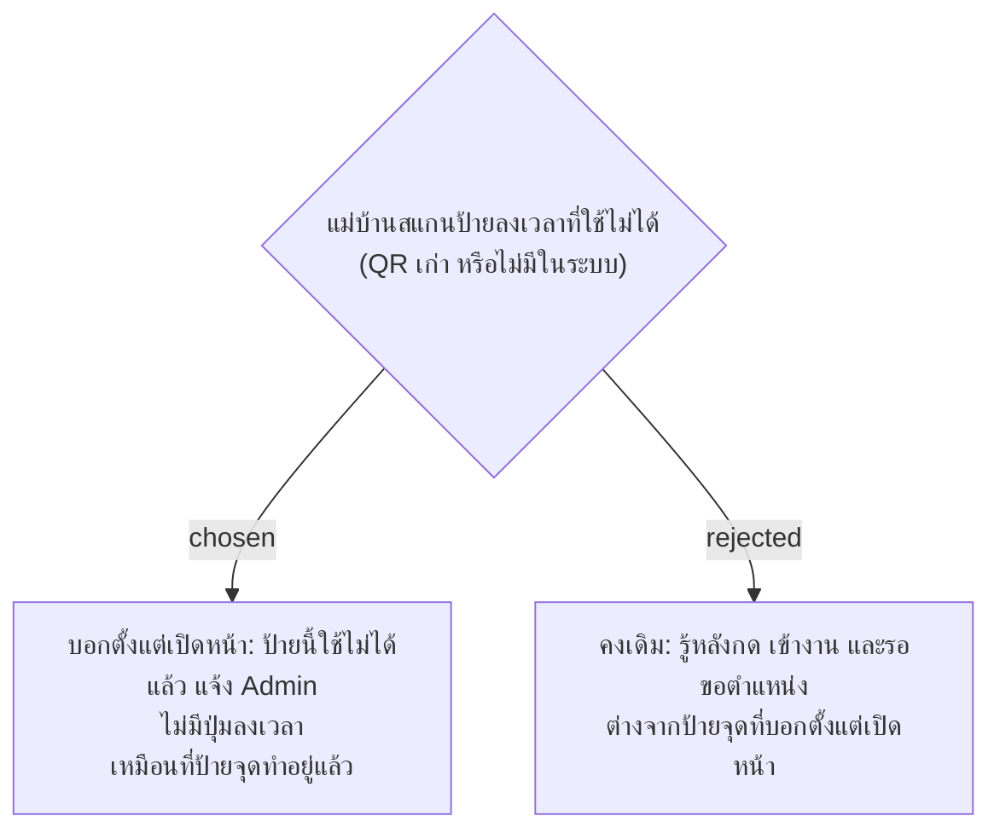

# ป้ายลงเวลาที่ใช้ไม่ได้ บอกตั้งแต่เปิดหน้า

- วันที่: 2026-10-22
- ที่มา: เจ้าของโปรเจกต์ 2026-10-22 เลือก A (ผู้พัฒนาแนะนำ B เพราะเกิดไม่บ่อย)
- เกี่ยวข้อง: facility-0074 ข้อ 4.1 (ส่วนที่เหลือหลัง facility-0080), facility-0080 (ป้ายของ Area อื่นคงแบบเดิม), facility-0026 (หน้าป้ายจุดเปิดด้วย QR Token)

## Context & Decision

หน้าป้ายลงเวลา (`CheckInPage`) ไม่ตรวจ QR Token ตอนเปิด แม่บ้านที่สแกนป้ายเก่า (Admin ออก QR ใหม่แล้ว) หรือ QR ที่ไม่มีในระบบ จะเห็นปุ่มลงเวลาตามปกติ แล้วรู้ว่าป้ายใช้ไม่ได้หลังกด "เข้างาน" ("ไม่พบป้ายลงเวลานี้") ส่วนหน้าป้ายจุดบอกตั้งแต่เปิดหน้าอยู่แล้ว

ตัดสินว่าหน้าป้ายลงเวลาตรวจ QR Token ตอนเปิด ถ้าป้ายใช้ไม่ได้ แสดงว่าป้ายนี้ใช้ไม่ได้และให้แจ้ง Admin โดยไม่มีปุ่มลงเวลา การตรวจตอนเปิดไม่บันทึกอะไร

## Consequences

- ต้องมีทางให้หน้าป้ายลงเวลาถามเซิร์ฟเวอร์ว่า QR Token เป็นป้ายลงเวลาที่ใช้ได้ไหม ตอบแค่ใช้ได้หรือไม่ได้ ไม่บอกว่าเป็นป้ายของ Area ไหน
- ป้ายของ Area อื่นยังรู้ตอนกด "เข้างาน" ตาม facility-0080 การตรวจตอนเปิดจึงต้องไม่บอกว่าป้ายเป็นของ Area อื่น
