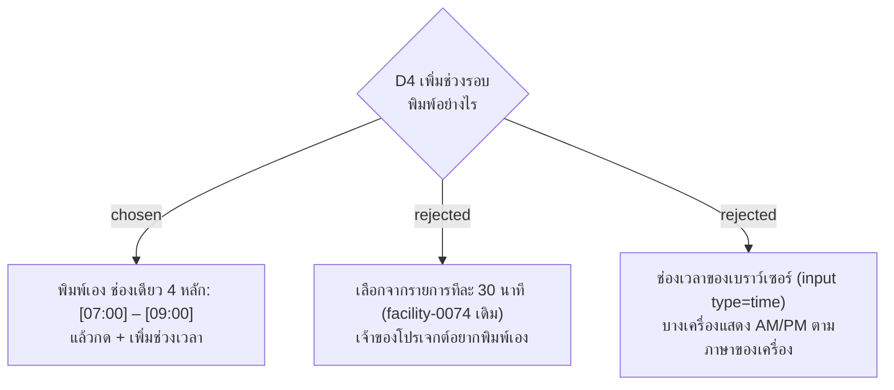

# เวลารอบในหน้า Area พิมพ์เองในช่องเดียว 4 หลัก (HH:mm)

- วันที่: 2026-10-22
- ที่มา: เจ้าของโปรเจกต์ 2026-10-22: "อยากได้แบบพิมพ์เอง แต่เป็นช่องแบ่ง ชั่วโมงและนาที เช่น [10:00] ถึง [13:00] ... อันนี้พอมันรวมกันมันเลยงงๆ"
- เกี่ยวข้อง: facility-0074 ข้อ 2 ส่วน D4 (ข้อนี้แทน "เลือกเวลารอบจากรายการ"), facility-0047 (Round Window), facility-0073 (หน้า Admin ใช้บนคอม)

## Context & Decision

`PointEditor` ให้ Admin พิมพ์เวลาเริ่มและเวลาจบของช่วงรอบในช่องเดียวแบบ "07:00" facility-0074 วางไว้ว่าจะเปลี่ยนเป็นเลือกจากรายการ แต่เจ้าของโปรเจกต์อยากพิมพ์เอง ปัญหาคือช่องที่รวมชั่วโมงกับนาทีไว้ด้วยกันทำให้งง

ตัดสินว่าเวลาแต่ละค่าเป็นสองช่อง ชั่วโมง (00–23) และนาที (00–59) คั่นด้วย ":" ช่วงรอบหนึ่งช่วงจึงเป็น [ชั่วโมง]:[นาที] ถึง [ชั่วโมง]:[นาที] แล้วกด "เพิ่ม" ช่วงที่มีอยู่แล้วในจุดเพิ่มซ้ำไม่ได้ (เหมือนเดิม "มีช่วงนี้แล้ว") ส่วนเรื่องช่วงห้ามซ้อนกันและต้องอยู่ในกะ เซิร์ฟเวอร์ยังตรวจเหมือนเดิม

ไม่ใช้ช่องเวลาของเบราว์เซอร์ เพราะเครื่องที่ตั้งภาษาอังกฤษ (สหรัฐฯ) จะแสดงเป็น AM/PM

## Consequences

- เซิร์ฟเวอร์ยังรับ "HH:mm" หน้าจอรวมสองช่องก่อนส่ง ไม่ต้องแก้ API
- รายละเอียดการพิมพ์ (เช่น พิมพ์ชั่วโมงครบ 2 หลักแล้วไปช่องนาทีเอง, ช่องนาทีว่างถือเป็น 00 หรือไม่) ให้แผนกำหนด
- test ที่พิมพ์เวลาลงช่อง "เริ่ม" และ "ถึง" ต้องแก้ไปพร้อมกัน

> **แก้ไข 2026-10-22 (แผน 13):** รายละเอียดการพิมพ์: ช่องชั่วโมงรับ 0–23 จะพิมพ์ 1 หรือ 2 หลักก็ได้ ("7" คือ 07) ช่องนาทีว่างถือเป็น 00 ถ้าพิมพ์ต้องเป็น 2 หลัก 00–59 ช่องรับเฉพาะตัวเลข พิมพ์ชั่วโมงครบ 2 หลักแล้วเคอร์เซอร์ไปช่องนาทีเอง กด Enter ในช่องไหนก็เท่ากับกด "เพิ่ม" ถ้าเวลาไม่ถูก ขึ้นว่า "ชั่วโมงใส่ 0–23 นาทีใส่ 00–59"

> **แก้ไข 2026-10-23 (เจ้าของโปรเจกต์, #79):** กลับคำตัดสินเรื่องช่องกรอก จาก "แยกช่องชั่วโมงและนาที" เป็น **ช่องเดียวต่อเวลา** เจ้าของเห็นว่าช่องเล็กสี่ช่อง `[07]:[00]` ถึง `[09]:[00]` ดูละลานตาและกดใช้งานยาก ต้องการ `[07:00] – [09:00]` แล้วกด "+ เพิ่มช่วงเวลา"
>
> - ช่องรับเฉพาะตัวเลข 4 หลัก และเติม ":" ให้เองหลังหลักที่สอง ("0700" แสดงเป็น "07:00") — ไม่ใช่ช่อง `input type=time` ของเบราว์เซอร์ เหตุผลเดิมยังอยู่ (AM/PM ตามภาษาเครื่อง)
> - Backspace ลบหลักสุดท้ายที่พิมพ์ ไม่ต้องเล็งไปที่ ":" ที่ระบบเติม · Enter ในช่องเท่ากับกด "+ เพิ่มช่วงเวลา"
> - เวลาที่ไม่ครบ 4 หลัก หรือชั่วโมงเกิน 23 หรือนาทีเกิน 59 ขึ้นว่า "ใส่เวลาเป็น 07:00 (ชั่วโมง 0–23 นาที 00–59)"
> - เซิร์ฟเวอร์ยังรับ "HH:mm" เหมือนเดิม ไม่ต้องแก้ API · ช่วงที่เพิ่มแล้วแสดงเป็น pill สีฟ้าอ่อนขนาดกะทัดรัด (24 px สูง) พร้อม ✕ ที่มีพื้นที่กด 36 px
> - ช่วงซ้ำ ("มีช่วงนี้แล้ว") ช่วงซ้อนกัน และขอบเขตของกะ เซิร์ฟเวอร์ยังตรวจเหมือนเดิม
