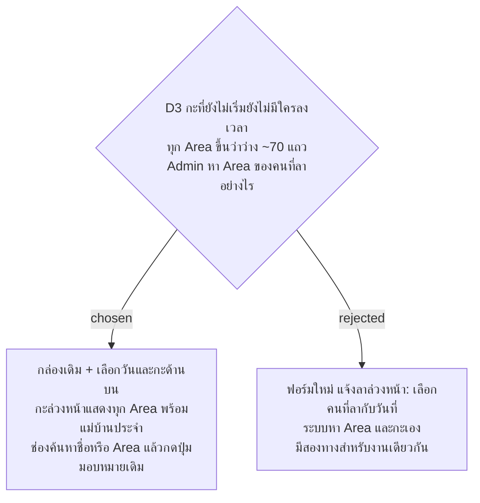

# มอบหมายล่วงหน้าใช้รายการ Area เดิม เพิ่มตัวเลือกวันกับกะ และช่องค้นหา

- วันที่: 2026-10-22
- ที่มา: เจ้าของโปรเจกต์ 2026-10-22 ดู mockup แล้วเลือก A
- เกี่ยวข้อง: facility-0075 (ข้อนี้ตัดสินเรื่อง "วิธีให้ Admin เลือก Area ของกะล่วงหน้าต้องตัดสินตอนเขียนแผน"), facility-0071 (เก็บหน้าตาเดิม), facility-0041 (มอบหมายทำแทน)

## Context & Decision

facility-0075 ให้ D3 เลือกวันและกะได้ถึง 7 วันข้างหน้า แต่กล่อง "Area ที่ยังไม่มีคน" ใช้สถานะลงเวลาของกะปัจจุบัน กะที่ยังไม่เริ่มไม่มีใครลงเวลา ทุก Area จึงจะขึ้นว่าว่าง

ตัดสินว่ากล่องเดิมได้ตัวเลือกวันและกะด้านบน (ค่าเริ่มคือกะปัจจุบัน) เมื่อเลือกกะปัจจุบัน กล่องทำงานเหมือนเดิม คือแสดงเฉพาะ Area ที่ยังไม่มีคน เมื่อเลือกกะที่ยังไม่เริ่ม หัวกล่องบอกว่ากะยังไม่เริ่ม และแสดงทุก Area ที่ทำกะนั้น พร้อมชื่อแม่บ้านประจำ กล่องมีช่องค้นหาชื่อแม่บ้านหรือ Area ปุ่ม "มอบหมายคนทำแทน" และฟอร์มเลือกคนทำแทนเป็นของเดิม ข้อความ "มีผลเฉพาะ..." บอกวันและกะที่เลือก

## Consequences

- หน้าจอต้องได้รายชื่อ Area ของกะที่เลือกพร้อมแม่บ้านประจำ แผนเป็นคนเลือกว่าใช้ข้อมูลที่มีอยู่ หรือต้องเพิ่มที่เซิร์ฟเวอร์
- การมอบหมายที่ทำไว้ล่วงหน้าต้องเห็นและยกเลิกได้จากหน้าเดียวกัน (facility-0075) แผนต้องให้กล่อง "คนทำแทนกะนี้" ตามวันและกะที่เลือกด้วย
