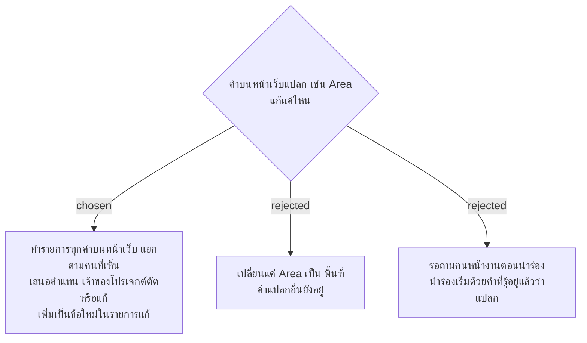

# คำบนหน้าเว็บใช้คำของคนหน้างาน ไม่ใช่ศัพท์ของทีมพัฒนา

- วันที่: 2026-10-22
- ที่มา: เจ้าของโปรเจกต์ 2026-10-22: "พวกคำต่างๆในหน้าเว็บมันแปลกมากๆ เช่น Area มันควรจะเป็นคำว่าพื้นที่ ... จะใช้คำอะไรนึกถึงการใช้งานจริง User ด้วย" แล้วเลือก A
- เกี่ยวข้อง: facility-0074 (ข้อนี้เพิ่มเป็นกลุ่มที่ 5), facility-0066 และ handoff (ข้อความไทยมาจาก wireframe), CONTEXT.md (ศัพท์ของทีม)

## Context & Decision

ข้อความบนหน้าเว็บใช้ศัพท์จาก CONTEXT.md, ADR และ wireframe ซึ่งเป็นภาษาที่ทีมพัฒนาใช้คุยกัน เช่น "Area" (78 แห่ง), "Admin" (36), "QR", "GPS", "Dashboard" และคำไทยอย่าง "ติดธง", "งานนอกรอบ" แม่บ้าน หัวหน้า และ Admin ที่ใช้งานจริงไม่ได้พูดแบบนี้

ตัดสินว่าข้อความบนหน้าเว็บใช้คำที่คนหน้างานใช้ ผู้พัฒนาทำรายการคำทั้งหมด แยกตามคนที่เห็นคำนั้น พร้อมคำที่เสนอให้ใช้แทน เจ้าของโปรเจกต์ตัด แก้ หรือเพิ่ม รายการที่อนุมัติแล้วเป็นกลุ่มที่ 5 ของ facility-0074

## Consequences

- เปลี่ยนเฉพาะข้อความที่ผู้ใช้เห็น ชื่อในโค้ด API ฐานข้อมูล และศัพท์ใน CONTEXT.md และ ADR ยังเป็นคำเดิม (เช่น Area) CONTEXT.md บอกคำที่หน้าเว็บใช้คู่กันไว้ เพื่อให้คนอ่านโค้ดหาเจอ
- ที่ wireframe กับคำที่อนุมัติไม่ตรงกัน ให้ยึดคำที่อนุมัติ
- test หาองค์ประกอบด้วยข้อความและ label จึงต้องแก้ไปพร้อมกัน
- คำที่ยังงงตอนนำร่อง แก้เพิ่มได้โดยไม่ต้องรอรอบใหญ่

## รายการคำที่อนุมัติ (เจ้าของโปรเจกต์ 2026-10-22: "ได้เลยครับ")

เปลี่ยนทุกที่ที่ผู้ใช้เห็น: หน้าเว็บ ข้อความจากเซิร์ฟเวอร์ หัวคอลัมน์และค่าในไฟล์ Excel และป้ายที่พิมพ์

| # | เดิม | ใหม่ | ใครเห็น |
|---|---|---|---|
| 1 | Area | พื้นที่ (เช่น "พื้นที่ของคุณ", "รหัสพื้นที่") | ทุกคน |
| 2 | Admin | แอดมิน | ทุกคน |
| 3 | GPS / Location | ตำแหน่ง | ทุกคน |
| 4 | ติดธง | ไกลป้าย | ทุกคน |
| 5 | เลยรอบ | เลยเวลา | ทุกคน |
| 6 | งานนอกรอบ | ส่งเพิ่ม (ไม่นับรอบ) | ทุกคน |
| 7 | ข้อบกพร่อง | สิ่งที่ต้องแก้ | หัวหน้า แอดมิน |
| 8 | Dashboard | หน้าสถานะจุด | แอดมิน |
| 9 | สแกนนอก Area / ตึก / กะ (ถูกบล็อก), สแกนแล้วถูกบล็อก | สแกนผิดพื้นที่ / สแกนผิดตึก / สแกนนอกกะ | แอดมิน |
| 10 | ออก QR ใหม่ | สร้าง QR ใหม่ | แอดมิน |
| 11 | ธง, ตรวจที่ติดธง GPS | ไกลป้าย, ตรวจตอนอยู่ไกลป้าย | แอดมิน |
| 12 | พิกัด "หน้างาน" / "จากแผนที่" | วัดที่ป้ายจริง / ปักจากแผนที่ | แอดมิน |
| 13 | ประวัติ Admin | ประวัติการแก้ไขของแอดมิน | แอดมิน |
| 14 | Issue | แจ้งปัญหา | แอดมิน (ไฟล์ Excel) |

คงไว้: QR, สแกน, จุด, รอบ, ป้ายลงเวลา, เข้างาน/ออกพัก/กลับจากพัก/เลิกงาน, ส่งงาน, ทำแทน, รอตรวจ, ตรวจผ่าน, ไม่สะอาด, หัวหน้าให้แก้, กะเช้า/กะดึก, Excel, รัศมี
