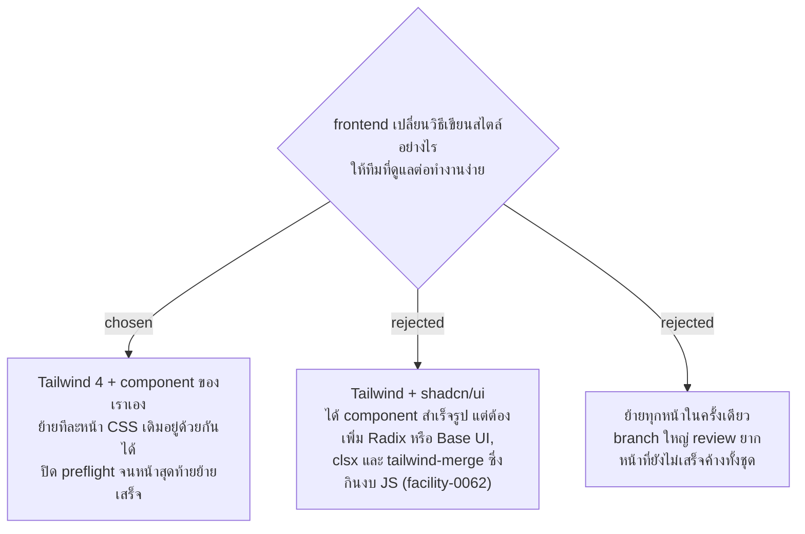

# Frontend ใช้ Tailwind CSS แทน CSS ต่อหน้า ย้ายทีละหน้า

- วันที่: 2026-10-22
- ที่มา: เจ้าของโปรเจกต์ตัดสิน 2026-10-22 ตอน grill การย้ายไป Tailwind ("ทีละหน้า", "เขียนเองด้วย Tailwind", "CSS ไฟล์เดียว", ลำดับงานตามที่แนะนำ) เหตุผลของเจ้าของโปรเจกต์: ให้ทีมที่ดูแลโปรเจกต์ต่อจากเราทำงานได้ง่ายขึ้น
- แทนที่: facility-0063 (CSS ธรรมดา, token ใน `index.css`, CSS ไฟล์ต่อหน้า, prefix `app-`)
- เกี่ยวข้อง: facility-0087 (หน้าตาใหม่), facility-0088 (ไอคอน), facility-0062 (งบ JS 200 kB), facility-0070 (ลำดับงานก่อนนำร่อง), `docs/agents/frontend-standards.md`, `design-system/facility/MASTER.md`

## Context & Decision

วัดบน master `c04eab3`: CSS 19 ไฟล์ รวม 2,656 บรรทัด (`index.css` 79 บรรทัด มี token 36 ตัว, `shared/components/shared.css` 437 บรรทัด คลาส `app-*` 31 คลาส) มี `className` ราว 650 จุดใน `.tsx` ที่ไม่ใช่ test 77 ไฟล์ ประมาณ 25 หน้า ขนาดตัวอักษรกระจายอยู่ 10 ขนาด

ตัดสินว่า:

1. ใช้ Tailwind CSS 4 ผ่าน `@tailwindcss/vite` CSS สร้างตอน build จึงไม่เพิ่ม JavaScript ที่มือถือโหลด
2. token อยู่ใน `@theme` ของ `src/index.css` ที่เดียว คลาสใช้ชื่อตามหน้าที่ เช่น `bg-primary` ไม่เขียน `bg-[var(--…)]` และไม่ใช้สีชุดของ Tailwind (เช่น `bg-blue-600`) ตรงๆ ในหน้า
3. ชิ้นที่ใช้ร่วมกัน (ปุ่ม ช่องกรอก กล่องข้อความแจ้ง chip สถานะ ตาราง แถบหัว) เป็น React component ของเราเองใน `shared/components` ไม่ใช้ `@apply` และไม่เพิ่ม UI library
4. ชื่อคลาสต้องเขียนครบทั้งคำในโค้ด ห้ามประกอบเอง เช่น `` `bg-${x}` `` เพราะ Tailwind หาไม่เจอ ตัวแปรของ component ใช้ map ไปหาคลาสเต็ม
5. ยังไม่เพิ่ม `clsx` หรือ `tailwind-merge` จนกว่าจะมีคลาสชนกันจริง
6. ย้ายทีละหน้า Tailwind กับ CSS เดิมอยู่ด้วยกันได้ ปิด preflight ของ Tailwind ไว้จนหน้าสุดท้ายย้ายเสร็จ
7. ลำดับ: ติดตั้ง Tailwind กับ token → component ที่ใช้ร่วม → หน้ามือถือ → หน้าแอดมิน → หน้าพิมพ์ป้าย (D5) → เปิด preflight แล้วลบ CSS เดิม
8. ปลายทางเหลือ CSS ไฟล์เดียวคือ `src/index.css` (`@import "tailwindcss"`, `@theme`, base rule และ `@page` ของหน้าพิมพ์ป้ายที่ไม่มีคลาส Tailwind ทำแทนได้) ไม่มี CSS ต่อหน้า การพิมพ์ใช้ variant `print:`

## Consequences

- ระหว่างย้าย บางหน้าเป็นหน้าตาเดิม บางหน้าเป็นหน้าตาใหม่ ยอมรับได้เพราะ merge ทีละชิ้นและทุกหน้ายังใช้งานได้
- test หาองค์ประกอบด้วย role, label และข้อความ ไม่หาด้วยคลาส จึงใช้ต่อได้ แต่ test ไม่จับหน้าตาที่เพี้ยน ทุกหน้าต้องตรวจด้วยตาบนมือถือและคอมพิวเตอร์ รวมถึงป้ายที่พิมพ์
- งบที่ต้องเฝ้าคือขนาด CSS (วัดบน `c04eab3`: 18.75 kB ดิบ, 3.26 kB gzip) ส่วนงบ JS 200 kB ของ facility-0062 ไม่ถูกแตะจาก Tailwind
- `code-review` ตรวจกฎใน `docs/agents/frontend-standards.md` และมีรอบตรวจ UX ด้วย `ui-ux-pro-max` (Accessibility, Touch) แยกอีกรอบ
