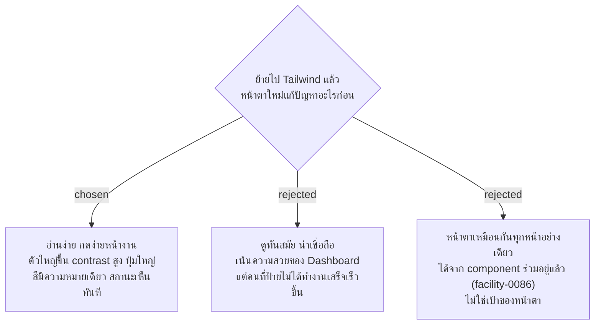

# หน้าตาใหม่: อ่านง่ายและกดง่ายที่หน้างาน สีหลักน้ำเงิน

- วันที่: 2026-10-22
- ที่มา: เจ้าของโปรเจกต์ตัดสิน 2026-10-22 ตอน grill การย้ายไป Tailwind (Q1, Q4–Q7, Q9–Q11, Q13) ข้อเสนอเริ่มต้นมาจาก skill `ui-ux-pro-max` (`--design-system`, ไม่ได้บันทึก) แล้วตัดส่วนที่ไม่เข้ากับระบบนี้ออก
- แทนที่: facility-0071 (เก็บหน้าตาเดิมจนหลังนำร่อง)
- เกี่ยวข้อง: facility-0086 (Tailwind), facility-0072 (ฟอนต์ของเครื่อง ยังใช้ต่อ), facility-0047 (Point Status), `design-system/facility/MASTER.md`

## Context & Decision

ตอนนี้ข้อความส่วนใหญ่เล็ก (14px 40 จุด, 13px 33 จุด, chip สถานะ 12px) ปุ่มปกติสูง 40px ต่ำกว่า 44px และสถานะ "รอตรวจ" (`#4a6378` เทาอมน้ำเงิน) ใช้สีคนละความหมายกับปุ่มไม่ชัด แม่บ้านใช้มือถือมือเดียวที่หน้าป้าย บางครั้งกลางแจ้ง

ตัดสินว่าหน้าตาใหม่ทำเพื่อ**อ่านง่ายและกดง่ายที่หน้างาน**:

1. **พื้นสว่างทุกหน้า** ไม่มีโหมดมืดในรอบนี้ token ตั้งชื่อตามหน้าที่ จึงเพิ่มโหมดมืดทีหลังได้
2. **สีหลักน้ำเงิน `#2563EB`** (ตัวขาวบนสีนี้ 5.17:1) กดแล้วเข้มขึ้นเป็น `#1D4ED8` (6.7:1) **ไม่มีสีเน้นแยก** น้ำเงินแปลว่ากดได้ สีส้ม แดง เขียว ใช้บอกสถานะเท่านั้น (สีส้ม `#EA580C` ที่ skill เสนอ ตัวขาวได้ 3.56:1 และชนกับ "เลยเวลา" จึงไม่ใช้)
3. **สีสถานะ** (facility-0047) คงความหมายเดิม: ต้องแก้ไข `#b42318`, เลยเวลา `#a85a00`, รอตรวจ **`#0e7490`** (ฟ้าอมเขียว เปลี่ยน ให้ต่างจากปุ่มน้ำเงิน สีเทา และสีเขียวของตรวจผ่าน ดูหมายเหตุแก้ไขด้านล่าง), ตรวจผ่าน `#2e6e4a`, ยังไม่ทำ / ยังไม่ถึงรอบ / นอกเวลา ใช้เทาเดียวกัน `#5f696b` เพราะยังไม่มีอะไรต้องแก้ พัก (หน้าลงเวลา D2) `#6b5b95` ทุกสีได้ตัวขาว 4.5:1 ขึ้นไป chip สถานะต้องมีข้อความเสมอ ไม่ใช้สีอย่างเดียว
4. **กล่องข้อความแจ้ง** แบบ info เปลี่ยนเป็นโทนน้ำเงิน (พื้น `#EFF6FF` ตัว `#1E40AF`, 8.01:1) ส่วน error และ warn เก็บโทนเดิม
5. **ตัวอักษร** ฟอนต์ของเครื่องตาม facility-0072 เนื้อความบนมือถืออย่างน้อย 17px หน้าแอดมินอย่างน้อย 14px ไม่มีข้อความเล็กกว่า 13px ที่ไหน (รวม chip) ใช้ชุดขนาดตายตัวราว 6 ขนาด
6. **จุดกด** บนมือถือสูงอย่างน้อย 48px ปุ่มหลัก (ส่งงาน ลงเวลา) สูง 56px เต็มความกว้าง หน้าแอดมินสูงอย่างน้อย 36px
7. **รูปทรง** มุมมน 8px ขอบบาง ไม่มีเงาหนา (แนว Swiss minimal)
8. **ป้าย QR ที่พิมพ์ (D5)** เก็บเลย์เอาต์เดิม ย้ายแค่โค้ด ป้ายที่ติดอยู่กับป้ายที่พิมพ์ใหม่จึงหน้าตาเหมือนกัน

## Consequences

- ค่าจริงของสีและขนาดอยู่ใน `@theme` ของ `index.css` `design-system/facility/MASTER.md` อธิบายกฎพร้อมค่าที่ตกลงไว้ ถ้าสองที่ไม่ตรงกัน ให้ถือ `index.css` และแก้ MASTER.md ในงานเดียวกัน
- ก่อนเขียน spec ทำ mockup 3 หน้า (งานของฉัน, หน้าสแกน, Dashboard D1) ให้เจ้าของโปรเจกต์ดูบนมือถือจริง ถ้า "รอตรวจ" `#0e6b66` กับ "ตรวจผ่าน" `#2e6e4a` ดูใกล้กันเกินใน mockup ให้แก้ token ข้อนี้ได้
- ฟอนต์ของเครื่องต่างกันไปตามมือถือ ข้อความ 17px อาจตัดบรรทัดต่างกัน ต้องตรวจบน iPhone และ Android อย่างน้อยอย่างละเครื่อง (facility-0072)
- ทุกหน้าใช้ token ชุดเดียวกันนี้ ส่วนโครงหน้าของแต่ละหน้าเลือกจาก mockup (ดูหมายเหตุแก้ไขด้านล่าง)
- ข้อเสนอของ `ui-ux-pro-max` ที่ไม่ใช้: ฟอนต์ Kalam / Patrick Hand / Fira (ขัด facility-0072), โครงหน้าแบบหน้าโฆษณา (Hero + CTA), แอนิเมชัน GSAP (ไม่มีใน dependency และกินงบ JS), หน้าแอดมินพื้นเข้ม, กฎ hover บนมือถือ

> **แก้ไข 2026-10-22 (หลังดู mockup):** เจ้าของโปรเจกต์ดู mockup บนมือถือ (branch `prototype/tailwind-look`) แล้วเห็นว่า "รอตรวจ" `#0e6b66` กับ "ตรวจผ่าน" `#2e6e4a` ใกล้กันเกินไป จึงเทียบ ม่วง `#6D28D9`, ฟ้าอมเขียว `#0E7490` และชมพูเข้ม `#9D174D` แล้วเลือก **ฟ้าอมเขียว `#0E7490`** (ตัวขาว 5.36:1) โครงหน้าที่เลือก: งานของฉัน แบบ B (การ์ดใหญ่ "ทำอันนี้ก่อน" ตามด้วยรายการสั้นแบ่งเป็น ต้องทำต่อ / ส่งแล้ว / ยังไม่ถึงรอบ), หน้าสแกน แบบ A (ฟอร์มเดียว ปุ่มเลือก เรียบร้อย / พบปัญหา ใหญ่ ปุ่มส่ง 56px) และ Dashboard D1 แบบ A (การ์ดแยกตามพื้นที่ แถวตัวกรองมีจำนวนต่อสถานะ)
