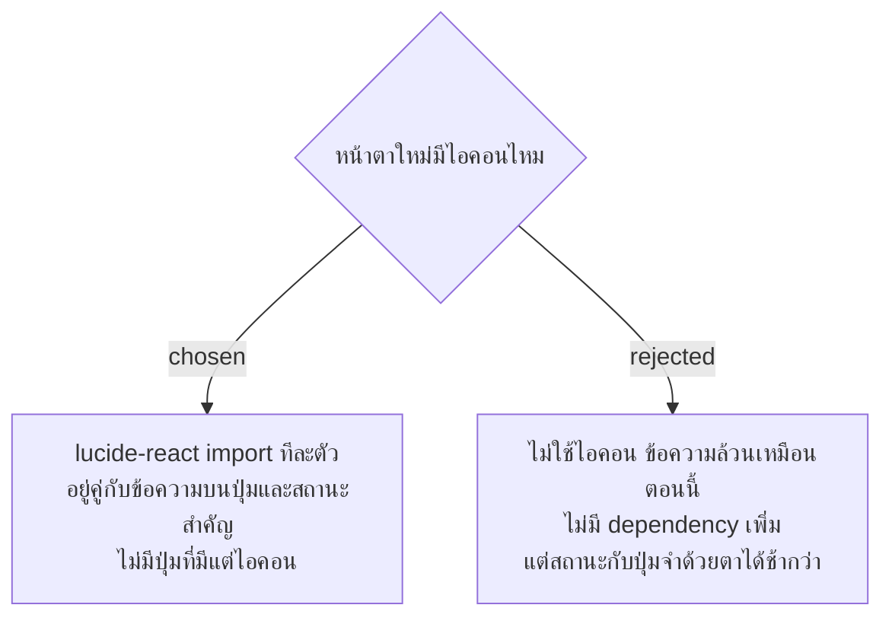

# ไอคอนจาก lucide-react วางคู่กับข้อความเสมอ

- วันที่: 2026-10-22
- ที่มา: เจ้าของโปรเจกต์ตัดสิน 2026-10-22 ตอน grill การย้ายไป Tailwind (Q12, "เพิ่ม คู่กับข้อความ")
- เกี่ยวข้อง: facility-0087 (หน้าตาใหม่), facility-0062 (งบ JS 200 kB), facility-0086 (Tailwind)

## Context & Decision

ตอนนี้ frontend ไม่มีไลบรารีไอคอนเลย (`lucide-react` อยู่ใน build ที่วัดตอนตั้ง facility-0062 แต่ตอนนี้ไม่อยู่ใน `package.json` แล้ว) ตัดสินว่าใช้ `lucide-react` โดย import ทีละตัว ไอคอนอยู่คู่กับข้อความบนปุ่มและสถานะสำคัญเท่านั้น ไม่มีปุ่มที่มีแต่ไอคอน ไอคอนที่อยู่คู่ข้อความใส่ `aria-hidden` ไม่ใช้ emoji เป็นไอคอน

## Consequences

- เป็น dependency ใหม่ที่เข้าไฟล์ JS หลัก ประมาณการ (ยังไม่ได้วัด) ราว 0.3 kB gzip ต่อไอคอน ต้องวัดด้วย `vite build` หลังเพิ่ม ตามข้อ 2 ของ facility-0062 (ไฟล์หลักวัดล่าสุด 157.93 kB จาก 200 kB)
- ข้อความยังเป็นตัวบอกความหมายหลัก test จึงยังหาด้วยข้อความได้เหมือนเดิม
