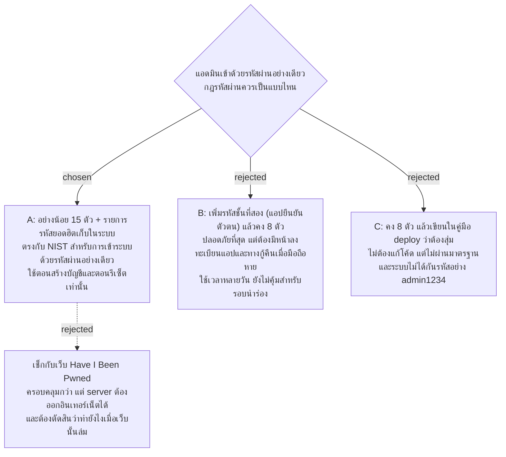

# รหัสผ่านแอดมินยาวอย่างน้อย 15 ตัว และห้ามใช้รหัสยอดฮิต

- วันที่: 2026-10-26
- ที่มา: เจ้าของโปรเจกต์ตัดสิน 2026-10-26 ตอน grill เรื่องลิงก์ "หน้าแอดมิน" บนหน้า login ของพนักงาน (Q2 "15 ตัว + ห้ามรหัสยอดฮิต", Q5 "เก็บในระบบเอง", Q6 "ใช้ได้ต่อ บังคับเฉพาะตอนตั้งหรือรีเซ็ต"); issue #101
- เกี่ยวข้อง: facility-0002 (เก็บรหัสผ่านแบบ hash), facility-0014 (รีเซ็ตรหัสแล้ว token ทุกใบถูกยกเลิก), facility-0020 (หน้าจัดการบัญชี: รหัสผ่านชั่วคราว บอกด้วยวาจาหรือกระดาษ), facility-0049 (server ออกอินเทอร์เน็ต, seed รันเฉพาะเครื่องนักพัฒนา), facility-0054 (แม่บ้านและหัวหน้าเข้าด้วยรหัสพนักงานกับเบอร์โทร รหัสผ่านเหลือเฉพาะแอดมิน), facility-0057 (ไม่เก็บรหัสผ่านในประวัติ)

## Context & Decision

หลัง facility-0054 คนที่ใช้รหัสผ่านมีแต่แอดมิน และแอดมินเข้าระบบด้วยชื่อผู้ใช้กับรหัสผ่านอย่างเดียว ไม่มีรหัสชั้นที่สอง ตอนนี้ระบบรับรหัสยาว 8–100 ตัว (`AccountRules.MinPassword`) และไม่มีกฎอื่น server ล็อกชื่อผู้ใช้ 15 นาทีหลังใส่ผิด 5 ครั้ง (`LoginThrottle`, ตั้งใน `appsettings.json`) คนที่ลองเดาจึงลองได้ราว 480 ครั้งต่อวันต่อบัญชี ถ้ารหัสสั้นและเดาง่าย ตัวเลขนี้ถือว่ามาก

เรื่องนี้เริ่มจากคำถามว่าควรเอาลิงก์ "หน้าแอดมิน" ออกจากหน้า login ของพนักงานไหม แต่การซ่อนลิงก์ไม่ได้ซ่อนทาง เพราะ `/login/admin` อยู่ในไฟล์ JS ที่ทุกคนโหลดอยู่แล้ว สิ่งที่กันคนเดารหัสจริง ๆ มีแค่ server ที่ตรวจ role กับรหัสผ่านและการล็อก ลิงก์จึงคงไว้ทุกจอ (แอดมินต้องใช้บนมือถือตอนเก็บพิกัด M17 และคนที่เปิดเว็บจากคอมจะเจอ `/login` ก่อน) แล้วมาเพิ่มความปลอดภัยที่รหัสผ่านแทน

NIST SP 800-63B-4 (ส.ค. 2025) ข้อ 3.1.1.2 กำหนดว่ารหัสผ่านที่ใช้เข้าระบบอย่างเดียว "SHALL" ยาวอย่างน้อย 15 ตัว (ถ้ามีรหัสชั้นที่สองด้วย ขั้นต่ำคือ 8 ตัว) ต้องเทียบกับรายการรหัสที่คนใช้บ่อย เดาได้ หรือเคยหลุด ห้ามบังคับผสมชนิดตัวอักษร และห้ามบังคับเปลี่ยนรหัสตามรอบเวลา ส่วน OWASP ASVS 5.0 ตั้งขั้นต่ำ 8 ตัวและแนะนำอย่างยิ่งให้ใช้ 15 ตัว

จึงตัดสินว่า

1. **รหัสผ่านแอดมินยาว 15–100 ตัว** นับแบบเดียวกับตอนนี้ ช่องว่างนับด้วย และห้ามเป็นช่องว่างล้วน ความยาวสูงสุด 100 ตัวเท่าเดิม ซึ่งเกินที่ NIST แนะนำ (อย่างน้อย 64 ตัว) อยู่แล้ว 15 ตัวเป็นวลียาว ๆ ได้ (เช่น คำไทยหรืออังกฤษหลายคำต่อกัน) จึงยังบอกด้วยวาจาหรือเขียนลงกระดาษได้ตาม facility-0020
2. **ห้ามรหัสที่อยู่ในรายการรหัสยอดฮิต** รายการเป็นไฟล์ในระบบ server เทียบแบบไม่สนตัวพิมพ์เล็กใหญ่ ไม่ส่งรหัสหรือ hash ไปเว็บภายนอก รายการนี้ไม่ส่งไปที่หน้าเว็บ เพราะจะทำให้ไฟล์ JS ใหญ่ขึ้น (facility-0062) หน้าเว็บตรวจแค่ความยาว แล้วให้ server ตอบเรื่องรายการ
3. **ไม่มีกฎผสมตัวอักษร และไม่บังคับเปลี่ยนตามรอบเวลา** ตาม NIST
4. **กฎใช้ตอนตั้งรหัสเท่านั้น** คือตอนสร้างบัญชีแอดมินและตอนรีเซ็ตรหัส ตอน login ไม่ตรวจ รหัสที่ตั้งไว้ก่อนแล้วและสั้นกว่า 15 ตัวยังใช้ต่อได้จนกว่าจะรีเซ็ต ระบบจริงยังไม่ได้ deploy จึงยังไม่มีรหัสแบบนี้ ไม่ต้องทำหน้าบังคับเปลี่ยนรหัส

## Consequences

- `AccountRules.MinPassword` เปลี่ยนเป็น 15 และมีการตรวจรายการเพิ่ม ทั้งตอนสร้างบัญชีและตอนรีเซ็ตใน `AdminAccountEndpoints` ข้อความ error ของสองกรณีแยกกัน: ยาวไม่พอ และเป็นรหัสที่คนใช้กันเยอะ
- หน้าเว็บ: ข้อความ "8–100 ตัวอักษร" บนฟอร์มเพิ่มบัญชีและฟอร์มรีเซ็ตรหัส (`CreateAccountForm`, `SecretForms`, `accountRules.ts`) เปลี่ยนเป็น 15–100 และเทสที่อ้างข้อความเดิมต้องแก้ตาม
- ที่มาของรายการ (เช่น ชุดรายการสาธารณะที่ใช้ license อนุญาต) วิธีกรองให้เหลือรายการที่ยาว 15 ตัวขึ้นไป และจำนวนรายการจริง ตัดสินและวัดตอนทำแผน รายการยอดฮิตส่วนใหญ่สั้นกว่า 15 ตัว กฎความยาวจึงกันรายการเหล่านั้นได้อยู่แล้ว รายการในไฟล์มีไว้กันรหัสยาวที่เดาง่าย
- seed ของเครื่องนักพัฒนา (`admin` / รหัสที่อยู่ใน `DbInitializer`) และ helper ของเทสที่ login ด้วยรหัสนั้นไม่ต้องเปลี่ยน เพราะ seed ไม่ได้ผ่านกฎนี้ และไม่รันบน server จริง (facility-0049)
- ความเสี่ยงที่รู้และรับไว้ในรอบนำร่อง: การล็อกนับตามชื่อผู้ใช้ ใครที่พิมพ์ชื่อผู้ใช้แอดมินแล้วใส่รหัสผิด 5 ครั้ง จะทำให้แอดมินตัวจริงเข้าระบบไม่ได้ 15 นาที คนนั้นเดารหัสไม่ได้ แต่ก่อกวนได้ ถ้าเกิดขึ้นจริงค่อยตัดสินเรื่องนับตามเครื่อง (IP) ในภายหลัง
- รหัสชั้นที่สอง (ทางเลือก B) ยังเป็นทางเลือกหลังรอบนำร่อง ถ้าเพิ่มเมื่อไร ขั้นต่ำของ NIST จะกลับเป็น 8 ตัว
