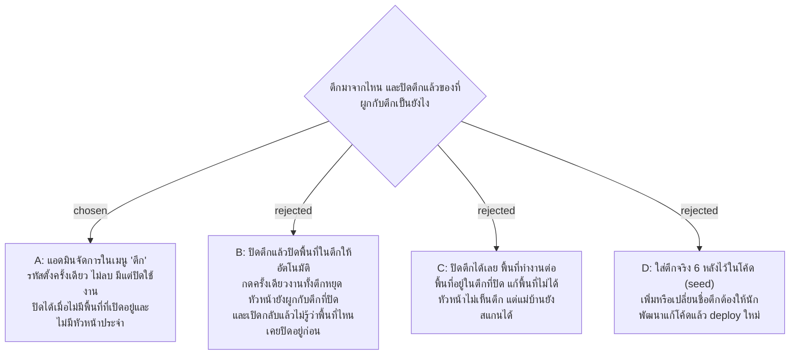

# แอดมินเพิ่ม แก้ชื่อ และเปิดปิดตึกเอง ปิดได้เมื่อไม่มีพื้นที่หรือหัวหน้าค้างอยู่

- วันที่: 2026-10-26
- ที่มา: เจ้าของโปรเจกต์ตัดสิน 2026-10-26: แอดมินเพิ่ม แก้ชื่อ และเปิดปิดตึกเอง รหัสตั้งครั้งเดียว ไม่ลบ การแก้ลงประวัติ (handoff, Pending work); ตัวเลือกตึกในหน้ารายงานแสดงตึกที่ปิดด้วย; รหัส A–Z/0–9 ยาว 1–20 ตัว; เมนูใหม่ "ตึก" ส่วนการปิดตึกที่ยังมีของผูกอยู่ เจ้าของให้เลือกตามที่ใช้กันทั่วไป จึงเลือก "ห้ามจนกว่าจะเคลียร์" (ข้อ 4); ชื่อตึกซ้ำได้ (ข้อ 3) และห้ามเปิดพื้นที่หรือบัญชีหัวหน้าในตึกที่ปิดอยู่ (ข้อ 4) เจ้าของยืนยัน 2026-10-26
- เกี่ยวข้อง: facility-0040 (Area อยู่ในตึก 1 ตึก), facility-0045 (แอดมินจัดการพื้นที่ ปิดใช้งานแทนลบ), facility-0048 (หัวหน้าประจำตึก + กะ), facility-0041 (มอบหมายทำแทน), facility-0049 (seed รันเฉพาะเครื่องนักพัฒนา), facility-0057 (ประวัติการแก้ไขของแอดมิน)

## Context & Decision

ตาราง `buildings` (รหัส ชื่อ เปิดใช้งาน) มีมาตั้งแต่ facility-0048 แต่ไม่มีหน้าไหนสร้างตึกได้ ตึกที่มีอยู่คือ "ตึก A" ของ seed บนเครื่องนักพัฒนา และอ่านได้ผ่าน `GET /api/admin/buildings` อย่างเดียว ตึกจริง 6 หลังจึงยังเข้าระบบไม่ได้

โค้ดตอนนี้ถือว่าตึกที่ปิดคือตึกที่ไม่ใช้งานแล้ว ตึกที่ปิดไม่อยู่ในรายการตึก (ฟอร์มพื้นที่ ฟอร์มบัญชี ตัวกรองทุกหน้า) สร้างหรือแก้พื้นที่ในตึกนั้นไม่ได้ ผูกหัวหน้าหรือมอบหมายตรวจแทนตึกนั้นไม่ได้ และหน้าตึกของฉันไม่แสดงตึกนั้น แต่ยังไม่มีอะไรกันการปิดตึกที่ยังมีพื้นที่หรือหัวหน้าอยู่

จึงตัดสินว่า

1. **แอดมินจัดการตึกในเมนูใหม่ "ตึก"** (`/admin/buildings`) อยู่ถัดจาก "จัดการพื้นที่และป้าย" หน้านี้มีตารางเดียว คอลัมน์ รหัส · ชื่อ · จำนวนพื้นที่ที่เปิดอยู่ · สถานะ · แก้ไข ปุ่ม "+ เพิ่มตึก" อยู่บนขวาของตาราง การเพิ่มและการแก้เปิดใน Drawer ด้านขวาแบบเดียวกับ D4 เพราะฟอร์มมีแค่รหัสกับชื่อ
2. **รหัสตึกตั้งครั้งเดียว** ระบบตัดช่องว่างหัวท้ายและเปลี่ยนเป็นตัวพิมพ์ใหญ่ให้ ต้องเป็น A–Z หรือ 0–9 ยาว 1–20 ตัว (รหัสพื้นที่ยาว 2–20 ตัว ส่วนตึกยอมให้ยาว 1 ตัว เช่น `A`) และห้ามซ้ำกับตึกอื่น รวมถึงตึกที่ปิดแล้ว ตั้งรหัสแล้วแก้ไม่ได้ เพราะรหัสพิมพ์อยู่ในรายงาน ไฟล์ Excel และประวัติ
3. **ชื่อตึกแก้ได้** ห้ามว่าง ยาวไม่เกิน 100 ตัว ชื่อซ้ำกับตึกอื่นได้ (รหัสเป็นตัวแยกตึก) รายงานแสดงชื่อปัจจุบัน ส่วนชื่อเดิมยังดูได้ในประวัติ
4. **ไม่ลบตึก มีแต่ปิดใช้งาน และปิดได้เมื่อไม่มีของค้างอยู่เท่านั้น** ถ้ายังมีพื้นที่ที่เปิดอยู่ในตึก หรือยังมีบัญชีหัวหน้าที่เปิดใช้งานและประจำตึกนั้น ระบบไม่ให้ปิด และบอกว่ายังเหลือพื้นที่กี่แห่งและหัวหน้ากี่คน แอดมินต้องปิดพื้นที่ และย้ายหัวหน้าไปตึกอื่นหรือปิดบัญชีหัวหน้าเองก่อน การเปิดตึกกลับไม่มีเงื่อนไข และไม่เปิดพื้นที่ในตึกให้เอง

   ทางกลับก็กันไว้ด้วย ถ้าตึกปิดอยู่ ระบบไม่ให้เปิดพื้นที่ในตึกนั้น และไม่ให้เปิดบัญชีหัวหน้าที่ประจำตึกนั้น (ตอนนี้ทั้งสองอย่างทำได้ เพราะบัญชีหัวหน้าที่ปิดยังเก็บตึกไว้) ต้องเปิดตึกก่อน หรือย้ายพื้นที่และหัวหน้าไปตึกที่เปิดอยู่ ตึกที่ปิดจึงไม่มีพื้นที่ที่เปิดอยู่และไม่มีหัวหน้าเลย

   ที่ไม่ปิดของในตึกตามไปด้วย (ทางเลือก B) เพราะพื้นที่และหัวหน้าเป็นงานของคน การกดผิดครั้งเดียวไม่ควรทำให้งานของทั้งตึกหยุด และตอนเปิดตึกกลับจะต้องรู้ว่าพื้นที่ไหนปิดอยู่ก่อนแล้ว พื้นที่ขึ้นกับตึก (พื้นที่ทุกแห่งต้องอยู่ในตึก) แต่ไม่ใช่ weak entity เพราะมีรหัสของตัวเองที่ไม่ซ้ำทั้งโรงงาน และระบบนี้ไม่ลบข้อมูล ประวัติการสแกน การตรวจ และการเข้างานของตึกที่ปิดยังอยู่ครบ
5. **ตึกที่ปิดยังเลือกได้ในหน้ารายงาน** ตัวเลือกตึกของสรุปการตรวจ (D7) และส่งออก Excel (D8) แสดงตึกที่ปิดด้วย และต่อท้ายว่า "(ปิดใช้งาน)" เพราะข้อมูลเก่าของตึกนั้นยังอยู่ หน้าที่ดูข้อมูลสด (Dashboard D1, การเข้างาน D2) ฟอร์มพื้นที่ ฟอร์มบัญชี และการมอบหมายทำแทน แสดงเฉพาะตึกที่เปิด
6. **การเพิ่ม แก้ชื่อ และเปิดปิด ลงประวัติการแก้ไขของแอดมิน** (`BUILDING_CREATE`, `BUILDING_UPDATE`, `BUILDING_ACTIVATE`, `BUILDING_DEACTIVATE`) แบบเดียวกับพื้นที่ เก็บค่าก่อนและหลัง ถ้ากดบันทึกโดยไม่ได้แก้อะไร ไม่ลงประวัติ

## Consequences

- API ใหม่: `GET /api/admin/buildings/manage` (ทุกตึก พร้อมสถานะและจำนวนพื้นที่ที่เปิดอยู่), `POST /api/admin/buildings`, `PUT /api/admin/buildings/{id}` (แก้ชื่อเท่านั้น), `POST /api/admin/buildings/{id}/deactivate` และ `/activate` ส่วน `GET /api/admin/buildings` เดิมยังคืนเฉพาะตึกที่เปิดให้ฟอร์มและหน้าข้อมูลสด ชื่อและรูปแบบ path สุดท้ายตัดสินตอนทำแผน
- รายการตึกของหน้ารายงานต้องมีตึกที่ปิดด้วย (`BuildingSelect` ใช้ใน D7 และ D8) จึงต้องมีรายการอีกชุด หรือมีตัวเลือกให้ endpoint คืนตึกที่ปิดด้วย ตัดสินตอนทำแผน
- ตึกที่ปิดไม่มีพื้นที่ที่เปิดอยู่ (ข้อ 4 กันไว้ทั้งตอนปิดตึกและตอนเปิดพื้นที่) จึงไม่มีป้ายให้แม่บ้านสแกน ไม่ต้องเพิ่มการตรวจตึกตอนสแกน
- การเปิดพื้นที่ (`AdminAreaEndpoints`) และการเปิดบัญชีหัวหน้า (`AdminAccountEndpoints`) ต้องตรวจเพิ่มว่าตึกยังเปิดอยู่
- ประวัติการแก้ไขของแอดมิน (D9) ต้องมีชื่อชนิดข้อมูลใหม่ "ตึก" ให้ตัวกรองและข้อความ
- seed ของเครื่องนักพัฒนา (`DbInitializer`, ตึก `A`) คงเดิม ตึกจริง 6 หลังเพิ่มผ่านหน้านี้ตอน deploy ไม่ใส่ในโค้ด (facility-0049)
- เจ้าของมีไฟล์ Excel ของแม่บ้าน หัวหน้า ตึก และพื้นที่อยู่แล้ว และรหัสพื้นที่ในไฟล์มีขีดล่าง (เช่น `BPI_B2_L1`) ซึ่งกฎรหัสตอนนี้ไม่รับ ทั้งของตึก (ข้อ 2) และของพื้นที่ (`SignCodes`) เจ้าของเลือกคงกฎ A–Z/0–9 ไว้ก่อน (2026-10-26) แล้วค่อยตัดสินกฎรหัสทั้งสองพร้อมเรื่องนำเข้า Excel (facility-0056) หลังได้ดูโครงไฟล์ ถ้าจะใช้รหัสตาม Excel ต้องยังห้าม `-` เพราะ `-` คั่นรหัสป้าย (`AR01-IN`, `AR01-03`)
- facility-0045 และ facility-0048 ได้บรรทัดแก้ไขชี้มาที่ ADR นี้ (ตึกมีหน้าจัดการของตัวเอง และกฎการปิด)
- หลังรอบนำร่อง ถ้าต้องย้ายพื้นที่ทั้งหมดจากตึกหนึ่งไปอีกตึกบ่อย ค่อยตัดสินเรื่องย้ายทีละหลายพื้นที่ ตอนนี้ฟอร์มพื้นที่เปลี่ยนตึกได้ทีละแห่งอยู่แล้ว

> **แก้ไข 2026-10-26 (แผน):** รายการตึกทั้งหมด (ตึกที่ปิดด้วย พร้อมจำนวนพื้นที่และหัวหน้าที่เปิดใช้งาน) อยู่ที่ `GET /api/admin/buildings/all` ไม่ใช่ `/manage` ตามที่เขียนไว้ใน Consequences รายการเดียวกันใช้ทั้งหน้า "ตึก" และตัวเลือกตึกของ D7 และ D8
