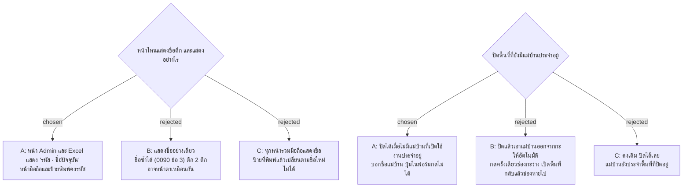

# หน้า Admin และ Excel แสดงตึกเป็น "รหัส · ชื่อปัจจุบัน" และปิดพื้นที่ได้เมื่อไม่มีแม่บ้านประจำอยู่

- วันที่: 2026-10-27
- ที่มา: เจ้าของทดสอบสาขา `feat/admin-buildings` 2026-10-27 พบ 3 เรื่อง: D4 (จัดการพื้นที่) ยังแสดง "ตึก A" หลังเปลี่ยนชื่อตึก, D8 (ส่งออก Excel) แสดงแต่รหัสตึกและเจ้าของมองไม่เห็นตึกที่ปิด, และเมื่อปิดตึก C แอดมินต้องปิดหัวหน้าของตึก แต่แม่บ้านของ AR03 ยังประจำพื้นที่ที่ปิดอยู่
- เกี่ยวข้อง: facility-0090 (แอดมินจัดการตึก ข้อ 3 และ 4), facility-0045 (แอดมินจัดการพื้นที่ ปิดใช้งานแทนลบ), facility-0048 (หัวหน้าประจำตึก + กะ), facility-0040 (Area อยู่ในตึก 1 ตึก และแม่บ้านประจำกะ)

## Context & Decision

ก่อน facility-0090 ตึกมาจาก seed อย่างเดียวและไม่เคยเปลี่ยนชื่อ ทุกหน้าจึงพิมพ์ "ตึก <รหัส>" ตรง ๆ facility-0090 ข้อ 3 บอกว่ารายงานแสดงชื่อปัจจุบัน แต่แผนของข้อนั้นไม่มีงานให้ทำ พอเปลี่ยนชื่อตึกได้ หน้าส่วนใหญ่จึงยังพิมพ์รหัสอยู่

ส่วนการปิดพื้นที่ facility-0045 ปิดใช้งานแทนการลบ แต่ไม่ได้กันกรณีที่แม่บ้านที่เปิดใช้งานยังประจำพื้นที่นั้น (ช่องกะของแม่บ้านผูกกับพื้นที่) พื้นที่ที่ปิดจึงยังมีแม่บ้านอยู่ และเจ้าของเจอตอนปิดตึก C

จึงตัดสินว่า

1. **หน้า Admin และ Excel แสดงตึกเป็น `<รหัส> · <ชื่อปัจจุบัน>`** เช่น "ตึก A · ตึกผลิต" ตัวเลือกตึกทุกตัวของ Admin ข้อความในหน้า D1 D2 D3 D4 D6 D7 D8 และช่อง "ตึก" ใน Excel ใช้รูปแบบนี้ ตึกที่ปิดใน D8 ต่อท้าย "(ปิดใช้งาน)" เหมือนเดิม ตัวเลือกตึกของ D7 และ D8 ถามรายการสดทุกครั้งที่เปิด เพราะชื่ออาจเพิ่งถูกแก้ ที่ไม่เลือกแสดงชื่ออย่างเดียว (ทางเลือก B) เพราะชื่อซ้ำได้ ตึก 2 ตึกจะเหมือนกัน และที่ไม่รวมหน้ามือถือ (ทางเลือก C) เพราะป้ายที่พิมพ์แล้วเปลี่ยนตามชื่อใหม่ไม่ได้ หน้ามือถือและป้ายจึงคงรหัส
2. **ปิดพื้นที่ได้เมื่อไม่มีแม่บ้านที่เปิดใช้งานประจำอยู่** แบบเดียวกับ facility-0090 ข้อ 4 และหลักของ Workday ที่ให้ย้ายคนออกก่อนจึงปิดหน่วยงานได้ ถ้ายังมีแม่บ้านอยู่ ระบบไม่ให้ปิดและบอกชื่อแม่บ้านทุกคน ฟอร์มพื้นที่ (D10) ปิดปุ่ม "ปิดใช้งานพื้นที่นี้" และแสดงชื่อชุดเดียวกัน แอดมินต้องเอาแม่บ้านออกจากกะหรือย้ายไปพื้นที่อื่นเอง การเปิดพื้นที่กลับไม่มีเงื่อนไขเพิ่ม ที่ไม่เอาแม่บ้านออกให้อัตโนมัติ (ทางเลือก B) เพราะกดครั้งเดียวช่องกะว่างหมด และเมื่อเปิดพื้นที่กลับช่องที่หายไปคืนไม่ได้ ส่วนการคงเดิม (ทางเลือก C) ทำให้แม่บ้านยังประจำพื้นที่ที่ปิดอยู่

## Consequences

- กฎใหม่อยู่ที่ `Application/Areas/AreaRules.DeactivateProblem` เรียกจาก `AdminAreaEndpoints.SetActiveAsync` ตอบ 409 พร้อมข้อความที่ระบุชื่อแม่บ้าน ฟอร์มพื้นที่ใช้ `cleanersLeft` (`pages/areas/areaText.ts`) แสดงชื่อชุดเดียวกัน
- ฝั่งหน้าบ้านมี `shared/api/buildingNames.ts` (`buildingOptionText`, `buildingText`, `useBuildingNames`) เป็นที่เดียวที่สร้างข้อความตึกของ Admin
- ตัวเลือกตึกของ D7 และ D8 (`BuildingSelect`) ถามรายการสดทุกครั้งที่เปิด
- ข้อมูลที่บันทึกก่อน ADR นี้อาจมีแม่บ้านประจำพื้นที่ที่ปิดอยู่ มีเฉพาะในฐานข้อมูลทดสอบ ไม่มีการย้ายข้อมูล (migration)
- ไฟล์ Excel จำนวนคอลัมน์เท่าเดิม ช่อง "ตึก" เปลี่ยนจากรหัสเป็น "รหัส · ชื่อปัจจุบัน"
- facility-0090 และ facility-0045 ได้บรรทัดแก้ไขชี้มาที่ ADR นี้
