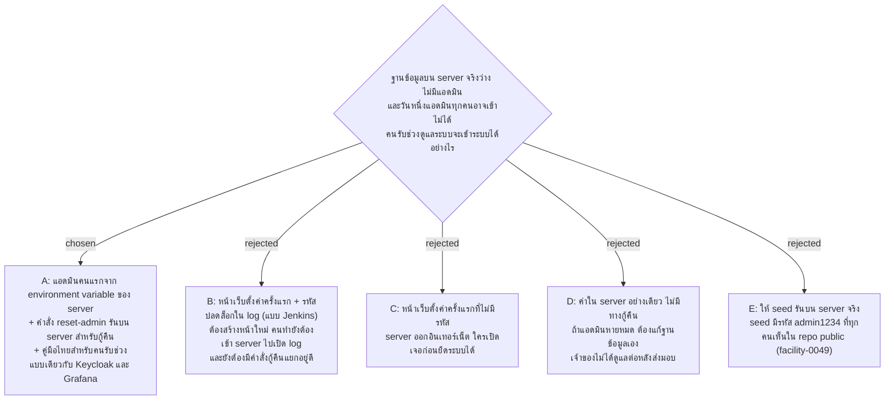

# แอดมินคนแรกสร้างจากค่าใน server และกู้คืนด้วยคำสั่งบน server

- วันที่: 2026-10-27
- ที่มา: เจ้าของโปรเจกต์ตัดสิน 2026-10-27 หลังพบว่าฐานข้อมูลจริงที่ว่างไม่มีทางให้ใคร login ได้ (ยืนยันทำ pilot ตาม facility-0043 และให้งานนี้มาก่อนการนำเข้า Excel ของ facility-0056) เจ้าของจะไม่ได้ดูแลระบบต่อหลังส่งมอบ และยังไม่รู้ว่าใครจะรับช่วง จึงขอแนวทางตามที่ระบบทั่วไปใช้กัน
- เกี่ยวข้อง: facility-0004 (repo public), facility-0014 (รีเซ็ตรหัสแล้ว token ทุกใบถูกยกเลิก), facility-0016 (PBKDF2), facility-0020 (หน้าจัดการบัญชี), facility-0049 (seed รันเฉพาะเครื่องนักพัฒนา), facility-0051 (ประวัติของแอดมิน), facility-0057 (ไม่เก็บรหัสผ่านในประวัติ), facility-0089 (รหัสผ่านแอดมิน 15 ตัว), facility-0090 (ตึกเพิ่มผ่านหน้าเว็บตอน deploy)

## Context & Decision

ตอนเริ่มระบบ `Program.cs` migrate ฐานข้อมูลทุกครั้ง แต่ seed (`DbInitializer`, แอดมิน `admin` / `admin1234`) รันเฉพาะ Development ตาม facility-0049 บัญชีทุกใบเพิ่มได้จากหน้าบัญชี (D6) ซึ่งต้อง login เป็นแอดมินก่อน server จริงที่เพิ่ง deploy จึงไม่มีใครเข้าได้เลย และงานตอน deploy ที่ตามมาทั้งหมด (เพิ่มตึก facility-0090, เพิ่ม Area, เพิ่มบัญชี) ทำไม่ได้ ถ้าวันหนึ่งแอดมินทุกคนลืมรหัสหรือถูกปิดใช้งาน ก็จะเข้าไม่ได้อีกเช่นกัน

ระบบที่ใช้กันแพร่หลายทำเหมือนกันในเรื่องหลัก (ค้นเมื่อ 2026-10-27): Keycloak สร้างแอดมินชั่วคราวจากค่าตอนเริ่มครั้งแรก และมีคำสั่ง `bootstrap-admin` สำหรับกู้คืน, GitLab และ Grafana อ่านรหัสตั้งต้นจาก config ครั้งเดียวแล้วเมินค่านั้น และรีเซ็ตด้วยคำสั่งบน server, Jenkins ให้หน้าเว็บตั้งค่าครั้งแรกที่ต้องกรอกรหัสจาก log ของ server ไม่มีระบบไหนมีรหัสตั้งต้นตายตัว (OWASP ISR07:2024) และไม่มีระบบไหนให้คนที่ไม่มีสิทธิ์บน server สร้างหรือกู้แอดมินได้ คนที่รับช่วงดูแลระบบต้องเข้า server ได้อยู่แล้ว (ฐานข้อมูล, https, ค่าความลับ) ทางนี้จึงไม่เพิ่มทักษะที่ต้องใช้

จึงตัดสินว่า

1. **ค่าที่ตั้งใน server** อยู่ใน section `FirstAdmin` ได้แก่ `Username`, `Password` และ `DisplayName` ตั้งเป็น environment variable (`FirstAdmin__Username`, `FirstAdmin__Password`, `FirstAdmin__DisplayName`) ไม่เขียนลง `appsettings.json` และไม่เข้า git
2. **สร้างเฉพาะตอนยังไม่มีบัญชีแอดมินเลย** ตอนเริ่มระบบหลัง migrate ถ้าตาราง users ไม่มีแอดมินสักแถว (เปิดหรือปิดใช้งานก็นับ) และตั้งค่าครบ ระบบสร้างแอดมินหนึ่งคน ถ้ามีแอดมินอยู่แล้ว ค่าเหล่านี้ไม่มีผลอะไร ตั้งค้างไว้ก็ไม่สร้างซ้ำ ไม่เปลี่ยนรหัส และไม่เปิดบัญชีที่ปิดไว้ การกู้คืนใช้คำสั่งในข้อ 5 เท่านั้น
3. **ชื่อผู้ใช้และรหัสผ่านต้องผ่านกฎเดียวกับหน้าบัญชี** (`AccountRules.NormalizeUsername`, `AccountRules.PasswordProblem` ตาม facility-0089: 15–100 ตัว ไม่ใช่รหัสยอดฮิต) ถ้าไม่ผ่าน ระบบไม่ยอมเริ่ม และบอกว่าค่าไหนผิด โดยไม่พิมพ์รหัสผ่านลง log ตั้งผิดแล้วรู้ทันทีตอน deploy ดีกว่าเริ่มได้แต่เข้าไม่ได้
4. **ยังไม่มีแอดมินและไม่ได้ตั้งค่า** ระบบเริ่มได้ตามปกติ และเขียน warning ลง log ว่ายังไม่มีแอดมิน พร้อมชื่อ environment variable ที่ต้องตั้ง ใช้ได้กับ Development ด้วย แต่ที่นั่น seed สร้างแอดมินไปก่อนแล้ว จึงไม่มีอะไรเกิดขึ้น
5. **คำสั่งกู้คืน `reset-admin`** รันบน server ด้วยโปรแกรม API ตัวเดียวกัน (เช่น `dotnet FacilityRealtime.Api.dll reset-admin <username>`) ใช้ connection string เดียวกับตอนรันระบบ แล้วจบโดยไม่เปิด web server
   - ถามรหัสผ่านใหม่สองครั้งโดยไม่แสดงบนจอ ไม่รับรหัสทาง argument เพราะจะค้างใน history ของ shell รหัสต้องผ่านกฎข้อ 3
   - ชื่อผู้ใช้เป็นของแอดมินอยู่แล้ว: ตั้งรหัสใหม่ เปิดบัญชีถ้าถูกปิด และยกเลิก token ทุกใบของบัญชีนั้น (facility-0014)
   - ไม่มีบัญชีชื่อนี้: สร้างแอดมินใหม่ ถามชื่อที่แสดงด้วย
   - ชื่อนี้เป็นของแม่บ้านหรือหัวหน้า: ไม่ทำอะไร และบอกเหตุผล
   - ทำงานได้แม้ระบบกำลังรันอยู่ แต่การล็อกหลังใส่รหัสผิด 5 ครั้ง (`LoginThrottle`) อยู่ในหน่วยความจำของระบบที่รันอยู่ ถ้าบัญชีถูกล็อกอยู่ ต้องรอ 15 นาทีหรือรีสตาร์ตระบบ
6. **ลงประวัติ** ทั้งการสร้างจากข้อ 2 และทุกครั้งที่ใช้คำสั่งข้อ 5 บันทึกลงประวัติของแอดมิน (facility-0051) โดยไม่มีรหัสผ่าน (facility-0057) ผู้กระทำคือระบบ เพราะไม่มีแอดมินคนไหนเป็นคนกด
7. **หลังสร้างหรือกู้คืนเสร็จ** คนที่ deploy ลบ `FirstAdmin__Password` ออกจาก server แล้วแอดมินคนนั้นเปลี่ยนรหัสของตัวเองในหน้าบัญชี (D6) เพราะรหัสที่ตั้งไว้เคยอยู่ใน config ของ server หรือเคยถูกพิมพ์ผ่านคนกลาง
8. **คู่มือส่งมอบภาษาไทย** สำหรับคนรับช่วงที่ยังไม่รู้ว่าเป็นใคร เขียนทีละขั้น: ติดตั้ง, สร้างแอดมินคนแรก, กู้คืนด้วย `reset-admin` และแนะนำให้มีแอดมินที่เปิดใช้งานอย่างน้อย 2 คนเสมอ เพื่อให้แทบไม่ต้องใช้คำสั่งกู้คืน

## Consequences

- เพิ่มขั้นตอนตอนเริ่มระบบใน `Program.cs` ต่อจาก migrate ใช้ได้ทุก environment ยกเว้น Testing ส่วน seed ยังรันเฉพาะ Development เหมือนเดิม
- `Program.cs` ต้องแยกเส้นทางเมื่อมี argument `reset-admin`: migrate (เพื่อให้ฐานข้อมูลตรงรุ่น) ทำคำสั่ง แล้วจบ โดยไม่ต้องมี `Jwt:SigningKey` ถ้าคำสั่งไม่ได้ใช้
- เทสต้องครอบคลุม: สร้างเมื่อไม่มีแอดมิน, ไม่ทำอะไรเมื่อมีแอดมินแล้ว (รวมแอดมินที่ปิดใช้งาน), ไม่เริ่มเมื่อชื่อหรือรหัสผิดกฎ และข้อความไม่มีรหัสผ่าน, warning เมื่อไม่ได้ตั้งค่า, `reset-admin` ทั้งสามกรณีของข้อ 5 และ token ถูกยกเลิก, แถวในประวัติไม่มีรหัสผ่าน
- ประวัติต้องรับผู้กระทำที่เป็นระบบได้ ถ้าตารางประวัติบังคับว่าผู้กระทำต้องเป็นบัญชี วิธีบันทึกตัดสินตอนทำแผน
- คู่มือ deploy ต้องเขียนลำดับ: deploy → ตั้ง `FirstAdmin__*` → เริ่มระบบ → login → ลบรหัสผ่านออกจาก server → เปลี่ยนรหัส → เพิ่มแอดมินคนที่สอง → เพิ่มตึก (facility-0090)
- ค่าอื่นที่ server จริงต้องตั้งเหมือนกัน (`Jwt:SigningKey`, `Jwt:RefreshCookieSecure` เป็น true บน https, connection string) ไม่อยู่ใน ADR นี้ แต่ต้องอยู่ในคู่มือเดียวกัน
- ใครเข้า server ได้ก็ตั้งตัวเองเป็นแอดมินได้ด้วย `reset-admin` ถือว่ารับได้ เพราะคนที่เข้า server ได้ก็อ่านและแก้ฐานข้อมูลได้อยู่แล้ว ทุกครั้งที่ใช้จะเห็นในประวัติ
