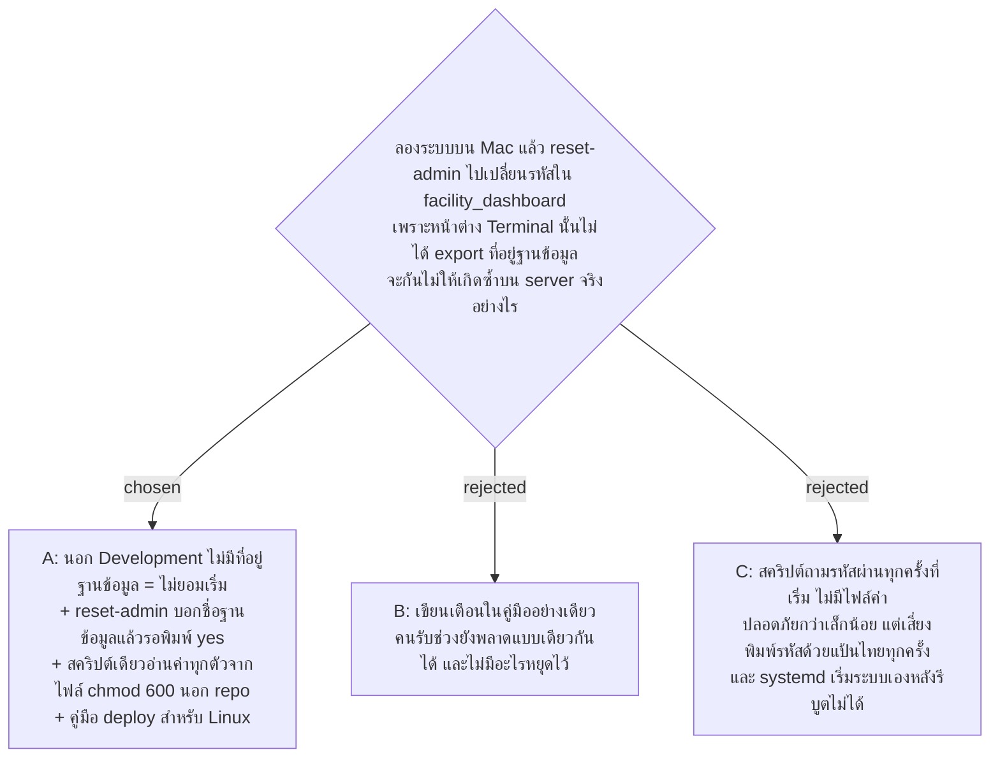

# ระบบไม่เดาฐานข้อมูลเอง, reset-admin ถามก่อนทำ, สคริปต์เริ่มระบบจากไฟล์ค่าเดียว และคู่มือ deploy

- วันที่: 2026-10-28
- ที่มา: ลองระบบ 1 Area บน Mac ของเจ้าของ (2026-10-27) ค่าที่ `export` อยู่แค่ในหน้าต่างเดียว หน้าต่างที่ไม่มี `ConnectionStrings__DefaultConnection` ใช้ค่าตั้งต้น `facility_dashboard` จาก `appsettings.json` ไปเงียบ ๆ เจ้าของเลือกทางแก้ทาง popup วันที่ 2026-10-28: ไฟล์ค่านอก repo, reset-admin ถาม yes, ยังไม่ได้เลือกชนิด server
- เกี่ยวข้อง: facility-0011 (`Jwt:SigningKey` ไม่เข้า git), facility-0049 (server เปิดผ่าน https, seed เฉพาะ Development), facility-0092 (แอดมินคนแรก, `reset-admin`, คู่มือส่งมอบ)

## Context & Decision

`appsettings.json` มีที่อยู่ฐานข้อมูลของเครื่องนักพัฒนา (`facility_dashboard`) และ `Program.cs` ใช้ค่าเดียวกันซ้ำอีกทีถ้าหาไม่เจอ ระบบจึงไม่เคยหยุดเมื่อลืมตั้งที่อยู่ฐานข้อมูล ทั้งตอนเริ่มระบบและตอนรัน `reset-admin` บน server จริงนี่คือการแก้ฐานข้อมูลผิดตัวโดยไม่รู้ตัว

จึงตัดสินว่า

1. **ที่อยู่ฐานข้อมูลตั้งต้นมีเฉพาะ Development** ย้ายจาก `appsettings.json` ไป `appsettings.Development.json` และลบค่าสำรองในโค้ด environment อื่นที่ไม่ได้ตั้ง `ConnectionStrings__DefaultConnection` (หรือตั้งเป็นค่าว่าง) ไม่ยอมเริ่มระบบ และไม่ยอมรัน `reset-admin` ข้อความบอกชื่อค่าที่ขาด เครื่องนักพัฒนาที่รัน `dotnet run` (launch profile = Development) และ `dotnet ef` ยังใช้ `facility_dashboard` เหมือนเดิม
2. **`reset-admin` บอกก่อนว่าจะทำกับฐานข้อมูลไหน** พิมพ์ server, port และชื่อฐานข้อมูล (ไม่พิมพ์ชื่อผู้ใช้หรือรหัสผ่านของฐานข้อมูล) แล้วรอให้พิมพ์ `yes` ถ้าไม่ใช่ `yes` จบโดยไม่แตะฐานข้อมูลเลย การถามนี้เกิดก่อน migrate เพราะ migrate ฐานข้อมูลผิดตัวก็คือการแก้ฐานข้อมูลผิดตัวเหมือนกัน
3. **สคริปต์เดียวสำหรับเริ่มระบบและรัน `reset-admin`** (`scripts/facility.sh`) อ่านค่าทุกตัวจากไฟล์ค่าไฟล์เดียวที่อยู่นอก repo
   - ไฟล์ค่าเขียนแบบ `KEY=VALUE` บรรทัดละค่า ไม่มีเครื่องหมายคำพูด รูปแบบเดียวกับ `EnvironmentFile` ของ systemd จึงใช้ไฟล์เดียวกันได้ทั้งสคริปต์และ server
   - สคริปต์อ่านทีละบรรทัด ไม่ `source` ไฟล์ เพราะที่อยู่ฐานข้อมูลมี `;` ซึ่ง shell จะตัดเป็นคำสั่งใหม่
   - ไฟล์ต้องอ่านได้เฉพาะเจ้าของ (`chmod 600`) ไม่อย่างนั้นสคริปต์ไม่ทำงาน
   - ค่าเดิมที่ค้างอยู่ใน shell (`ConnectionStrings__*`, `Jwt__*`, `FirstAdmin__*`, `ASPNETCORE_*`, `FACILITY_*`) ถูกล้างก่อนอ่านไฟล์ มีผลเฉพาะค่าในไฟล์
   - `ASPNETCORE_ENVIRONMENT` เป็น `Production` ถ้าไฟล์ไม่ได้ตั้ง
   - คำสั่ง `init` สร้างไฟล์ค่าให้: ถามที่อยู่ฐานข้อมูลและแอดมินคนแรก, สุ่ม `Jwt__SigningKey`, ตั้ง `Jwt__RefreshCookieSecure=true` รหัสผ่านพิมพ์แบบไม่แสดงบนจอ
   - ฐานข้อมูลใช้ผู้ใช้ MySQL เฉพาะของระบบ ที่มีสิทธิ์แค่ฐานข้อมูลของระบบ ไม่ใช้ root รหัสของ root จึงไม่อยู่ในไฟล์ใด
4. **คู่มือ deploy เขียนสำหรับ Linux** (Ubuntu LTS, systemd, reverse proxy ทำ https) เพราะยังไม่ได้เลือก server ฝ่าย IT ยังไม่ตอบ (facility-0049 ข้อ 2) Windows Server เป็นเรื่องที่ยังเปิดอยู่ คู่มืออยู่ใน `docs/handover.md` ไฟล์เดียวกับคู่มือแอดมินคนแรก (facility-0092)
5. **คู่มือเตือนเรื่องแป้นพิมพ์ไทย** ทุกจุดที่พิมพ์รหัสผ่านแบบไม่แสดงบนจอ เพราะพิมพ์ผิดภาษาแล้วมองไม่เห็น

## Consequences

- เครื่องที่เคยรัน Production โดยพึ่งค่าใน `appsettings.json` จะเริ่มไม่ได้จนกว่าจะตั้ง `ConnectionStrings__DefaultConnection` ซึ่งคือสิ่งที่ต้องการ ยังไม่มี server จริงที่ได้รับผลกระทบ
- `reset-admin` ใน script หรือ pipe ต้องส่ง `yes` เป็นบรรทัดแรก
- สคริปต์ใช้ bash และทดสอบด้วย `scripts/facility.test.sh` (ใช้ `dotnet` ปลอม) ใช้ได้ทั้ง macOS (bash 3.2) และ Linux ไม่ได้รันใน pre-commit
- ถ้าเลือก Windows Server ภายหลัง ต้องเพิ่มคู่มือส่วน IIS และวิธีตั้งค่าแทนไฟล์ค่าของสคริปต์
- `facility_dashboard` บน Mac ของเจ้าของถูกเปลี่ยนรหัสแอดมินไปแล้วหนึ่งครั้ง (ข้อมูลทดสอบ) ADR นี้ไม่ได้กู้คืน

> **แก้ไข 2026-10-29 (facility-0099):** service เขียน log ลง journal namespace `facility` ที่เก็บ 90 วัน (`/etc/systemd/journald@facility.conf`) คำสั่งอ่าน log ในคู่มือเป็น `sudo journalctl --namespace=facility -u facility`
