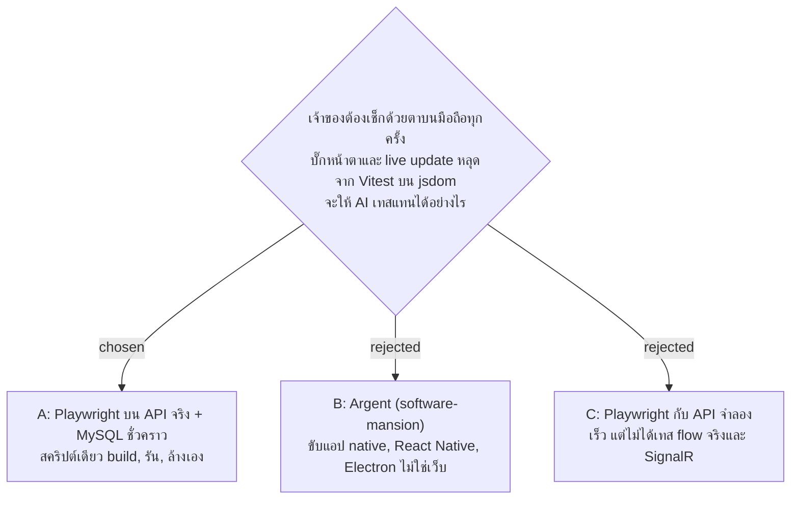

# เทส end-to-end ด้วย Playwright บนระบบจริงและฐานข้อมูลชั่วคราว

- วันที่: 2026-10-28
- ที่มา: เจ้าของอยากให้ AI เทสแทน เลือกทาง popup วันที่ 2026-10-28: Playwright แบบถาวร, ตรวจทั้ง flow และหน้าตาบนมือถือ, สคริปต์เดียว (แนวทาง A ของ spec `docs/superpowers/specs/2026-10-28-playwright-e2e-design.md`)
- เกี่ยวข้อง: facility-0049 (seed เฉพาะ Development), facility-0064 (badge), facility-0067 (frontend ใน `wwwroot`), facility-0093 (สคริปต์, เหตุการณ์ `facility_dashboard`)

## Context & Decision

1. **`npm run e2e` คำสั่งเดียว** (`scripts/e2e.sh`): build frontend, สร้าง `facility_e2e_test` ใหม่, รัน API ที่ build แล้วในโหมด Development (ได้ seed) พอร์ต 5101, รัน Playwright, แล้วหยุด API ลบฐานข้อมูล ลบ `wwwroot` ทุกครั้งแม้เทสล้ม สคริปต์ไม่แตะฐานข้อมูลชื่ออื่น `npm run e2e:clean` ล้างของที่ค้างเมื่อรันถูกฆ่ากลางทาง และจะหยุดเฉพาะโปรเซสที่คำสั่งเป็น API ของเราเท่านั้น (ไฟล์ pid เก่าที่ค้างอยู่จึงไม่ทำให้ไปฆ่าโปรแกรมอื่น)
2. **Chromium อย่างเดียว** สองแบบ: มือถือ 390 x 844 (touch, GPS อยู่ที่ป้ายลงเวลา AR01) และโต๊ะ 1280 px สำหรับ D1 รันทีละเทสเพราะใช้ฐานข้อมูลเดียวกัน
3. **ตรวจหน้าตาด้วยค่าที่วัดได้** (ล้นจอด้านข้างวัดจาก `documentElement.scrollWidth - clientWidth` เพราะ `window.innerWidth` ในโหมดจำลองขยายตามเนื้อหา, ปุ่มอยู่ในจอ, CLS ต่ำกว่า 0.01, ข้อความ badge ไม่โผล่) เทสการขยับของ D1 รันที่หน้าต่างกว้าง 700 px เพราะที่ 1280 px บั๊กเก่าให้ค่าแค่ 0.0025 ซึ่งไม่เกินเส้น และเก็บ screenshot ทุกเทสไว้ดู ยังไม่ทำ screenshot เทียบภาพต้นแบบ
4. **ไม่ผูกกับ pre-commit และยังไม่มี CI** เพราะช้า (build + เริ่ม API) แต่ lint และ `tsc -b` ตรวจไฟล์เทสใน pre-commit

## Consequences

- จับไม่ได้: บั๊กเฉพาะ Safari บน iPhone, บั๊ก `100dvh` (Chromium จำลองไม่มีแถบเครื่องมือที่หดได้), GPS จริง, การพิมพ์ D5 บนกระดาษ สามอย่างนี้ยังต้องเช็กบนเครื่องจริง
- เทส flow สดข้ามตัวเองช่วง 19:00–20:00 เวลาไทย เพราะรอบแรกของกะกลางคืนยังไม่เริ่ม (ช่วงนั้นผลจะเป็น 8 ผ่าน 1 ข้าม)
- เปลี่ยน seed ใน `DbInitializer.cs` ต้องแก้ `frontend/e2e/support/seed.ts` ตาม
- ครั้งแรกดาวน์โหลด Chromium ราว 150 MB
- e2e ลบ `wwwroot` ซึ่งใช้ร่วมกับ test build ที่พอร์ต 5001 ของเจ้าของ ต้อง build ใหม่หลังรัน
