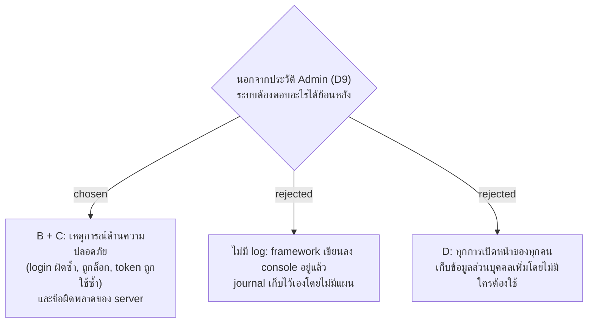

# Log ทางเทคนิคเก็บเหตุการณ์ด้านความปลอดภัยและข้อผิดพลาดของ server ไม่เก็บการเปิดหน้า

- วันที่: 2026-10-29
- ที่มา: เจ้าของถามว่าโปรเจกต์ต้องมี logging ไหม เลือก "B and C" ในรอบ grill วันที่ 2026-10-29
- เกี่ยวข้อง: facility-0051 และ 0057 (Audit Log ของ Admin), facility-0054 (ล็อก login 5 ครั้ง 15 นาที), facility-0015 (token ถูกใช้ซ้ำ), facility-0055 (PDPA และระยะเวลาเก็บ), facility-0068 (ไม่มีอะไรออกจากมือถือ), facility-0093 (systemd และ journal)

## Context & Decision

วัดบน master `284052c`: Audit Log (D9) เก็บทุกการแก้ของ Admin อยู่แล้ว แต่ log ทางเทคนิคมีแค่ข้อความตอนสร้างแอดมินคนแรกกับคำเตือน live update (`PointNotifications.cs`) login ผิดนับในหน่วยความจำอย่างเดียว รีสตาร์ตแล้วหาย ถูกล็อกตอบ 429 โดยไม่เขียนอะไร token ถูกใช้ซ้ำยกเลิก session โดยไม่เหลือร่องรอย

จึงตัดสินใจว่า log ทางเทคนิคของ server ต้องตอบได้สองเรื่อง:

1. **เหตุการณ์ด้านความปลอดภัย:** login ผิด, บัญชีถูกล็อก, refresh token ถูกใช้ซ้ำแล้ว session ถูกยกเลิก
2. **ข้อผิดพลาดของ server:** request ที่ล้ม (500), ฐานข้อมูลต่อไม่ได้, server เริ่มไม่ได้หรือหยุด

ไม่เก็บว่าใครเปิดหน้าไหนเมื่อไร Audit Log คงเป็นของการแก้ของ Admin เหมือนเดิม log ทางเทคนิคเป็นอีกอย่าง

## Consequences

- ยังต้องตัดสิน: ใครอ่าน log และอ่านที่ไหน, ห้ามมีอะไรใน log, เก็บนานเท่าไร
- log อยู่ที่ server เท่านั้น ตาม facility-0068
