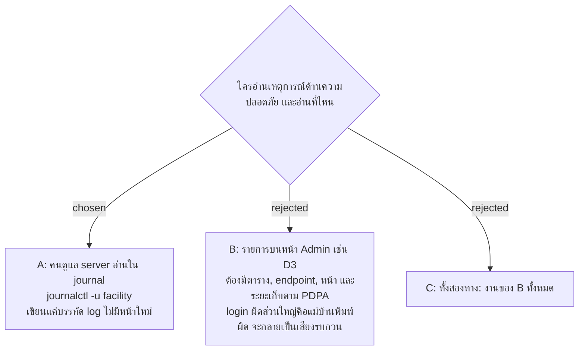

# Server Log อ่านจาก journal ของเครื่องเท่านั้น ไม่มีหน้าให้ Admin

- วันที่: 2026-10-29
- ที่มา: เจ้าของเลือก "A" ในรอบ grill วันที่ 2026-10-29
- เกี่ยวข้อง: facility-0095 (log เก็บอะไร), facility-0093 (systemd, `journalctl` ในคู่มือ), facility-0055 (PDPA), facility-0054 (ล็อก login)

## Context & Decision

facility-0095 ให้ Server Log เก็บเหตุการณ์ด้านความปลอดภัยและข้อผิดพลาดของ server จึงตัดสินใจว่า **คนดูแล server อ่านจาก journal ของเครื่อง** (`sudo journalctl -u facility`) ซึ่งคู่มือ deploy ใช้อยู่แล้ว ระบบแค่เขียนบรรทัด log ไม่มีตาราง endpoint หรือหน้าใหม่ Admin ที่ได้รับแจ้งว่าแม่บ้านถูกล็อก ตอบได้ว่ารอ 15 นาที ถ้าเกิดซ้ำ คนดูแล server ดูใน journal

## Consequences

- ไม่มีข้อมูลส่วนบุคคลเพิ่มในฐานข้อมูล
- ถ้าเหตุการณ์จริงแสดงว่า Admin ต้องเห็นเอง ค่อยตัดสินเรื่องหน้าใหม่แยก บรรทัด log เดิมยังใช้ได้
- ยังต้องตัดสิน: บรรทัด log บอกตัวตนด้วยอะไร, ห้ามมีอะไร, journal เก็บนานเท่าไร
