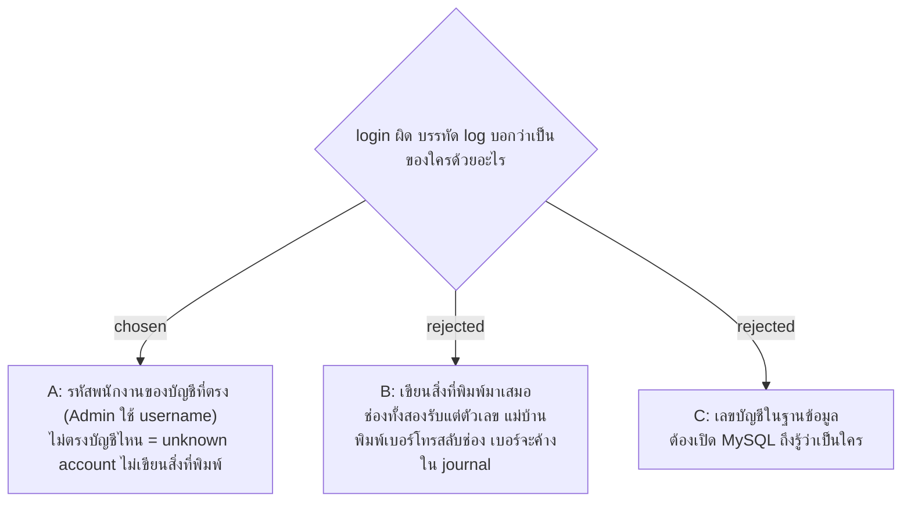

# Server Log บอกบัญชีด้วยรหัสพนักงาน ไม่เขียนข้อความที่พิมพ์มา

- วันที่: 2026-10-29
- ที่มา: เจ้าของเลือก "A" ในรอบ grill วันที่ 2026-10-29
- เกี่ยวข้อง: facility-0095, 0096 (Server Log), facility-0054 (login ด้วยรหัสพนักงาน + เบอร์โทร), facility-0055 (PDPA), seed 7 หลัก (PR #117)

## Context & Decision

ทุกบรรทัดของเหตุการณ์ด้านความปลอดภัย (login ผิด, ถูกล็อก, token ถูกใช้ซ้ำ) บอกบัญชีด้วย **รหัสพนักงาน** หรือ **username** ถ้าเป็น Admin ถ้าสิ่งที่พิมพ์ไม่ตรงกับบัญชีไหน เขียนแค่ว่า unknown account ไม่เขียนสิ่งที่พิมพ์มา

ห้ามเขียนลง Server Log: เบอร์โทร, รหัสผ่าน, ค่าของ token (access, refresh, QR Token), พิกัด GPS

## Consequences

- เบอร์โทรที่พิมพ์ผิดช่องไม่หลุดลง journal
- คนดูแล server อ่านรหัสพนักงานแล้วเทียบกับหน้า D6 ได้เลย
- การไล่ดูคนที่เดารหัสพนักงานที่ไม่มีอยู่จริงทำไม่ได้จากชื่อที่พิมพ์ (ยอมรับ)
