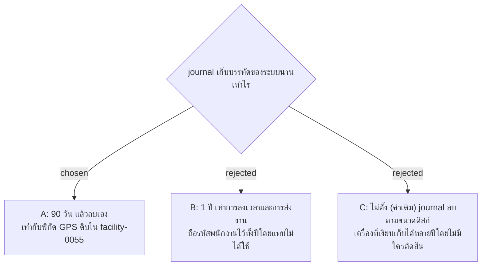

# Server Log เก็บ 90 วัน

- วันที่: 2026-10-29
- ที่มา: เจ้าของเลือก "A" ในรอบ grill วันที่ 2026-10-29
- เกี่ยวข้อง: facility-0095, 0096, 0097 (Server Log), facility-0055 (ระยะเวลาเก็บข้อมูล), facility-0093 (คู่มือ deploy)

## Context & Decision

Server Log มีรหัสพนักงาน ซึ่งเป็นข้อมูลส่วนบุคคลตาม PDPA (facility-0055) แต่ journal ตามค่าเดิมลบตามขนาดดิสก์เท่านั้น จึงตัดสินใจ **เก็บ 90 วัน** แล้วลบเอง ปัญหาด้านความปลอดภัยที่ควรดูมักเห็นในไม่กี่วันหรือสัปดาห์ และข้อผิดพลาดของ server มีประโยชน์จนกว่าจะแก้เสร็จ

## Consequences

- คู่มือ deploy (`docs/handover.md` ข้อ 2) ต้องตั้งค่าการเก็บ 90 วัน
- ตารางระยะเวลาเก็บใน facility-0055 ควรมีแถว Server Log
