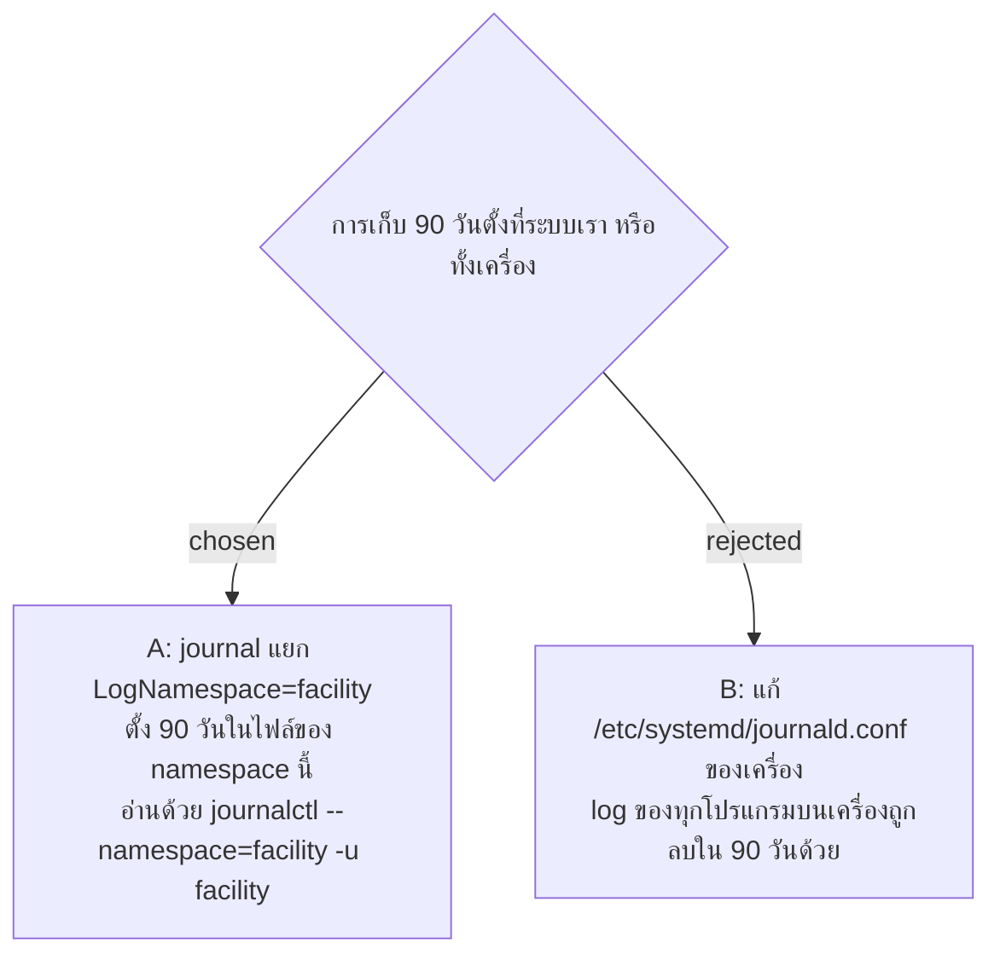

# Server Log อยู่ใน journal แยกของระบบ (namespace facility)

- วันที่: 2026-10-29
- ที่มา: เจ้าของเลือก "A" ในรอบ grill วันที่ 2026-10-29
- เกี่ยวข้อง: facility-0098 (เก็บ 90 วัน), facility-0096 (อ่านจาก journal), facility-0093 (คู่มือ deploy, ยังไม่ได้เลือกระบบปฏิบัติการ)

## Context & Decision

เครื่องที่ IT ให้อาจรันโปรแกรมอื่นด้วย การแก้ค่า journal ของทั้งเครื่องจะลบ log ของโปรแกรมเหล่านั้นตามไปด้วย จึงตัดสินใจให้ service ของระบบเขียนลง **journal namespace ของตัวเอง** (`LogNamespace=facility` ในไฟล์ service) และตั้งการเก็บ 90 วันในไฟล์ค่าของ namespace นั้น ค่าของเครื่องไม่ถูกแตะ

## Consequences

- คำสั่งอ่าน log ยาวขึ้น: `sudo journalctl --namespace=facility -u facility` คู่มือ deploy ที่ใช้ `journalctl -u facility` อยู่ต้องแก้ตาม
- ต้องใช้ systemd ที่มี `LogNamespace=` (Linux รุ่นใหม่ทั่วไปมีแล้ว)
- ถ้า IT เลือก Windows ต้องกลับมาตัดสินเรื่องที่เก็บและระยะเก็บ (facility-0096, 0098, ADR นี้) ใหม่ เพราะ Windows ไม่มี journal
