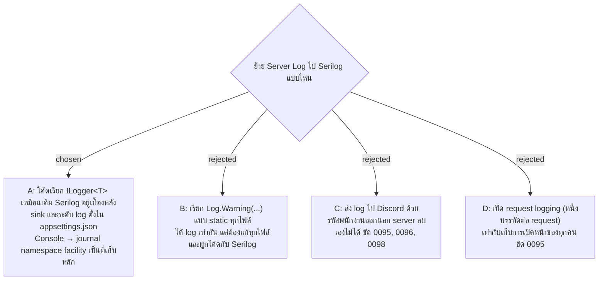

# Server Log เขียนผ่าน Serilog ตั้ง sink ใน config และยังลง journal เป็นที่เก็บหลัก

- วันที่: 2026-11-02
- ที่มา: เจ้าของบอกไว้ 2026-10-29 ว่าจะย้าย logging ไป Serilog Senior ของเจ้าของตัดสินเรื่องการเรียกในโค้ด, sink ใน config, console และ Discord ส่วนเจ้าของตัดสินข้อที่เหลือ ทั้งหมดในรอบ grill วันที่ 2026-11-02
- เกี่ยวข้อง: facility-0095 (log เก็บอะไร), 0096 (อ่านจาก journal), 0097 (ห้ามมีอะไรใน log), 0098 (เก็บ 90 วัน), 0099 (journal namespace), facility-0055 (PDPA), facility-0068 (log อยู่ที่ server)

## Context & Decision

ก่อนหน้านี้ระบบใช้ logging ที่มากับ .NET เขียนลง console แล้ว systemd เก็บลง journal namespace `facility` ซึ่งทำตาม 0095–0099 ได้ครบ เหตุผลที่ย้ายคือให้เพิ่มปลายทางของ log ได้ด้วยการตั้งค่า โดยแก้โค้ดน้อยที่สุด จึงตัดสินใจ:

1. **โค้ดยังเรียกผ่าน `ILogger<T>`** Serilog เป็นตัวรับ log ที่อยู่เบื้องหลัง (`Serilog.AspNetCore`) บรรทัดที่ ASP.NET และ EF เขียนเองก็ผ่าน Serilog ด้วย
2. **sink และระดับ log ตั้งใน `appsettings.json`** (`Serilog.Settings.Configuration`) ระดับ log อยู่ที่ `Serilog:MinimumLevel` ที่เดียว `Logging:LogLevel` ถูกลบ ระดับเดิมยังคงอยู่ รวมถึง `Microsoft.EntityFrameworkCore.Database.Command` เป็น Warning ซึ่งกัน SQL ไม่ให้ลง log
3. **Console เป็น sink เดียว** พิมพ์เป็นข้อความธรรมดา ไม่ใช่ JSON และพิมพ์ category กับข้อความไว้บรรทัดเดียวกัน (template มี `{SourceContext}` ไม่ใส่เวลาเพราะ journal ใส่ให้) category `FacilityRealtime.Security` ใช้ชื่อเดิม ค้นได้ด้วย `grep FacilityRealtime.Security` โดยไม่ต้องใช้ `-A1`
4. **ใช้ bootstrap logger** เพื่อให้กรณี server เริ่มไม่ได้ (ตาม 0095) ยังมีเหตุผลลง journal รวมถึงคำสั่ง `reset-admin`
5. **ไม่เปิด request logging** ตาม 0095
6. **sink ที่ส่ง log ออกนอก server** (Discord, Seq บนคลาวด์ หรืออื่น ๆ) ต้องมี ADR ใหม่มาแทนข้อ "log อยู่ที่ server เท่านั้น" ของ 0095 ก่อน เพราะ log มีรหัสพนักงานซึ่งเป็นข้อมูลส่วนบุคคล (0055) และบริการภายนอกไม่อยู่ใต้การเก็บ 90 วันของ 0098 ส่วน sink ที่อยู่บนเครื่องเดียวกันเพิ่มด้วย config ได้ แต่ต้องทำตาม 0097 และ 0098
7. **ยังไม่เพิ่ม File sink** ถ้า IT เลือก Windows ค่อยเพิ่มพร้อม ADR ใหม่ตามที่ 0099 บอกไว้
8. **test ดัก log ด้วย sink ของ Serilog ที่เขียนเอง** และพิมพ์ด้วย template เดียวกับของจริง test จึงตรวจได้ทั้งข้อความและว่ามี category อยู่ในบรรทัด

## Consequences

- 0095–0099 ยังใช้ได้ทั้งหมด ADR นี้ไม่ได้มาแทนใบไหน
- คู่มือ deploy (`docs/handover.md`) ต้องแก้คำสั่งค้นเหตุการณ์ด้านความปลอดภัยเป็น `grep FacilityRealtime.Security` และบอกว่าระดับ log อยู่ที่ `Serilog:MinimumLevel`
- คนที่คุ้นกับ ASP.NET แบบปกติต้องรู้ว่าแก้ `Logging:LogLevel` แล้วไม่มีผล
- มี package ใหม่: `Serilog.AspNetCore` และ `Serilog.Settings.Configuration` (Console sink มาด้วยกัน)
