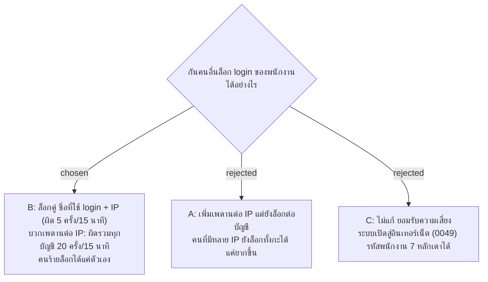

# Login Lock นับเป็นคู่ "ชื่อที่ใช้ login + IP" และมีเพดานต่อ IP

- วันที่: 2026-11-02
- ที่มา: การทดสอบความปลอดภัย 2026-11-02 (finding F2: ส่งเบอร์ผิด 6 ครั้งแล้ว แม้เบอร์ที่ถูกก็ได้ 429 อีก 15 นาที) เจ้าของตัดสินทุกข้อในรอบ grill วันเดียวกัน
- เกี่ยวข้อง: facility-0054 (login ด้วยรหัสพนักงาน + เบอร์โทร, ADR นี้แก้ข้อจำกัดการ login ผิด), facility-0097 (ADR นี้เพิ่ม IP ลงบรรทัดความปลอดภัย), facility-0049 (เปิดสู่อินเทอร์เน็ตผ่าน https), facility-0093 (คู่มือ deploy, Caddy), facility-0095, 0096 (Server Log), facility-0055 (PDPA)

## Context & Decision

facility-0054 จำกัดจำนวนครั้งที่ login ผิด **ต่อรหัสพนักงาน** ผลคือใครก็ได้บนอินเทอร์เน็ตที่รู้รหัสพนักงาน ส่งเบอร์ผิด 6 ครั้งก็ล็อกพนักงานคนนั้นได้ 15 นาที และทำซ้ำได้ทุก 15 นาที เช่น ล็อกทั้งกะตอนเข้างาน การแค่เพิ่มเพดานต่อ IP ไม่ปิดปัญหานี้ เพราะตัวนับยังผูกกับบัญชีของเหยื่อ จึงตัดสินใจ:

1. **Login Lock นับเป็นคู่ "ชื่อที่ใช้ login + IP"** ผิด 5 ครั้งใน 15 นาที คู่นั้นล็อก 15 นาที (ตัวเลขเดิมของ 0054) ชื่อที่ใช้ login คือรหัสพนักงาน หรือ username ของ Admin รวมถึงชื่อที่ไม่มีบัญชี บัญชีเดียวกันจาก IP อื่นยัง login ได้ คนร้ายจึงล็อกได้แค่ตัวเอง
2. **เพดานต่อ IP** IP เดียว login ผิดรวมทุกชื่อครบ 20 ครั้งใน 15 นาที IP นั้น login ไม่ได้ 15 นาที กันการไล่เดาเบอร์ทีละหลายบัญชีจาก IP เดียว
3. **นับเฉพาะครั้งที่ผิด** แม่บ้านส่วนใหญ่ login ด้วยเน็ตมือถือ ซึ่งมักใช้ IP สาธารณะร่วมกับคนอื่น (CGNAT) การนับเฉพาะครั้งผิดทำให้คนที่ login ถูกไม่ชนเพดาน login ผ่านจะล้างตัวนับของคู่ตัวเองเท่านั้น **ไม่ล้างตัวนับต่อ IP** ไม่อย่างนั้นคนร้ายจะใช้บัญชีของตัวเอง login ผ่านสลับไปเพื่อล้างเพดาน
4. **Admin ใช้กติกาเดียวกัน** คนร้ายจะได้ล็อก Admin ทุกคนไม่ได้
5. **ไม่มีเพดานรวมต่อบัญชี** คนที่มีหลาย IP เดาเบอร์ของบัญชีเดียวได้ IP ละ 5 ครั้ง แต่เบอร์มีราว 10⁸ แบบ เดาสุ่มไม่ไหว ถ้ามีเพดานรวมที่ล็อกบัญชีได้ ปัญหาเดิมจะกลับมา ความเสี่ยงที่เพื่อนรู้เบอร์ยังเป็นความเสี่ยงที่ 0054 ยอมรับไว้
6. **IP คือ IP จริงของผู้ใช้** หลัง Caddy ทุก request มาจาก `127.0.0.1` ระบบจึงเชื่อ `X-Forwarded-For` **เฉพาะจาก proxy ในเครื่องเดียวกัน (loopback) และชั้นเดียว** Kestrel ฟังแค่ localhost (0093) คนภายนอกจึงปลอม header ไม่ได้ ถ้ารันโดยไม่มี proxy ใช้ IP ของ connection
7. **IPv6 นับตามช่วง /64** ซึ่งเป็นช่วงที่เครือข่ายแจกให้มือถือหนึ่งเครื่องหรือบ้านหนึ่งหลัง ถ้านับทีละที่อยู่ คนร้ายจะสลับที่อยู่ได้ทุก request ส่วน IPv4 นับตามที่อยู่เต็ม
8. **หน้า login ใช้ข้อความเดิม** ถูกล็อกแบบไหนก็ตอบ 429 และหน้าเว็บแสดง "กรอกผิดหลายครั้ง รอสักครู่แล้วลองใหม่" ไม่บอกว่าล็อกด้วยเหตุใด
9. **Server Log เขียน IP** (แก้ 0097) บรรทัด login ผิดและบรรทัดถูกล็อกมี IP ด้วย และมีบรรทัดใหม่เมื่อ IP ชนเพดาน คนดูแล server จะได้บล็อก IP ที่ firewall และแยกคนร้ายออกจากพนักงานที่พิมพ์ผิด IP ไม่ใช่สิ่งที่ผู้ใช้พิมพ์ จึงไม่ขัดกับ "ไม่เขียนข้อความที่พิมพ์มา" ของ 0097 ข้อห้ามเดิมของ 0097 ยังใช้ทั้งหมด

## Consequences

- ยังเก็บในหน่วยความจำเหมือน 0054 (server เดียว) รีสตาร์ตแล้วตัวนับหายหมด ตัวเลขทั้งสองตั้งได้ในหมวด `LoginThrottle`
- เพดานต่อ IP จำกัดจำนวนรายการที่ IP เดียวสร้างในหน่วยความจำได้ จึงลดความเสี่ยงที่ชื่อมั่ว ๆ จำนวนมากจะทำให้หน่วยความจำโต
- แม่บ้านที่พิมพ์ผิด 5 ครั้งยังถูกล็อก แต่เฉพาะจาก IP นั้น ถ้าเปลี่ยนจากเน็ตมือถือไปใช้ Wi-Fi ก็ login ได้ ถือว่ายอมรับได้ เพราะเป็นเจ้าของบัญชีตัวจริง
- คนที่ใช้ IP เดียวกับคนร้ายโดยบังเอิญ (CGNAT) อาจโดนเพดานต่อ IP ไปด้วย 15 นาที (ยอมรับ)
- IP ของผู้ใช้อยู่ใน journal 90 วันตาม 0098 IP เป็นข้อมูลส่วนบุคคล ส่วนเรื่อง PDPA เจ้าของสั่งให้พักไว้ก่อน (facility-0055 ยังไม่ได้แก้)
- คู่มือ deploy (`docs/handover.md`) ต้องแก้คำอธิบายบรรทัด log และข้อ "บัญชีถูกล็อก" ให้ตรงกับการล็อกเป็นคู่
- ถ้าวันหนึ่งมีอีก proxy หน้า Caddy (เช่น Cloudflare) การเชื่อ header ชั้นเดียวจะได้ IP ของ proxy แทน ต้องมี ADR ใหม่

> **แก้ไข 2026-11-02:** [facility-0106](facility-0106-security-headers-set-by-the-app.md) ให้เชื่อ `X-Forwarded-Proto` จาก proxy เดียวกันด้วย ตามกติกาข้อ 6 (loopback ชั้นเดียว) เพื่อให้แอปรู้ว่าคำขอมาทาง https และส่ง HSTS ได้
