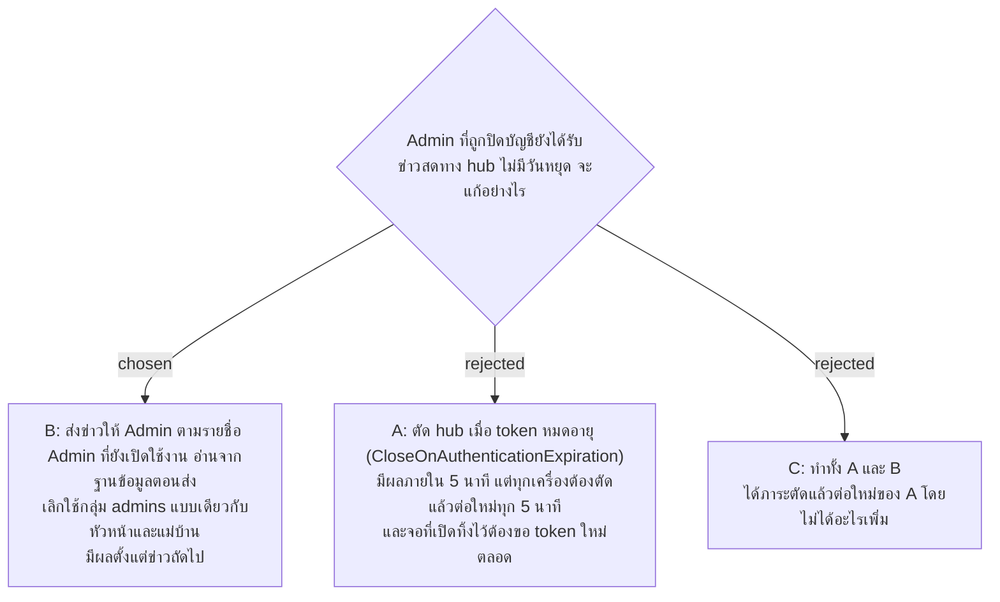

# ปิดบัญชีแล้วมีผลทันที ทั้งข่าวสดทาง hub และ API

- วันที่: 2026-11-02
- ที่มา: การทดสอบความปลอดภัย 2026-11-02 (finding F1: Admin ที่ถูกปิดบัญชี แม้ token หมดอายุแล้ว ยังได้รับ `ScanRecorded` ทาง hub, finding F4: `/api/me` และ `by-token` ยังตอบบัญชีที่ปิดแล้วจนกว่า token จะหมดอายุ) เจ้าของตัดสินทุกข้อในรอบ grill วันเดียวกัน
- เกี่ยวข้อง: facility-0012 (access token 5 นาที, ADR นี้แก้ข้อ "SignalR ใช้ token เฉพาะตอนเริ่มต่อ connection"), facility-0058 และ 0027 (ข่าวที่ส่งให้ Admin), facility-0057 (ข่าวที่ส่งให้หัวหน้า ซึ่งอ่านรายชื่อจากฐานข้อมูลอยู่แล้ว), facility-0006 (`users.is_active`)

## Context & Decision

facility-0012 สัญญาว่าปิดบัญชีแล้วมีผลภายใน 5 นาที เพราะ access token อายุ 5 นาที แต่ hub ตรวจ token ครั้งเดียวตอนเริ่มต่อ connection Admin ถูกใส่ในกลุ่ม `admins` ตอนนั้นแล้วไม่ถูกถอดออกอีกเลย Admin ที่ถูกปิดบัญชีแต่ยังเปิดหน้าเว็บค้างไว้ จึงได้รับข่าวสดของทุกอาคารต่อไปไม่มีวันหยุด ทั้งชื่อแม่บ้าน สถานะจุด และข้อความแจ้งปัญหา หัวหน้าและแม่บ้านไม่มีปัญหานี้ เพราะข่าวของสองกลุ่มนี้ส่งตามรายชื่อที่อ่านจากฐานข้อมูลตอนส่ง และกรองเฉพาะบัญชีที่เปิดใช้งานอยู่แล้ว จึงตัดสินใจ:

1. **ข่าวที่ส่งให้ Admin ส่งตามรายชื่อ Admin ที่ยังเปิดใช้งาน อ่านจากฐานข้อมูลตอนส่ง** และเลิกใช้กลุ่ม `admins` ใช้กับทั้ง `ScanRecorded`, `InspectionRecorded` และ `AttendanceRecorded` Admin ที่ถูกปิดบัญชี หรือถูกเปลี่ยนเป็น role อื่น จะไม่ได้รับข่าวตั้งแต่ข่าวถัดไป
2. **ไม่ตัด hub เมื่อ token หมดอายุ** connection ของบัญชีที่ปิดแล้วยังเปิดค้างได้ แต่ไม่มีข่าวส่งไปถึง มือถือและจอที่เปิดค้างจึงไม่ต้องตัดแล้วต่อใหม่ทุก 5 นาที
3. **`GET /api/me`, `GET /api/service-points` และ `GET /api/service-points/by-token/{token}` ตรวจว่าบัญชียังเปิดใช้งาน** เหมือน endpoint อื่นที่อ่านบัญชีจากฐานข้อมูลก่อนตอบ บัญชีที่ปิดแล้วได้ 401 ทันที รายงานทดสอบพบสองตัวแรก ตัวกลาง (รายการจุดของ Admin) พบตอนไล่ตรวจทุก route ในรอบ grill นอกจาก login, refresh และ logout ที่ตรวจบัญชีเองแล้ว ไม่มี route HTTP อื่นที่ขาดการตรวจนี้ ส่วนการต่อ hub (`/hubs/scan`) ยังรับ token ของบัญชีที่ปิดแล้วที่ยังไม่หมดอายุ ตามข้อ 2 ต่อได้แต่ไม่มีข่าวส่งไปถึง

ผลรวม: ปิดบัญชีแล้วมีผลทันทีทุกช่องทาง ไม่ต้องรอ token หมดอายุ หน้าที่เปิดค้างไว้หลุดออกจากระบบเมื่อเรียก API ครั้งถัดไป เพราะได้ 401 แล้ว refresh ก็ถูกปฏิเสธ

## Consequences

- ส่งข่าวหนึ่งครั้งอ่านฐานข้อมูลเพิ่มหนึ่งครั้ง (รายชื่อ Admin ที่เปิดใช้งาน) Admin มีไม่กี่คน จึงรับได้
- การอ่านรายชื่อเกิดหลังบันทึกข้อมูลแล้ว ถ้าล้ม ข่าวลงเวลา (`AttendanceRecorded`) จะเขียน log แล้วไม่ส่ง ไม่ตอบ 500 เหมือนข่าวของจุดที่ทำแบบนี้อยู่แล้ว (facility-0061) หน้าเว็บดึงข้อมูลใหม่ทุก 30 วินาทีอยู่แล้ว
- ถ้าวันหนึ่งเพิ่มข่าวชนิดใหม่ที่ส่งให้กลุ่มคน ต้องส่งตามรายชื่อจากฐานข้อมูลแบบเดียวกัน ห้ามกลับไปใช้กลุ่มที่เข้าครั้งเดียวตอนต่อ connection
- token ของบัญชีที่ปิดแล้วยังผ่านการตรวจ JWT ได้จนหมดอายุ (facility-0012 ยังเป็นแบบนี้) แต่ทุก endpoint ที่ต้อง login อ่านบัญชีจากฐานข้อมูลก่อนตอบแล้ว token ที่ยังไม่หมดอายุจึงทำอะไรไม่ได้
