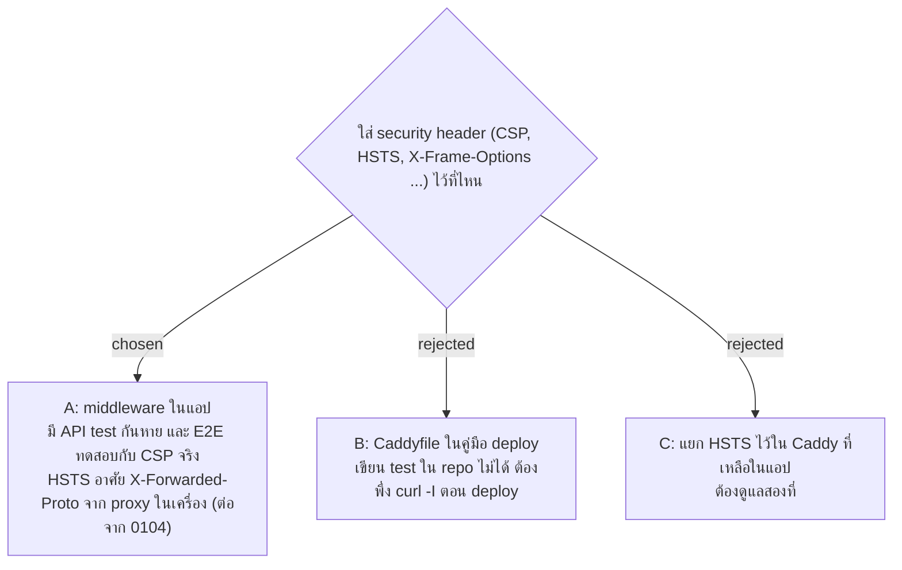

# แอปส่ง security header เอง และคำตอบของ API ห้าม browser เก็บ

- วันที่: 2026-11-02
- ที่มา: การทดสอบความปลอดภัย 2026-11-02 (finding F3: ไม่มี security header เลย ทั้งในแอปและใน Caddy ตามคู่มือ deploy, finding F7: คำตอบที่มี access token ไม่มี `Cache-Control: no-store`) เจ้าของเลือกที่ใส่และให้รวม F7 ส่วนชุด header และค่าของแต่ละตัว เจ้าของให้ Claude เลือกตามคำแนะนำ
- เกี่ยวข้อง: facility-0104 (เชื่อ header จาก proxy ในเครื่องเดียวกันชั้นเดียว, ADR นี้เพิ่ม `X-Forwarded-Proto`), facility-0067 (API ส่งหน้าเว็บจาก origin เดียว), facility-0049 (เปิดสู่อินเทอร์เน็ตผ่าน https), facility-0093 (คู่มือ deploy, Caddy), facility-0012 (access token อยู่ในหน่วยความจำ, refresh cookie)

## Context & Decision

แอปไม่ส่ง security header เลย และ Caddy ตามคู่มือ deploy (`reverse_proxy` อย่างเดียว) ก็ไม่ใส่เพิ่ม เว็บอื่นจึงใส่หน้าแอปไว้ใน iframe ได้ และมือถือที่เปิด `http://` ครั้งแรกบน Wi-Fi ที่ไม่น่าไว้ใจอาจถูกดักก่อน Caddy redirect ไป https ตอนนี้ยังหลอกให้ Admin กดปุ่มผ่าน iframe ไม่ได้ เพราะหน้าใน iframe ไม่มี session (refresh cookie เป็น `SameSite=Strict` และ access token อยู่ในหน่วยความจำ) ความรุนแรงจึงต่ำ จึงตัดสินใจ:

1. **แอปเป็นคนส่ง header เอง** ผ่าน middleware (`SecurityHeaders.cs` เรียกจาก `Program.cs`) ไม่ใส่ใน Caddyfile จะได้มี API test กันไม่ให้หายในอนาคต และ CSP อยู่ที่เดียวกับโค้ดหน้าเว็บที่ต้องเข้ากัน
2. **ชุด header** ส่งกับทุกคำตอบ ทุก environment ยกเว้นที่ระบุ
   - `Content-Security-Policy: default-src 'self'; script-src 'self'; style-src 'self'; img-src 'self' data:; connect-src 'self'; object-src 'none'; base-uri 'none'; form-action 'self'; frame-ancestors 'none'` บังคับใช้จริง ไม่ใช้ report-only เพราะไม่มีที่รับรายงาน และ E2E พิสูจน์ได้ว่าหน้าเว็บยังใช้งานได้ หน้าเว็บไม่ดึงอะไรจากเว็บอื่นและไม่มี inline script ถ้า E2E พังเพราะห้าม inline style ให้ผ่อนเฉพาะ `style-src` เป็น `'self' 'unsafe-inline'` และบันทึกเหตุผลไว้ในโค้ด
   - `X-Frame-Options: DENY` สำหรับ browser เก่าที่ไม่รู้จัก `frame-ancestors`
   - `X-Content-Type-Options: nosniff`
   - `Referrer-Policy: no-referrer` เพราะลิงก์ `/scan/<token>` มี QR Token อยู่ใน path
   - `Permissions-Policy: geolocation=(self), camera=(), microphone=()` หน้าเว็บใช้แค่ GPS
   - `Strict-Transport-Security: max-age=31536000` **ทุกโหมดยกเว้น Development และเฉพาะคำขอที่มาทาง https** (server จริงใช้ Production ส่วนโหมด Testing ของ API test ได้ด้วย test จึงเช็กได้ บน localhost ไม่ส่ง) ไม่ใส่ `includeSubDomains` และ `preload` เพราะยังไม่รู้ว่าจะได้โดเมนอะไร ถ้าเป็น subdomain ขององค์กร จะไปบังคับเว็บอื่นขององค์กรไม่ได้
   - ไม่ส่ง `Server: Kestrel`
3. **แอปรู้ว่าคำขอมาทาง https จาก `X-Forwarded-Proto`** เชื่อเฉพาะจาก proxy ในเครื่องเดียวกัน (loopback) ชั้นเดียว กติกาเดียวกับ `X-Forwarded-For` ใน facility-0104
4. **หน้า Swagger ใน Development ไม่ได้รับ CSP** เพราะหน้านั้นอาจพังเมื่อเจอ CSP แบบเข้ม และเปิดเฉพาะ Development อยู่แล้ว ไม่มีบน server (0049)
5. **ทุกคำตอบใต้ `/api` ได้ `Cache-Control: no-store`** (F7) คำตอบของ login และ refresh มี access token อยู่ในตัว ตอนนี้ browser ไม่เก็บอยู่แล้วเพราะเป็น POST แต่ไม่ควรพึ่งพฤติกรรมนั้น ไฟล์หน้าเว็บยังใช้ `Cache-Control` เดิมของ 0067

## Consequences

- E2E ต้องรันกับหน้าเว็บที่ API ส่ง (`npm run build:api`) จึงจะทดสอบกับ CSP จริง ส่วน Vite dev server ส่งหน้าเว็บเอง จึงไม่มี CSP ระหว่างพัฒนา
- ถ้าวันหนึ่งหน้าเว็บต้องใช้ของจากเว็บอื่น (font, แผนที่, analytics) ต้องแก้ CSP ไม่อย่างนั้น browser จะบล็อก
- Caddy ยังใส่ `Server: Caddy` เอง (ยอมรับ ไม่ได้บอกเวอร์ชัน)
- HSTS มีผลเฉพาะ browser ที่เคยเปิดผ่าน https มาแล้วอย่างน้อยครั้งหนึ่ง ครั้งแรกสุดยังถูกดักได้ (ยอมรับ ต้อง preload ถึงจะกันได้ ซึ่งต้องรู้โดเมนก่อน)
- คู่มือ deploy (`docs/handover.md`) มีขั้นเช็ก `curl -sI https://<โดเมน>/login/admin` ว่าเห็น header ครบหลังขึ้น server ต้องเช็กผ่านโดเมนจริง เพราะระบบไม่ส่ง HSTS ให้ localhost
- คำตอบ 500 ที่เกิดจาก exception ที่ไม่มีใครจับ ไม่มี header เหล่านี้ เพราะ Kestrel ล้าง header ก่อนตอบ (ยอมรับ คำตอบนั้นไม่มี body)
