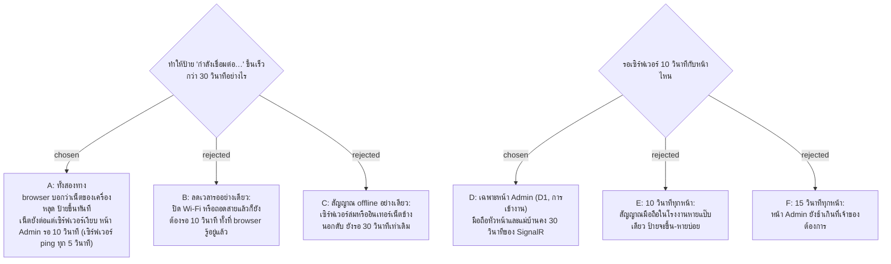

# หน้า Admin รู้เร็วขึ้นว่าการเชื่อมต่อหลุด: ฟังสัญญาณ offline ของ browser และรอเซิร์ฟเวอร์ 10 วินาที

- วันที่: 2026-11-03
- ที่มา: E2E 2026-11-02 วัดได้ว่าหน้า Admin ที่เน็ตหลุดยังดูเหมือนออนไลน์ราว 29.4 วินาที ก่อนป้ายจะขึ้น (SignalR รอเซิร์ฟเวอร์ 30 วินาทีตามค่าเริ่มต้น) เจ้าของอยากให้เร็วขึ้น และเลือก A กับ D (popup 2026-11-03)
- เกี่ยวข้อง: facility-0064 (ป้ายและการถามใหม่ตอนต่อกลับ ADR นี้ไม่เปลี่ยนข้อความหรือสีของป้าย), facility-0061 (poll 30 วินาทีคู่กับ push), facility-0058 (Dashboard เฉพาะ Admin)

## Context & Decision

ก่อนหน้านี้ ป้ายจะขึ้นก็ต่อเมื่อ SignalR client ไม่ได้ยินอะไรจากเซิร์ฟเวอร์ครบ 30 วินาที (`serverTimeoutInMilliseconds` ค่าเริ่มต้น) ส่วนเซิร์ฟเวอร์ส่ง ping ทุก 15 วินาที (`KeepAliveInterval` ค่าเริ่มต้น) ทุกหน้าใช้ค่าเดียวกัน จึงตัดสินใจ:

1. **ฟังสัญญาณ `offline` และ `online` ของ browser** ใน `followScanHub` (`shared/api/scanHub.ts`) ใช้กับทุกหน้าที่ตาม hub
   - `offline` ตั้งสถานะเป็น reconnecting ทันที
   - `online` ถามเซิร์ฟเวอร์ใหม่หนึ่งครั้ง (`onMissed`) หลังจากนั้น 1 วินาที (`HUB_ONLINE_ASK_MS`) เพราะ Chromium ส่งสัญญาณ online ก่อนที่คำขอจะผ่านได้จริง (E2E 2026-11-03 คำขอที่ส่งทันทีล้มด้วย `net::ERR_INTERNET_DISCONNECTED` แล้วหน้าต้องรอ poll 30 วินาที) ถ้าการเชื่อมต่อไม่เคยหลุด สถานะกลับเป็น live ทันที ถ้าหลุดไปแล้วและกำลังต่อใหม่ ป้ายจะอยู่จนกว่าจะต่อได้ ซึ่งอาจรอได้ถึง 30 วินาทีตามช่วงลองใหม่ของ 0064 แต่ข้อมูลบนหน้าเป็นของใหม่แล้ว
   - การเริ่มเชื่อมต่อที่จบหลังเน็ตหลุดไปแล้วไม่ตั้งเป็น live (เจอใน Firefox)
2. **หน้า Admin รอเซิร์ฟเวอร์ 10 วินาที** (`ADMIN_HUB_SERVER_TIMEOUT_MS`) ทั้ง Dashboard (D1) และหน้าการเข้างาน (D2) ส่วนหน้ามือถือ (ตึกของฉัน, งานของฉัน) คง 30 วินาทีของ SignalR
3. **เซิร์ฟเวอร์ ping ทุก 5 วินาที** (`KeepAliveInterval` ใน `Program.cs`) เพราะ client ต้องได้ยินเซิร์ฟเวอร์อย่างน้อยสองครั้งในหนึ่งช่วงที่รอ ค่ารอฝั่งเซิร์ฟเวอร์ (`ClientTimeoutInterval`) คง 30 วินาทีตามเดิม

## Consequences

- ปิด Wi-Fi หรือถอดสาย ป้ายขึ้นใน 0.0 วินาที เน็ตยังต่อแต่เซิร์ฟเวอร์เงียบ ป้ายขึ้นใน 6–10 วินาที (E2E 2026-11-03 ทั้ง Chromium, WebKit, Firefox)
- เซิร์ฟเวอร์ส่ง ping ถี่ขึ้นสามเท่าให้ทุกการเชื่อมต่อ รวมมือถือด้วย ข้อความ ping มีขนาดไม่กี่ byte ผู้ใช้ราว 200 คนจึงไม่ได้รับผลกระทบ
- ถ้าเซิร์ฟเวอร์ ping ห่างกว่าครึ่งหนึ่งของ 10 วินาที หน้า Admin จะหลุดแล้วต่อใหม่ทุก 10 วินาที โดยป้ายแทบไม่โผล่ให้เห็น แต่หน้าจะถามเซิร์ฟเวอร์ใหม่ทุกครั้ง E2E "an Admin page stays live on a quiet link" นับจำนวนการเชื่อมต่อเพื่อจับกรณีนี้ (ลองตั้ง ping 15 วินาทีแล้ว เทสต์ล้ม)
- สัญญาณ `offline` บอกได้เฉพาะเน็ตของเครื่องเอง กรณี Wi-Fi ยังต่ออยู่แต่ทางออกอินเทอร์เน็ตดับ ยังต้องรอ 10 วินาที (Admin) หรือ 30 วินาที (มือถือ)
