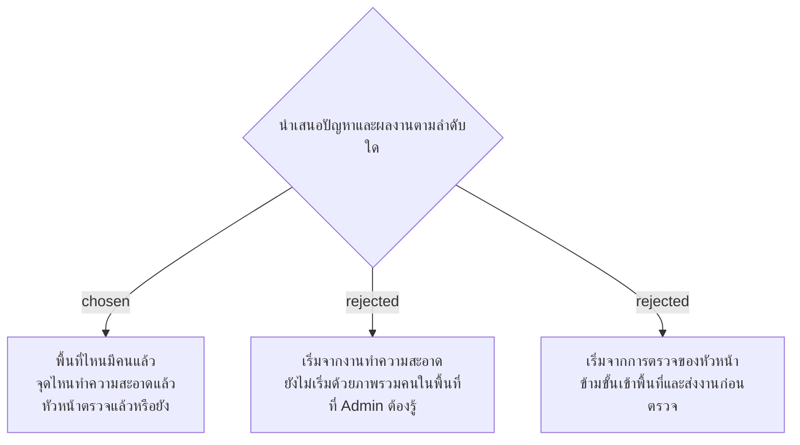

# SMM Presentation: Area Coverage, Cleaning Progress, Then Inspection

วันที่ 4 พฤศจิกายน 2026 เจ้าของเลือกให้เรื่องนำเสนอ SMM เริ่มจาก Area coverage ตามด้วย Cleaning progress และ Inspection records เพื่อให้ผู้ฟังเข้าใจจากภาพรวมของ Admin ไปสู่ขั้นตอนส่งงานและตรวจงาน การตัดสินใจนี้กำหนดลำดับการเล่าเรื่องเท่านั้น ยังไม่กำหนดจำนวนสไลด์หรืออนุมัติข้อความภาษาอังกฤษฉบับสุดท้าย และไม่เปลี่ยนขอบเขตการทำงานของระบบ

ปัญหาเดิมที่เจ้าของยืนยันคือ Admin อาศัยและเชื่อตามรายงานของหัวหน้า โดยยังไม่มีข้อมูลให้ตรวจสอบได้โดยตรงว่าแม่บ้านเข้าพื้นที่ใดแล้ว จุดไหนทำความสะอาดเสร็จ และหัวหน้าตรวจแล้วหรือยัง ตัวอย่าง 100 พื้นที่เป็นสมมติฐาน ไม่ใช่จำนวนพื้นที่จริง ห้ามเติมว่ารายงานผ่านกระดาษ Excel หรือ LINE โดยไม่มีข้อมูลยืนยัน

ข้อความนำเสนอต้องสอดคล้องกับ facility-0037 และ facility-0050: การลงเวลาพร้อม GPS เป็นหลักฐาน ณ เวลาทำรายการ ไม่ใช่การติดตามตำแหน่งตลอดกะหรือระบบคิดค่าจ้าง และผลความสะอาดเป็นผลตรวจที่หัวหน้าบันทึก ไม่ใช่การวัดความสะอาดโดยซอฟต์แวร์
