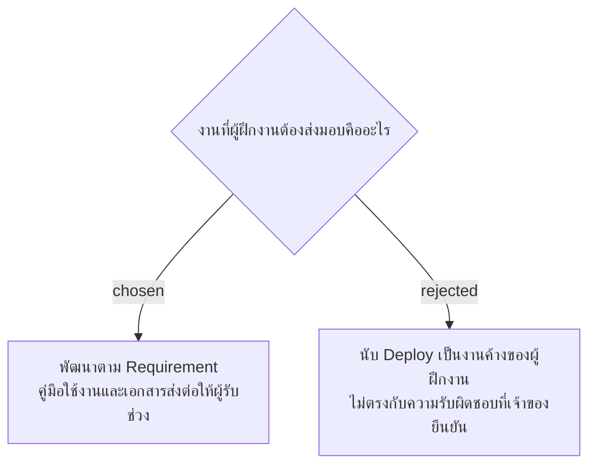

# Internship Scope: Development and Handover

วันที่ 4 พฤศจิกายน 2026 เจ้าของยืนยันระหว่างเตรียม SMM presentation ว่างานของตนคือพัฒนาระบบตาม Requirement ซึ่งพัฒนาเสร็จแล้ว งานที่เหลือคือจัดทำคู่มือใช้งานและเอกสาร handover สำหรับผู้รับช่วงนำระบบไปใช้จริง ผู้ฝึกงานไม่ใช่ผู้ทำ Deploy จึงไม่แสดง Deploy หรือการนำร่องเป็นงานพัฒนาค้างของผู้ฝึกงานใน Current Progress หรือ Timeline

การตัดสินใจนี้แยกความรับผิดชอบส่งมอบออกจากสถานะการนำระบบไปใช้จริง ไม่ได้ยืนยันว่า Deploy หรือนำร่องเสร็จแล้ว และไม่ได้มอบหมายการนำร่องให้บุคคลใด คู่มือติดตั้งและดูแลระบบที่มีอยู่ใน `docs/handover.md` เป็นข้อมูลตั้งต้น ไม่ได้แปลว่าคู่มือผู้ใช้และชุดส่งมอบได้รับการตรวจรับแล้ว
