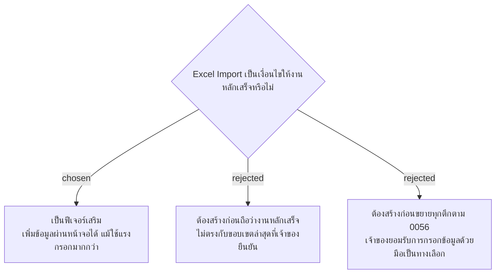

# Excel Import Is Optional; Manual Setup Remains Sufficient

วันที่ 4 พฤศจิกายน 2026 เจ้าของยืนยันว่า Excel Import เช่น ข้อมูลแม่บ้าน พื้นที่ และจุดทำความสะอาด จะทำหรือไม่ทำก็ได้ เพราะเพิ่มข้อมูลผ่านหน้าจอได้อยู่แล้ว เพียงใช้แรงกรอกมากกว่า จึงจัดเป็น optional enhancement ในแผนส่งมอบและ SMM presentation ไม่ใช่งานหลักที่ยังขาด และไม่อ้างว่าสร้างแล้ว

การตัดสินใจนี้แทนข้อบังคับเรื่องต้องมีการนำเข้าบัญชีก่อนขยายทุกตึกใน facility-0056 การพัฒนา Import ในอนาคตยังต้องตกลงรายละเอียดไฟล์และการตรวจข้อมูล ไม่ได้อนุมัติให้เริ่มสร้างฟีเจอร์หรือใช้ข้อมูลบุคลากรจริงจากการสนทนาเตรียมสไลด์นี้
