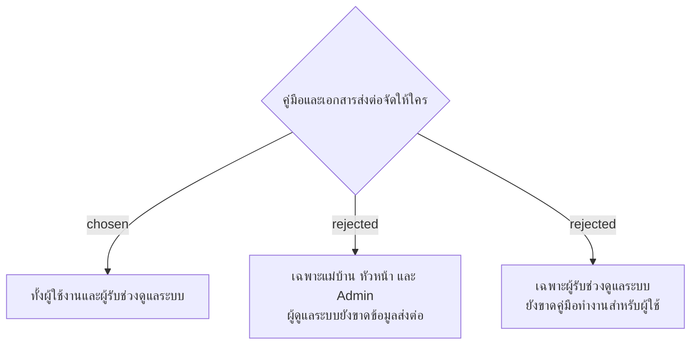

# Handover Documentation Covers Users and System Maintainers

วันที่ 4 พฤศจิกายน 2026 เจ้าของเลือกให้ชุดส่งมอบครอบคลุมทั้งผู้ใช้งาน (Cleaner, Supervisor และ Admin) และผู้รับช่วงดูแลระบบ ใช้เป็นขอบเขต Remaining deliverables และ Expected outcome ใน SMM presentation ต่อจาก facility-0109 ไม่ถือว่ามีการจัดทำหรือตรวจรับชุดเอกสารครบแล้ว และไม่เปลี่ยนผู้รับผิดชอบ Deploy
