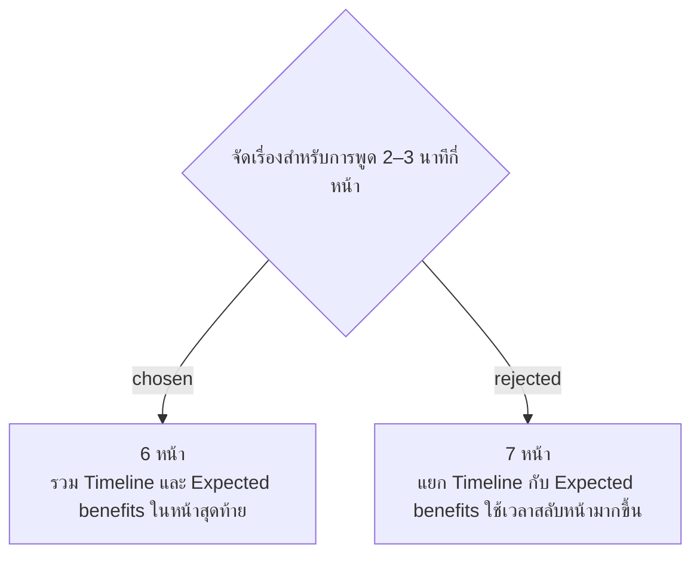

# SMM Presentation Uses Six Slides

วันที่ 4 พฤศจิกายน 2026 เจ้าของเลือกโครง 6 หน้า เป้าหมายเวลาพูดประมาณ 2 นาที 30 วินาที: (1) Personal/project introduction, (2) Existing topic overview, (3) Problem/background, (4) Solution/objectives/scope with actual application images, (5) Current progress, (6) Timeline/expected WD benefits หน้า 1–2 คงตามข้อกำหนดเดิม ยกเว้นแก้ชื่อ Project บนหน้า 1 ตาม facility-0113

เวลาเบื้องต้นแต่ละหน้าคือ 15, 5, 30, 40, 25 และ 35 วินาที รวม 150 วินาที ต้องตรวจด้วยการซ้อมบทพูดจริง การเลือกนี้ยังไม่ใช่การอนุมัติข้อความภาษาอังกฤษหรือหน้าตาสไลด์ฉบับสุดท้าย
