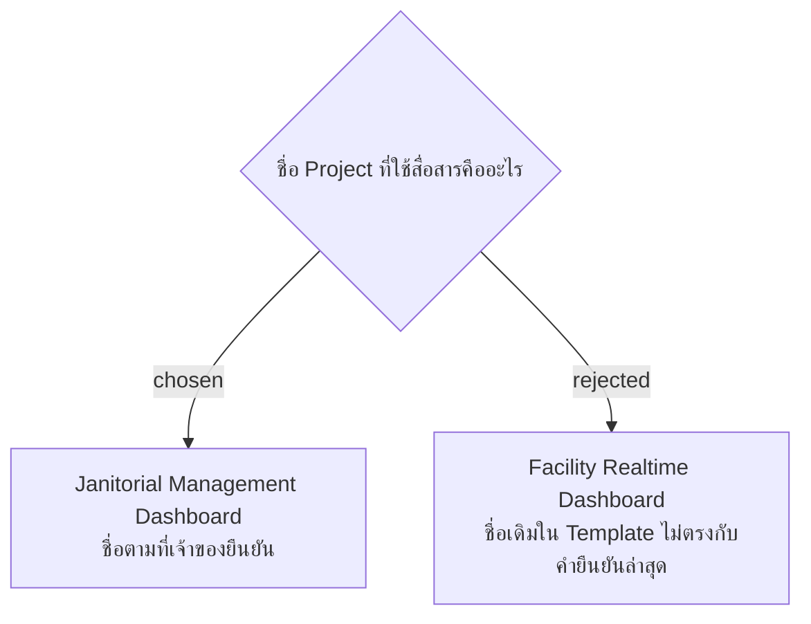

# Project Name Is Janitorial Management Dashboard

วันที่ 4 พฤศจิกายน 2026 เจ้าของแก้ชื่อ Project ระหว่างยืนยันโครง SMM presentation เป็น **Janitorial Management Dashboard** ใช้ชื่อนี้ในสไลด์ บทพูด และเอกสารนำเสนอ อัปเดตชื่อใน glossary เพื่อไม่ให้กลับไปใช้ชื่อเก่าในการสื่อสาร

คำยืนยันชื่อใหม่อนุญาตให้แก้เฉพาะ Project Name ใน source slide 1 แม้ข้อกำหนดเดิมให้คง source slides 1–2: รักษารูปแบบและข้อมูลอื่นของหน้า 1 และคงหน้า 2 เดิม ไม่เปลี่ยนชื่อ repository, namespace, database, URL หรือ application identifier จากการตัดสินใจด้านชื่อนำเสนอนี้
