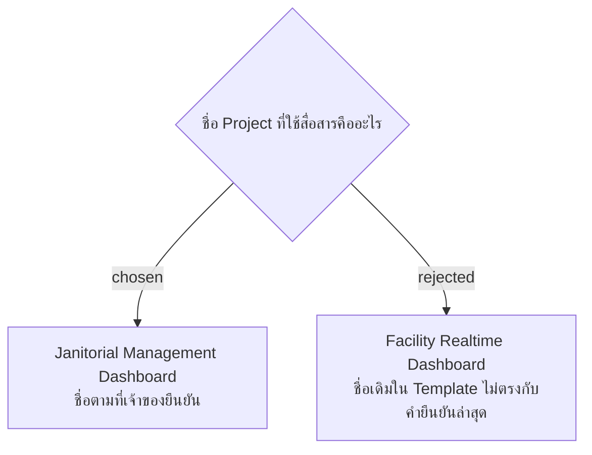

# Project Name Is Janitorial Management Dashboard

วันที่ 4 พฤศจิกายน 2026 เจ้าของแก้ชื่อ Project ระหว่างยืนยันโครง SMM presentation เป็น **Janitorial Management Dashboard** ใช้ชื่อนี้ในสไลด์ บทพูด และเอกสารนำเสนอ อัปเดตชื่อใน glossary เพื่อไม่ให้กลับไปใช้ชื่อเก่าในการสื่อสาร

คำยืนยันชื่อใหม่อนุญาตให้แก้เฉพาะ Project Name ใน source slide 1 แม้ข้อกำหนดเดิมให้คง source slides 1–2: รักษารูปแบบและข้อมูลอื่นของหน้า 1 และคงหน้า 2 เดิม ไม่เปลี่ยนชื่อ repository, namespace, database, URL หรือ application identifier จากการตัดสินใจด้านชื่อนำเสนอนี้

## Amendment — 6 พฤศจิกายน 2026: ใช้ชื่อเดียวกันในตัวระบบ

เจ้าของขอเปลี่ยนชื่อโปรเจ็กต์ใน codebase เป็น **Janitorial Management Dashboard** จึงขยายจากขอบเขตงานนำเสนอเดิมให้ครอบคลุมชื่อที่แสดงในหน้า Login ทั้งสองแบบ เมนูแอดมิน แท็บเบราว์เซอร์ ชื่อ API ใน Swagger/health และเอกสารหลักของโครงการด้วย ใช้ชื่อเดิมต่อสำหรับ repository/path, namespace, database, JWT issuer/audience และตัวระบุทางเทคนิค เพื่อให้การตั้งค่าและลิงก์เดิมใช้งานต่อได้ เอกสารประวัติ แผนเก่า และ mockup เดิมยังบันทึกชื่อ ณ เวลาที่จัดทำ

## Amendment — 6 พฤศจิกายน 2026: ชื่อไฟล์ โฟลเดอร์ และ .NET projects

เจ้าของขอเปลี่ยนชื่อไฟล์และโฟลเดอร์ให้สอดคล้องกันต่อจากการเปลี่ยนชื่อที่แสดง จึงใช้ `JanitorialManagementDashboard` แทน `FacilityRealtime` สำหรับ solution, project folders/files, assembly, namespace และ resource names ของ .NET ทั้ง source/tests/E2E seed ใช้ `JanitorialApiFactory` สำหรับ test factory, `scripts/janitorial.sh` / `scripts/janitorial.test.sh`, `design-system/janitorial/` และชื่อโฟลเดอร์หลัก `Janitorial-Management-Dashboard` แก้คำสั่ง ลิงก์ไฟล์ และจุดอ้างอิงที่เกี่ยวข้องพร้อมกัน ชื่อ npm package คือ `janitorial-management-dashboard`

ข้อนี้ขยายและแทนข้อจำกัดเรื่องไฟล์/namespace ใน amendment ก่อนหน้า ส่วนรหัส ADR `facility-`, map slug `facility-poc`, ชื่อ repository/ลิงก์ GitHub, ฐานข้อมูลที่มีอยู่, migration IDs/schema, user-secrets ID, JWT issuer/audience, deployment paths/service/journal namespace และคีย์ตั้งค่า `FACILITY_*` ยังใช้ค่าเดิม เพื่อให้ข้อมูลและการตั้งค่าที่มีอยู่ทำงานต่อได้ การเปลี่ยนชื่อครั้งนี้ไม่ย้ายฐานข้อมูลหรือระบบที่ deploy แล้ว
