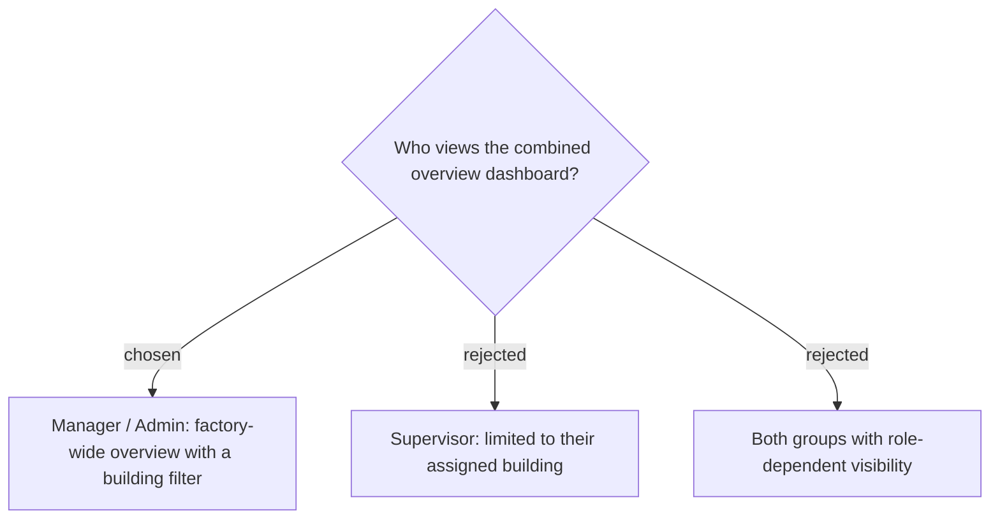

# Combined overview dashboard is for managers using Admin access

On 2026-11-16, during the combined overview dashboard grilling session, the owner selected option A: managers / Admin view the whole factory and can select individual buildings. The page is intended to reveal outstanding cleaning and Supervisor inspection work at a glance. This decision uses the existing Admin role; it does not introduce a new manager account type or extend Supervisor access. Time scope, counting rules, layout and navigation remain to be resolved. The owner requests a mockup after grilling and before the written design and implementation plan proceed.
