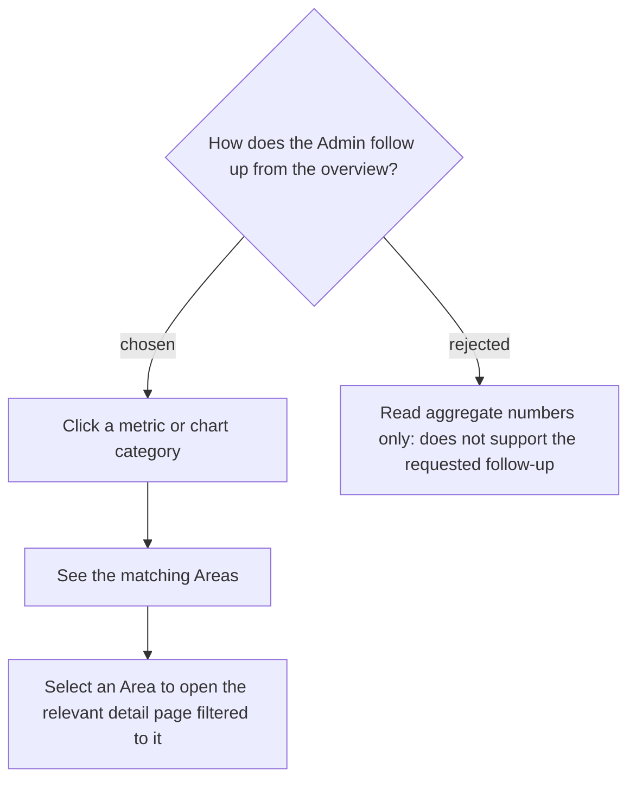

# Overview metrics lead to matching Areas and filtered detail pages

On 2026-11-16 the owner requested an actionable overview: clicking a count or chart category reveals its matching Areas, and selecting an Area navigates to the relevant page showing only that Area. The example is attendance coverage in the morning shift: 100 Areas expected, 90 entered, with a way to find the outstanding Areas. These numbers are hypothetical and do not replace documented site counts. Entered and outstanding categories must each lead to their own matching list; the example's reference to clicking 90 to see absent Areas is not an accepted category/count mismatch.

The list's placement (inside the overview, a drawer, or another page), destination routes and exact counting rules remain unresolved. Existing Attendance navigation supports date, shift and building, but its Area search is local state; the existing point Dashboard uses Redux filters and represents the shift running now. Exact Area filtering and consistent navigation context therefore require design and implementation work; do not describe the requested drill-through as already supported.
