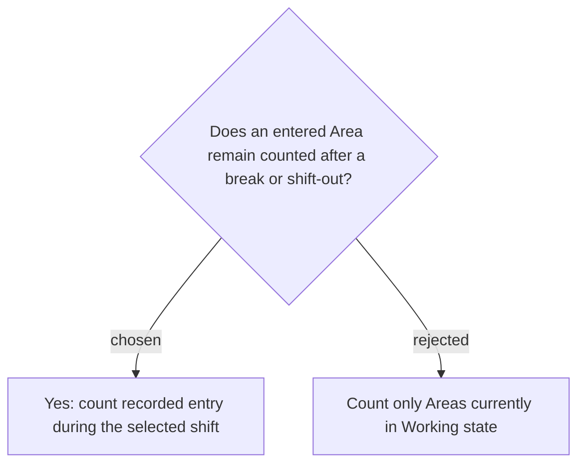

# Area entry count persists through breaks and shift-out

On 2026-11-16 the owner selected A: an Area with recorded entry in the selected shift remains in the overview's entered count even if its Cleaner later takes a break or records shift-out. The metric describes entry during the shift; it is not a count of people currently working or evidence of continuous physical presence. Break and shift-out states are shown separately as supporting information. Count distinct Areas, not attendance events or people. Cover Assignment treatment remains unresolved; assignment alone must not silently become proof of recorded entry.

**Transfer evidence extension:** [0216](facility-0216-overview-entry-includes-confirmed-transfer-arrival.md) accepts destination arrival confirmation alongside initial ShiftIn as entry evidence. Entry at A persists after moving, and B counts only when confirmed, with distinct Area IDs. Historical entry remains separate from current responsibility.
