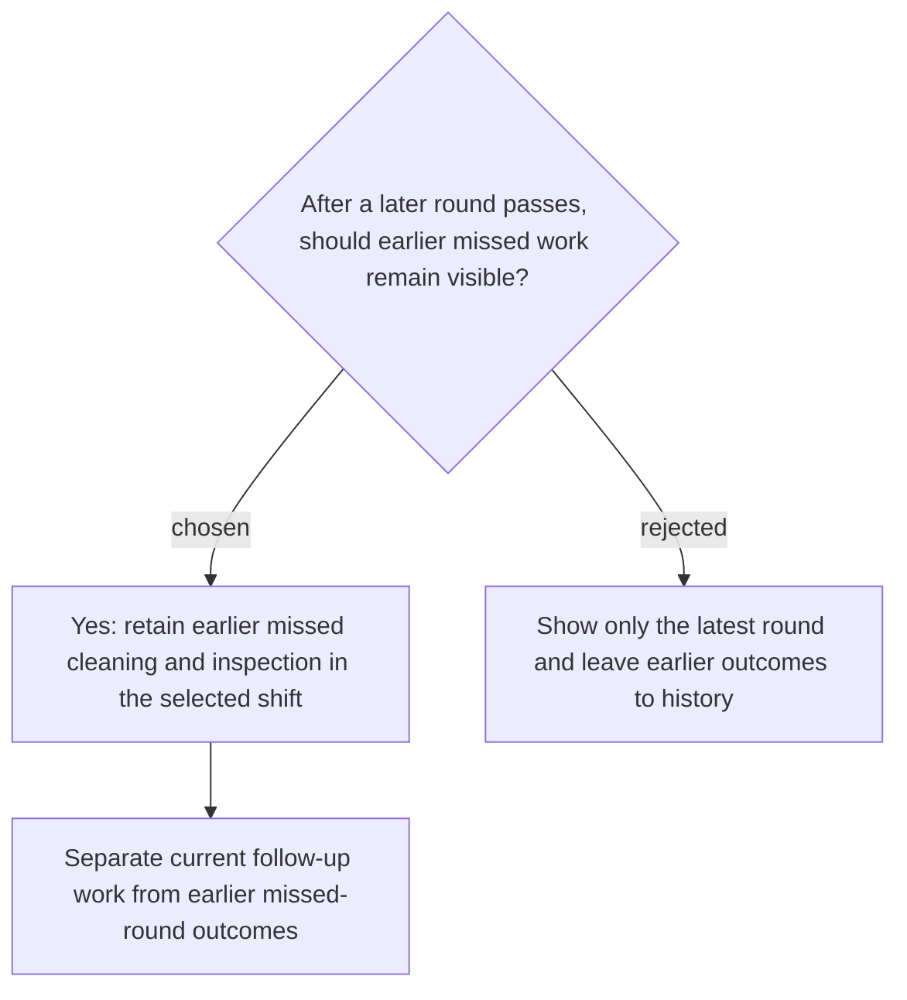

# Overview preserves missed rounds within the selected shift

On 2026-11-16 the owner selected A: if an earlier round was not cleaned or inspected, the overview continues to show that outcome within the selected shift even after a later round passes. Present current work requiring follow-up separately from earlier missed-round outcomes, so historical omissions are visible without implying that a Supervisor can still inspect an old round.

This adds a shift-level overview of existing round outcomes; it does not change the current-round status reset or inspection eligibility in [facility-0047](facility-0047-cleaning-rounds-are-time-windows.md). Current Point Status alone cannot supply the accepted historical view. Area aggregation, denominator rules and historical detail destinations remain to be resolved.
