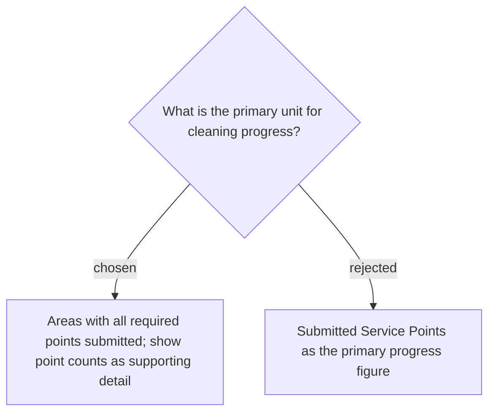

# Cleaning overview counts fully submitted Areas, with point counts as detail

On 2026-11-16 the owner selected A: the primary cleaning progress figure counts Areas whose relevant cleaning work has all been submitted. In the agreed example, an Area with five points required in the displayed round and four submitted is still incomplete (zero of one Area complete), with four of five points shown as supporting information. Clicking the incomplete category leads to its matching Areas and then filtered detail as agreed in facility-0115.

Submission completion is distinct from Supervisor inspection and acceptance: “ทำครบ” does not mean “ตรวจผ่าน.” Time-scope eligibility, treatment of rework resubmissions and the inspection coverage metric remain to be resolved; this decision does not invent a whole-shift denominator or include future rounds by default.
