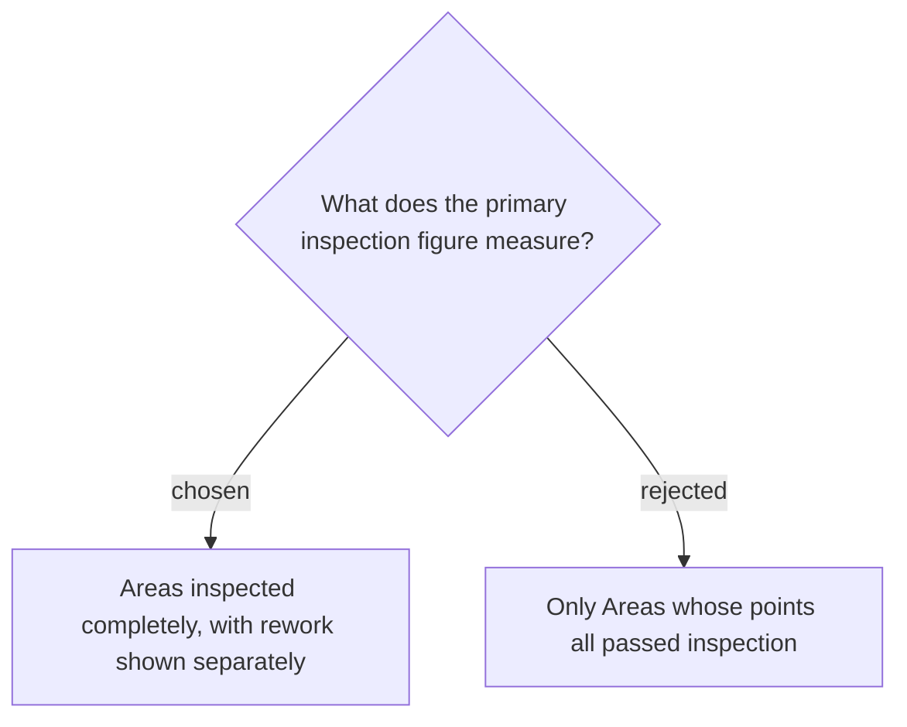

# Primary inspection count measures inspection coverage separately from acceptance

On 2026-11-16 the owner selected A: the primary inspection figure answers whether the Supervisor has inspected the Area completely, rather than whether every point passed. In the agreed example, five inspected points with one Rework result count as one fully inspected Area, with the outstanding correction shown separately. A failed inspection must not make the Area appear uninspected.

Required work and time-scope denominators, partial submissions, and inspection coverage after a rework resubmission remain to be resolved. This decision does not redefine current Point Status or permit inspecting earlier rounds. Inspection coverage, inspection acceptance and correction progress are distinct concepts.

Amendment: [facility-0125](facility-0125-overview-inspection-completion-tracks-latest-submission.md) resolves resubmission handling: completion follows the latest submitted work and resets while a new correction awaits inspection.
