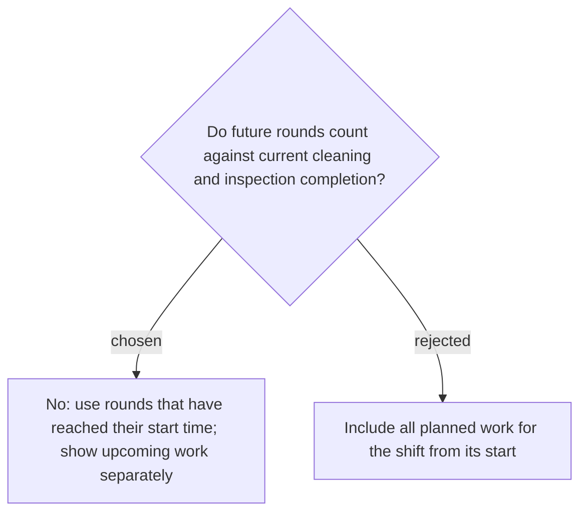

# Current completion targets exclude rounds that have not started

On 2026-11-16 the owner selected A: an Area whose morning work is submitted and inspected can be complete at 10:00 even when it has another round at 16:00. The afternoon round is “ยังไม่ถึงรอบ” until it starts. Completion figures can change when the next round starts; they are not cumulative completed-work totals for the whole shift.

Current follow-up work uses current rounds that have started. Earlier missed-round outcomes remain visible separately under [facility-0117](facility-0117-overview-preserves-missed-rounds-within-shift.md); they must not disappear when a new round starts. Areas with no work due yet must be distinguishable from incomplete Areas and must not dilute the current work target. Entry coverage continues to use Areas requiring staffing in the selected shift, a distinct denominator. Exact inspection eligibility with partial submissions and rework remains pending.
